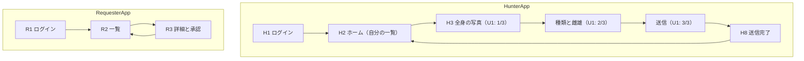

# Frontend Components（画面の部品）— U1 `u1-skeleton`

入力: functional-spec.md、rules.md、`inception/refined-mockups/mockups.md`・`interaction-spec.md`・`design-system-mapping.md`（画面案）、`inception/user-stories/stories.md`（stories）、`inception/domain-design/components.md`（UiKit・HunterApp・RequesterApp）、`inception/contract-design/contract-summary.md`。

U1 では、細い版に要るだけの画面と部品を作る。部品は UiKit にまとめ、HunterApp と RequesterApp が使う。

## 1. 画面の構成

<!-- Text fallback: ハンターの画面は、ログイン → ホーム（自分の一覧）→ 全身の写真 → 種類と雌雄 → 送信 → 送信完了 → ホーム。U1 では 3 ステップ。依頼元の画面は、ログイン → 一覧 → 詳細と承認 → 一覧。 -->

U1 の報告の作成は 3 ステップ（全身の写真 → 種類と雌雄 → 送信）。U2 で 7・8 ステップの完全な形に置き換える。

## 2. 部品

| 部品（UiKit） | 使う画面 | U1 での状態・入力 | 決まり |
|---|---|---|---|
| `LoginForm` | H1・R1 | ID・パスワード、エラー表示（入力した ID は残す） | BR1.1 |
| `AppShell` | すべて | ヘッダー、メニュー（ホーム／一覧・ログアウト） | BR1.3 |
| `StepHeader` | H3・種類と雌雄・送信 | 「n/3」、戻る、やめる | interaction-spec |
| `PhotoPicker` | H3 | 撮る・選ぶ、15 MB と形式の確認、アップロードの進み具合 | BR2.2 |
| `BigChoice` | 種類と雌雄 | 1〜3 個の大きな選択肢（種類 3 つ、雌雄 3 つを縦に 2 段） | BR2.4 |
| `LocationGate` | 送信 | 位置の取得、許可の手順 | BR2.5 |
| `SubmitButton` | 送信 | 送信中は押せない「確認しています」、失敗で「もう一度」 | BR2.6 |
| `ReportList` | H2・R2 | 新しい順・50 件・次のページ、空の表示、状態の印（文字＋アイコン） | BR4.2・BR4.3 |
| `ReportDetail` | R3 | 写真（拡大）、項目、状態、確認した人 | BR2.8・BR6.1 |
| `DecisionBar` | R3 | U1 は「承認」だけ。確認済みなら出さない。409 で「すでに確認済みです」。404 `REVIEW_NOT_READY` で「まだ確認の準備ができていません。少し待ってからもう一度押してください」 | BR3.3・BR3.6・BR3.7 |

テーマ: ハンター側は `hunterTheme`（文字 20px、ボタン 64px）、依頼元側は `staffTheme`（文字 16px、ボタン 48px）（design-system-mapping）。

## 3. 画面が持つ状態

| 画面 | 持つ状態 | 消えるとき |
|---|---|---|
| 報告の作成（HunterApp） | 写真の ID、種類、雌雄、送信のキー | 送信完了・やめる・ログイン切れ（下書きは残さない） |
| ログイン | 証明（1 時間）、出し直し用の値 | ログアウト・出し直しの失敗 |
| 一覧 | 表示中のページの位置 | 画面を離れたとき |

出し直し用の値をどこに保存するかは NFR Design で決める（contract-summary の未解決の点）。

## 4. API とのつなぎ

| 画面の操作 | API（contract-summary） |
|---|---|
| ログイン・ログアウト・出し直し | C1 `POST /v1/session`、`DELETE /v1/session`、`POST /v1/session/refresh` |
| 写真のアップロード | C2 `POST /v1/photos` → 保存場所へ直接 → `POST /v1/photos/{id}/complete` |
| 報告の送信 | C2 `POST /v1/reports` |
| ハンターの一覧 | C4 `GET /v1/catalog/my-reports` |
| 依頼元の一覧 | C4 `GET /v1/catalog/reports` |
| 詳細 | C2 `GET /v1/reports/{id}`、C3 `GET /v1/reviews/{id}` |
| 承認 | C3 `PUT /v1/reviews/{id}/decision` |

## 5. 入力の確かめ方

| 項目 | 画面での確認 | サーバーでの確認 |
|---|---|---|
| ID・パスワード | 空なら「入れてください」 | BR1.1 |
| 写真 | 形式・15 MB | BR2.2 |
| 種類・雌雄 | 選ぶまで「次へ」を押せない | BR2.4 |
| 位置 | 取れるまで「送る」を押せない | BR2.4・BR2.5 |

画面での確認は使いやすさのためで、決まりは必ずサーバーでも確かめる（corner checklist: client-side rules also enforced on the trusted side）。

## Assumptions & Open Questions

- U1 の種類と雌雄は 1 画面にまとめる（細い版のステップを減らすため）。U2 で 1 画面 1 項目に分ける。 [assumption]
