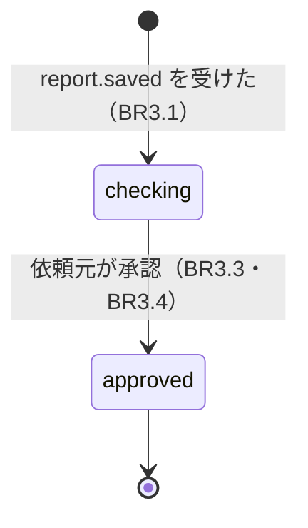
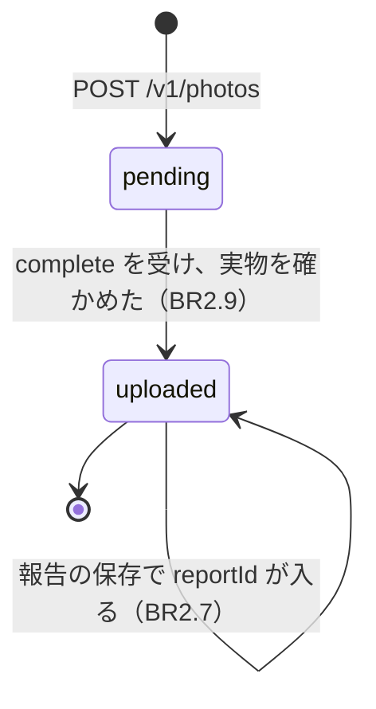
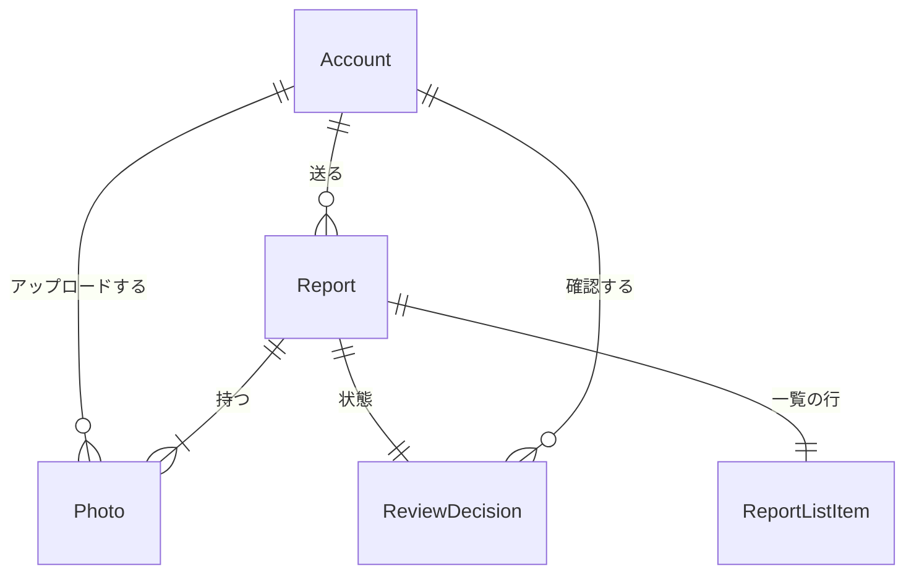

# Functional Spec（処理の流れ）— U1 `u1-skeleton`

入力: entities.md、rules.md、`inception/user-stories/stories.md`（stories。U1 のストーリー: US1.1・US2.1・US4.1・US4.2・US4.3・US5.1）、`inception/units-generation/unit-of-work.md`（unit-of-work）・`unit-of-work-story-map.md`（unit-of-work-story-map）、`inception/requirements-analysis/requirements.md`（requirements）、`inception/domain-design/components.md`（components）、`inception/contract-design/contract-summary.md`（contract-summary）、functional-design-questions.md（Q1〜Q6）。

この文書は、処理の順番と状態の移り変わりの正本（source of truth）である。データの形は entities.md、判断の決まりは rules.md が正本で、ここの図と表はそれを読みやすくした写し。

## 1. U1 の範囲

| ストーリー | 内容 | U1 での範囲 |
|---|---|---|
| US1.1 | ログインする | 全部（アカウントはスクリプトで作る） |
| US2.1 | 写真 1 枚で報告を送る | 全部 |
| US4.1 | 報告の一覧を見る | 絞り込み（AC4.1.2）を除く。絞り込みは U3 |
| US4.2 | 報告の詳細を見る | 重複の見比べ（AC4.2.2）を除く。見比べは U2 の重複の疑いが付いてから |
| US4.3 | 報告を承認する | 全部（取り消しなし） |
| US5.1 | 自分の報告の一覧を見る | 全部 |

## 2. 流れ

### UC1 ログイン（US1.1）

1. 利用者が ID とパスワードを入れて「ログイン」を押す。
2. Accounts が確かめる（BR1.1）。違えば「ID かパスワードが違います」を表示し、入れた ID は残す。
3. 正しければ、証明と出し直し用の値を受け取り、役割で行き先を決める: ハンター → ホーム（自分の一覧）、依頼元 → 報告の一覧。
4. 証明の期限（1 時間）の前に、画面は出し直し用の値で新しい証明を受け取る（BR1.5）。失敗したらログイン画面へ。
5. メニューの「ログアウト」で、出し直し用の値を無効にし、ログイン画面に戻る（BR1.3）。

### UC2 写真 1 枚で報告を送る（US2.1）

1. ハンターがホームの「報告する」を押す。
2. 全身の写真を撮る・選ぶ。画面が `POST /v1/photos` で写真の ID とアップロード用 URL（5 分）を受け取り（BR2.2）、写真の保存場所に直接送り、`POST /v1/photos/{photoId}/complete` で終わったことを知らせる。Reporting は保存場所に実際に写真があり、大きさと形式が申告どおりかを確かめてから「アップロード済み」にする（BR2.9）。
3. 種類（クマ・イノシシ・シカ）と雌雄（オス・メス・不明）を大きなボタンで選ぶ（U1 は手で選ぶ。判別は U2）。
4. 「送る」の画面で、スマホの位置を取る（BR2.5）。取れなければ許可の手順を表示し、送れない。
5. 「送る」を押すと、画面は送信のキーを作り、ボタンを押せなくして「確認しています」を表示する。
6. Reporting が確かめる: 証明（BR1.4）→ **送信のキー（BR2.6。同じキーの報告がすでにあれば、ほかの確認をせず 200 で同じ reportId を返す。処理中なら 409）** → 同意と従事者番号（BR2.1、Accounts に問い合わせ C10）→ 写真（BR2.3）→ 項目（BR2.4）。送信のキーを最初に確かめるのは、保存に成功したあとの「もう一度」で、写真がすでに報告に結び付いているために 422 にならないようにするため（レビューの指摘）。
7. 捕獲日時に、Reporting が報告を受け付けた時刻を入れる（BR2.5）。保存し、写真に reportId を入れ、`report.saved` を送る（BR2.7）。
8. 画面は送信完了を表示し、ホームの一覧に「確認中」で出る（知らせが一覧に届くまでの短い間は、画面が送った報告を一覧の先頭に仮に出す）。
9. 通信の失敗・時間切れ: 「送れませんでした」と「もう一度」を表示し、選んだ内容は残す。「もう一度」は同じ送信のキーで送る（BR2.6）。

### UC3 依頼元の一覧と詳細（US4.1・US4.2）

1. 依頼元が一覧を開く。ReportCatalog が新しい順に 50 件と、全件数、次のページの位置（cursor）を返す（BR4.2）。0 件なら「報告はまだありません」。
2. 51 件目からは、受け取った cursor を付けて次のページを読む。cursor が空なら最後のページ。cursor は前のページの最後の行の（送信日時、reportId）を表す、画面が中身を読まない文字列（BR4.4）。
3. 行を押すと詳細。Reporting から内容と写真の表示用 URL（BR2.8、BR6.1）、Review から状態（BR3.5）を読む。

### UC4 承認（US4.3）

1. 依頼元が詳細で「承認」を押す。
2. Review が確かめる: 証明と役割（BR1.4、BR3.2）→ 確認の記録があるか（BR3.7。一覧の行は先に出ることがあり、Review の記録がまだなら 404 `REVIEW_NOT_READY` で「まだ確認の準備ができていません。少し待ってからもう一度押してください」）→ 状態が確認中か（BR3.3）。
3. 確認中なら承認にし、確認した人と日時を記録し、`review.status-changed` を送る（BR3.4）。
4. すでに確認済みなら「すでに確認済みです（承認、確認した人）」を表示し、画面の状態を最新にする。
5. 承認済みの報告の詳細には、承認のボタンを出さない（BR3.6）。

### UC5 ハンターの一覧（US5.1）

1. ハンターがホームを開く。ReportCatalog が自分の報告だけを新しい順に返す（BR4.3）。
2. 状態は文字とアイコンで示す（確認中・承認）。0 件なら「まだ報告はありません。上の『報告する』から始めます」。

### UC6 知らせの処理

| 知らせ | 受け手 | 処理 |
|---|---|---|
| `report.saved` | Review | 確認中の記録を作る（BR3.1） |
| `report.saved` | ReportCatalog | 一覧の行の内容を入れ、一覧に出す（BR4.1） |
| `review.status-changed` | ReportCatalog | 新しい知らせなら状態を書き換える（BR4.1） |

どの受け手も、処理済みの eventId は無視する（contract-summary 2.4）。知らせを確実に届ける方法は NFR Design で決める（ADR-008）。

### UC7 アカウントを作るスクリプト（U1 の手順書）

1. 開発者が手元でスクリプトを実行する（ID・表示名・役割・所属・従事者番号を渡す）。
2. 決まり（BR5.1）に合わなければ、何も作らずエラーで止まる。U1 では管理者のアカウントは作らない（管理者の画面は U4。スクリプトは役割 admin を受け付けない）。
3. 認証のサービスのユーザーと Account を作り、仮のパスワードを 1 回だけ表示する。U1 ではパスワードの変更の画面がないため、変更を求めない状態で作る（mustChangePassword=false）。

## 3. 状態の移り変わり

### 報告の状態（ReviewDecision.status）

<!-- Text fallback: 報告が保存されたという知らせを受けると「確認中」になり、依頼元が承認すると「承認」になる。U1 では承認は確定で、ほかの状態には移らない（却下と取り消しは U3）。 -->

### 写真の状態（Photo）

<!-- Text fallback: 写真は受け付けたときに「待ち」、アップロードが終わり実物を確かめると「アップロード済み」になる。報告の保存では状態は変わらず、reportId が入る（結び付いたかは reportId の有無で分かる）。結び付かない写真を 24 時間で消す仕組みは U2 で作る。 -->

## 4. データの関係（entities.md から作った写し）

<!-- Text fallback: アカウントは報告と写真を持つ。報告は写真を 1 枚以上持ち、状態と一覧の行をそれぞれ 1 つ持つ。依頼元のアカウントは多くの報告を確認する。 -->

## 5. 決まりのまとめ（rules.md から作った写し）

| 決まり | 内容 |
|---|---|
| BR1.1〜BR1.5 | ログイン、役割、ログアウト、証明の確認、証明の出し直し |
| BR2.1〜BR2.8 | 同意、写真の形式、写真の持ち主、必須の項目、日時と位置、送信のキー、保存の知らせ、読める報告 |
| BR3.1〜BR3.6 | 確認中の記録、承認できる人、先着、承認の確定、読める状態、確認済みの表示 |
| BR4.1〜BR4.3 | 知らせからの一覧、依頼元の一覧、ハンターの一覧 |
| BR5.1 | アカウントを作るスクリプト |
| BR6.1 | 写真の表示用 URL |

## 6. 例外と角のケース

| 場面 | 振る舞い | 決まり |
|---|---|---|
| ログインの証明が切れた | 出し直しを試み、だめならログイン画面へ。報告の作成中なら「ログインが切れました。作成中の内容は消えました」 | BR1.5、FR1.6 |
| 写真のアップロードが 5 分を過ぎた | アップロード用 URL が使えないため、「もう一度」で取り直す | BR2.2 |
| 二重送信 | 1 件だけ作る | BR2.6 |
| 2 人の依頼元が同時に承認 | 先の 1 人だけが有効。後の人に「すでに確認済みです」 | BR3.3 |
| 状態の知らせが保存の知らせより先に届いた | 状態を覚えておき、保存の知らせのあとで一覧に出す | BR4.1 |
| ハンターが他人の報告を API で読む | 403 | BR2.8、BR3.5 |

## 7. 約束（contract-summary）との違い

| 約束 | U1 での扱い | 理由 |
|---|---|---|
| C2 の `capturedAt`・`location` の source（exif・manual） | U1 は `device` を使う。値を 1 つ足す変更として、Code Generation で共通の約束の仕様に足す（contract-summary 6 の「足すだけの変更はいつでもよい」） | U1 は写真の撮影情報を読まない（Q2） |
| C3 の 404 | 確認の記録がまだないときに `REVIEW_NOT_READY` を使う（BR3.7） | 知らせの届く順の違い（レビューの指摘） |
| C4 の cursor と全件数（contract-summary 7 で Functional Design に回した点） | BR4.4 で決めた | — |

## Assumptions & Open Questions

- 送信完了から一覧に知らせが届くまでの短い間、画面が送った報告を仮に一覧の先頭に出す（UC2 の 8）。知らせの届く速さは NFR Design で確かめる。 [assumption]
- 保存した報告には必ず `report.saved` を送る（BR2.7）。送りそこねたときに必ず届ける方法は NFR Design で決める（ADR-008）。 [assumption]
