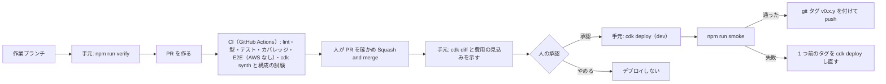

# CI/CD Pipeline（ビルド・試験・デプロイの流れ）— U1 `u1-skeleton`

入力: `inception/practices-discovery/team-practices.md`（PR と Squash and merge、TDD、CI は AWS に接続しない、人の確認のあと手元から `cdk deploy`、git タグで戻す）、`inception/delivery-planning/bolt-plan.md`（`npm run verify`）、infrastructure-specification.md、monitoring-design.md、infrastructure-design-questions.md（Q3・Q5）、project.md。

## 1. 流れの全体

<!-- Text fallback: 作業ブランチで手元の確認（npm run verify）を通し、PR を作る。CI で lint・型・テスト・カバレッジ・AWS なしの E2E・CDK の構成の試験を動かし、人が PR を確かめて取り込む。取り込んだあと、手元で cdk diff と費用の見込みを示し、人が承認したら dev にデプロイし、smoke を動かす。通ったら git のタグを付け、失敗したら 1 つ前のタグを配置し直す。 -->

## 2. 段階と通過の条件

| 段階 | どこで | 内容 | 通過の条件 |
|---|---|---|---|
| 0. bootstrap（最初の 1 回だけ） | 開発者の PC | 共用アカウントの既定の `CDKToolkit`（mononoke が使っているかもしれない）には触れず、`cdk bootstrap --qualifier mnote --toolkit-stack-name MonsterNote-CDKToolkit` で MonsterNote 専用の bootstrap を作る。CDK のアプリの synthesizer にも同じ qualifier を設定する。作るリソースと費用（infrastructure-specification の 4、0 円）を示してから | **人の承認**（project.md） |
| 1. 手元の確認 | 開発者の PC | `npm run verify`: Prettier の確認、ESLint、TypeScript の型チェック、Vitest（単体・DynamoDB Local を使う結合）、カバレッジ 80%、Playwright（AWS なしの E2E。API はモック）、CDK の構成の試験 | すべて成功 |
| 2. CI | GitHub Actions（push と PR） | 段階 1 と同じ。AWS の認証情報は置かない。`cdk synth` まで（デプロイしない） | すべて成功しないと PR を取り込まない |
| 3. 取り込み | GitHub | 人が PR の差分を確かめ、Squash and merge（秘密情報が入っていないことも確かめる） | 人の判断 |
| 4. デプロイ前の確認 | 開発者の PC | AI が `cdk diff --all` の結果と、新しく作るリソースの無料枠・月額の見込み（infrastructure-specification の 4）を示す | **人の承認**（project.md: AWS へのデプロイ・削除の前に必ず確認） |
| 5. デプロイ | 開発者の PC | 画面をビルドしてから `cdk deploy --all`（Auth → Web → Data → Api → WebContent の順に CDK が並べる。default のプロファイル、`ap-northeast-1`）。アラームの宛先は `infra/.env.local` から `-c alarmEmail=...` で渡す。WebContent のスタックが画面と `config.json` を S3 に置き、CloudFront のキャッシュを無効化する。**最初のデプロイのあと**、SNS から届く確認のメールのリンクを開いて購読を有効にする（開かないとアラームのメールが届かない） | 成功 |
| 6. スモーク | 開発者の PC | `npm run smoke`（細い版の端から端まで。レビューの指摘）: ① 2 つの画面の URL が開き、`config.json` が読める ② 試験用のハンターで `POST /v1/session` のログイン ③ `POST /v1/photos` → 署名付きの POST で S3 に小さな JPEG を送る（CORS を含む）→ `complete` ④ `POST /v1/reports` で報告を送る ⑤ `GET /v1/catalog/my-reports` に 10 秒以内に「確認中」で出る（EventBridge の配達）⑥ 試験用の依頼元でログインし、`GET /v1/catalog/reports` に出る報告を `PUT /v1/reviews/{id}/decision` で承認 ⑦ ハンターの一覧が 10 秒以内に「承認」になる。試験用のアカウントは `smoke-hunter`・`smoke-requester`（スクリプトで作る）で、スモークの報告は一覧で区別できる | すべて成功 |
| 7. タグ | GitHub | `v0.x.y` のタグを付けて push（U1 は `v0.1.0`） | — |

## 3. 戻し方

1. スモークが失敗したら、直前に成功したタグをチェックアウトする。
2. 人の承認のあと、そのタグで `cdk deploy --all` をし直す。
3. **最初のデプロイ（v0.1.0）には戻す先のタグがない**。スモークが失敗したら、原因を直して作業ブランチからデプロイし直す（前に進めて直す）。直せないときは、人の承認のあと Api・WebContent のスタックを `cdk destroy` で消す。
4. データのスタック（表・写真の S3）とユーザープールは RETAIN のため、戻してもデータは消えない。表の形を変えた場合（キーの変更）は、事前に人に確認する（team-practices）。
5. RETAIN のリソースは、スタックを消しても AWS に残る。データのスタックを作り直す必要が出たら、残ったリソースを人の承認のあと手で消すか、CDK に取り込む（import）。物理的な名前を固定していないため、作り直すと新しい名前の表ができ、古い表は残る（費用はほぼ 0）。

## 4. 秘密情報

| 情報 | 置き場所 |
|---|---|
| AWS の認証情報 | 開発者の PC の default のプロファイルだけ。GitHub には置かない（CI は AWS に接続しない） |
| アラームのメールの宛先 | `infra/.env.local`（`.gitignore`） |
| 試験用のアカウントのパスワード（スモーク） | `infra/.env.local`（`.gitignore`）。スクリプトで作った dev の試験用のアカウント |
| 関数の設定（表の名前など） | CDK が関数の環境変数に入れる（秘密ではない） |

## 5. U1 でまず作るもの

- リポジトリの構成（npm workspaces: `frontend`・`backend`・`infra`）と、`npm run verify`・`npm run smoke` のスクリプト
- GitHub Actions のワークフロー（段階 2）
- `.gitignore`（`.env*`・`cdk.out`・`node_modules`）

## Assumptions & Open Questions

- E2E のうち本物の AWS を使うもの（dev）は、スモークのあとに手元で動かす（team-practices）。U1 ではスモークで足りるものとし、U2 以降で足す。 [assumption]
