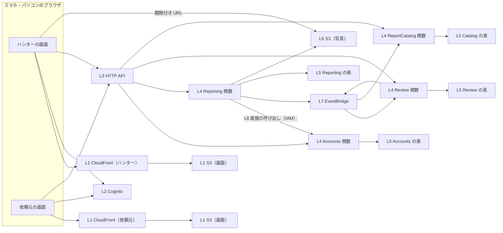

# Logical Components（論理的な構成要素）— U1 `u1-skeleton`

入力: `construction/u1-skeleton/nfr-requirements/`（performance・security・scalability・reliability・observability の要件、tech-stack-decisions）、`construction/u1-skeleton/functional-design/functional-spec.md`、`inception/domain-design/components.md`、`inception/contract-design/contract-summary.md`、nfr-design-questions.md（Q1〜Q7）。

NFR の設計がどこに当てはまるかを、論理的な構成要素（AWS のサービスの役割）で示す。具体の設定値と CDK の構成は Infrastructure Design で決める。

## 1. 構成要素の一覧

| # | 構成要素 | 役割 | U1 の部品 | 失敗したときの影響の範囲 |
|---|---|---|---|---|
| L1 | 画面の配信（CloudFront ×2 ＋ S3 ×2） | ハンター用・依頼元用の画面を HTTPS で配る。セキュリティのヘッダーを付ける | HunterApp・RequesterApp・UiKit | その画面だけが開けない |
| L2 | ログイン（Cognito のユーザープール） | ログイン、証明と出し直し用の値の発行、役割（グループ） | Accounts | 新しいログインと出し直しができない（発行済みの証明は 1 時間使える） |
| L3 | API の入口（API Gateway の HTTP API） | 証明の確認、流量の制限、CORS、外の道だけを出す | — | すべての API が使えない |
| L4 | 関数（Lambda、部品ごと） | Accounts・Reporting・Review・ReportCatalog の処理 | 各部品 | その部品の API だけが失敗する |
| L5 | データ（DynamoDB、部品ごとの表） | 各部品のデータ | 各部品 | その部品だけ |
| L6 | 写真の保存場所（S3、公開しない） | 写真の保存、期限付きの URL | Reporting | 写真のアップロードと表示 |
| L7 | 知らせの配り役（EventBridge のバス） | `report.saved`・`review.status-changed` を受け手の関数に配る | Reporting → Review・ReportCatalog | 一覧の行・確認中の記録の作成が遅れる（EventBridge がやり直す） |
| L8 | 部品の間の直接の呼び出し（Lambda の呼び出し ＋ IAM） | Reporting → Accounts（C10） | Reporting・Accounts | 報告の送信が失敗する（画面で送り直し） |
| L9 | 監視（CloudWatch Logs・メトリクス・アラーム、SNS） | ログ 14 日、アラーム 2 つ、メール | すべて | 気づくのが遅れる |

## 2. 構成図

<!-- Text fallback: ハンターと依頼元の画面は、それぞれの CloudFront と S3 から配られる。画面は Cognito でログインし、HTTP API を呼び、写真は期限付きの URL で S3 に直接送る。API は部品ごとの関数に振り分ける。Reporting の関数は Accounts の関数を IAM で直接呼び、保存の知らせを EventBridge に送る。EventBridge は Review と ReportCatalog の関数に配る。Review の関数は状態の知らせを EventBridge に送る。各関数は自分の DynamoDB の表だけを使う。 -->

## 3. 分け方の考え方

- **部品ごとに関数と表を分ける**: 1 つの部品の失敗や権限の誤りが、ほかの部品のデータに及ばない（関数の IAM の権限は自分の表だけ）。
- **画面を 2 つの配信に分ける**: ハンター用と依頼元用で CSP やキャッシュを別々に設定できる。
- **共有するもの**: API の入口（L3）、ログインのユーザープール（L2）、知らせの配り役（L7）。これらは全部品の共通の土台として 1 つずつ。

## Assumptions & Open Questions

- U2〜U4 で関数（SpeciesDetection・DuplicateDetection・Settings・AuditLog）と画面（AdminApp）が加わっても、同じ分け方を続ける。 [assumption]
