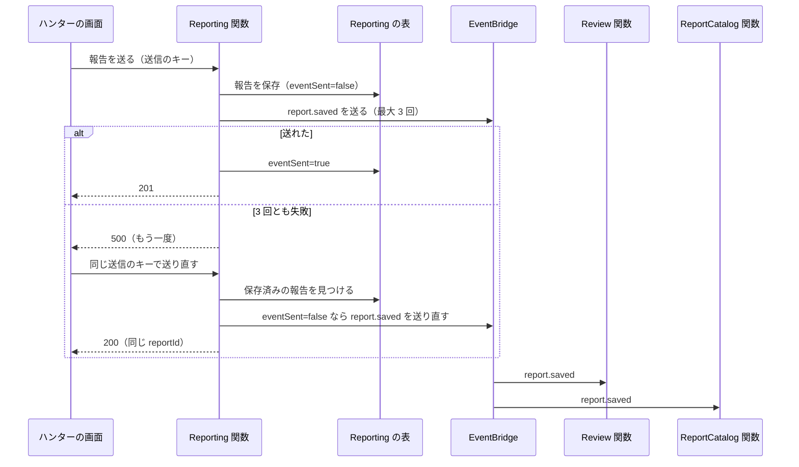

# Reliability Design（信頼性の設計）— U1 `u1-skeleton`

入力: `construction/u1-skeleton/nfr-requirements/reliability-requirements.md`（NFR10・NFR11）、logical-components.md、`construction/u1-skeleton/functional-design/rules.md`（BR2.6・BR2.7・BR3.1・BR3.7・BR4.1）、`inception/contract-design/contract-summary.md`（2.3〜2.5）、nfr-design-questions.md（Q1・Q6・Q7）。

## 1. 知らせの届け方（Q1・Q7）

<!-- Text fallback: Reporting の関数は報告を保存し、知らせを送ったかの印を「まだ」にしてから EventBridge に送る。送れたら印を「済み」にして 201 を返す。3 回とも送れなければ 500 を返し、画面の「もう一度」で同じ送信のキーが届くと、保存済みの報告の印が「まだ」なら知らせを送り直して 200 を返す。EventBridge は Review と ReportCatalog の関数に配る。 -->

| ID | 設計 |
|---|---|
| NFR10.3 | 報告の項目に「知らせを送ったか」（eventSent）を持つ。保存 → 送信 → 印を「済み」の順。送信は 1 回の呼び出しで最大 3 回まで（間隔 0.2・0.4・0.8 秒）。3 回とも失敗したら 500。同じ送信のキーの送り直し（BR2.6）では、印が「まだ」なら送り直してから 200 を返す。**BR2.7・NFR10.3 の読み替え**: 「保存した報告には、送信が成功として返るまでに必ず知らせを送る。送れないときは送信を失敗にし、送り直しで必ず送る」（Q7） |
| （残るリスク） | 送信が 500 になったあと、ハンターが送り直さずにやめると、その報告は知らせのないまま残る（承認も一覧への表示もできない）。気づくためのアラームは作らない（Q6）。U4 の管理者の画面か手順書で、eventSent が「まだ」の報告を見つけて送り直す（受け入れたリスク） |
| （配達） | EventBridge から受け手の関数への配達は、EventBridge の標準のやり直し（最大 24 時間・185 回）に任せる。失敗の置き場（DLQ）とアラームは作らない（Q6） |
| NFR10.4 | 受け手の関数は、eventId を処理済みとして表に記録し（条件付きの書き込み）、2 回目は何もしない。順番の入れ替わりは BR4.1（新しい occurredAt だけを反映） |
| （承認の知らせ。レビューの指摘） | 承認（Review）も同じ形にする。ReviewDecision に eventSent を持ち、承認の書き込みと同時に「まだ」にし、`review.status-changed` を最大 3 回送り、送れたら「済み」。3 回とも失敗したら 500。**同じ依頼元が同じ承認を送り直したとき**（状態が approved で decidedBy が本人）は、条件付きの書き込みを通さずに 200 を返し、eventSent が「まだ」なら送り直す。ほかの依頼元には 409（BR3.3 のまま） |
| （操作の記録の知らせ） | `audit.recorded` は、送れなかったらログに `EVENT_PUBLISH_FAILED` を書き、本来の操作は止めない（記録の欠けは受け入れたリスク。ADR-004） |

## 2. その場の呼び出しのやり直しと時間切れ

| 呼び出し | 時間切れ | やり直し | 失敗したとき |
|---|---|---|---|
| 画面 → API | 10 秒 | 送信だけ、画面が同じ送信のキーで（人の「もう一度」） | 入力を残して「送れませんでした」 |
| Reporting → Accounts（C10、Lambda の直接の呼び出し） | 2 秒 | しない | 500 |
| 関数 → DynamoDB | AWS SDK の標準（最大 3 回、指数のバックオフ） | SDK に任せる | 500 |
| 関数 → EventBridge | 1 回 0.5 秒 | 最大 3 回（間隔 0.1・0.2 秒） | 500 |

**時間の予算（送信）**: 送信のキーの確認と作成中の書き込み（DynamoDB、SDK のやり直しを含め最大 1 秒）＋ C10（2 秒）＋ 保存（最大 1 秒）＋ 知らせ（0.5 秒 ×3 ＋ 0.3 秒）= 最大 約 5.8 秒。API の関数の時間切れの設定は 8 秒（画面の 10 秒より短く、API Gateway の 30 秒より短い）。知らせの受け手の関数は 10 秒（レビューの指摘）。

## 3. 二重と同時の操作

| ID | 設計 |
|---|---|
| NFR10.2 | 送信のキーを報告の表の一意の項目にし、条件付きの書き込みで 1 件だけ作る。送信のキーの状態は下の表のとおり（レビューの指摘） |

送信のキーの状態:

| 状態 | 意味 | 同じキーで送り直されたとき |
|---|---|---|
| なし | まだ送られていない | 「作成中」（期限: 今から 30 秒）を条件付きで書き、処理する |
| 作成中（期限内） | 別の呼び出しが処理している | 409 `SUBMISSION_IN_PROGRESS`（2 秒後に送り直し） |
| 作成中（期限切れ） | 処理の途中で関数が止まった | 条件付きの書き込み（期限が切れていること）で「作成中」を取り直し、最初から処理する（写真はまだ結び付いていないので、やり直せる） |
| 保存済み・知らせ「まだ」 | 保存したが知らせを送れていない | 知らせを送り直し、送れたら 200（同じ reportId）。送れなければ 500 |
| 保存済み・知らせ「済み」 | 完了 | 200（同じ reportId） |

保存（作成中 → 保存済み）と写真への reportId の書き込みは、DynamoDB のトランザクション（TransactWriteItems）で同時に行い、どちらか一方だけになることはない。
| NFR10.5 | 承認は、状態が checking のときだけ書ける条件付きの書き込み（BR3.3）。記録がないときは 404 REVIEW_NOT_READY（BR3.7） |

## 4. 保存期間とバックアップ

| ID | 設計 |
|---|---|
| NFR11.1 | 関数のロググループの保存期間を 14 日に設定する（CDK） |
| NFR11.2 | 表と写真の S3 は、CDK のスタックを消しても残す設定（RemovalPolicy: RETAIN）。消すのは U4 の削除の操作 |
| NFR11.3 | DynamoDB のポイントインタイムリカバリは使わない。S3 のバージョン管理も使わない（費用と、試験運用の規模） |
| NFR10.1 | 目安 99%／30 日は、observability の指標で測る |

## Assumptions & Open Questions

- eventSent が「まだ」の報告を見つけて送り直す手順は、U1 では手順書（DynamoDB の表を調べて関数を呼ぶ）、U4 で管理者の画面に入れるかを検討する。 [assumption]
