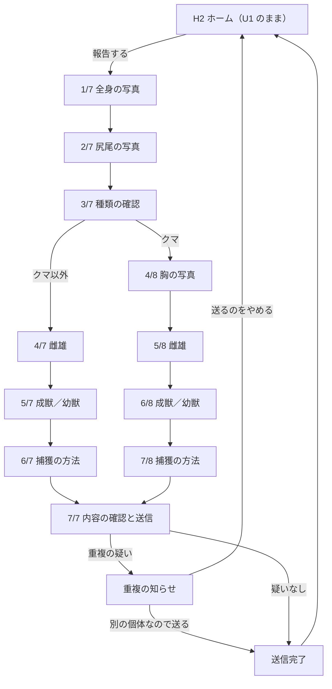

# Frontend Components（画面の部品）— U2 `u2-report-duplicate`

入力: entities.md、rules.md、functional-spec.md、`construction/u1-skeleton/functional-design/frontend-components.md`（U1 の画面。U2 は報告の作成を置き換える）、`inception/refined-mockups/`（画面案・interaction-spec）、`inception/user-stories/stories.md`（stories）、`inception/contract-design/contract-summary.md`（contract-summary）、functional-design-questions.md（Q1〜Q8）。

U2 で変わるのは **HunterApp の報告の作成**だけ。ログイン・ホーム・一覧（U1）と、依頼元の画面（U1・U3）は変えない。

## 1. 画面の構成（報告の作成）

<!-- Text fallback: ホームの「報告する」から、全身の写真 → 尻尾の写真 → 種類の確認 →（クマのときだけ胸の写真）→ 雌雄 → 成獣／幼獣 → 捕獲の方法 → 内容の確認と送信、の順に進む。送信で重複の疑いがあれば知らせの画面が出て、「別の個体なので送る」で送信完了、「送るのをやめる」で確認のうえホームに戻る。各画面に「戻る」があり、選んだ内容は残る。 -->

各画面に「戻る」（前の画面へ。入力は残る）と「やめる」（確認のうえ消してホームへ）がある。

## 2. 部品

### 新しく作る部品（UiKit）

| 部品 | 使う画面 | 状態・入力 | 決まり |
|---|---|---|---|
| `DateTimeQuick` | 7/7 内容の確認 | 日付と時刻を選ぶ（大きなボタンの日付送り＋時刻の選択）。空のときは空欄を示す | BR2.11 |
| `MapPicker` | 7/7 内容の確認 | 地図で場所を指す。対象地域の外は指せても警告を出す。現在地のボタン | BR2.11・BR2.16 |
| `ConfirmDialog` | 作成中の「やめる」、重複の知らせ | 「写真と入力内容は消えます。よろしいですか？」＋「消す」「続ける」 | BR2.19・BR7.4 |
| `DuplicateNotice` | 重複の知らせ | 相手ごとに「種類・捕獲日時・おおよその距離」を並べる。氏名・写真は出さない。「別の個体なので送る」「送るのをやめる」 | BR7.1・BR7.3 |
| `DetectionBadge` | 3/7 種類の確認 | 「AI の判定（92%）」の表示。判別できなかったときは「手で選んでください」 | BR6.4 |
| `ReviewSummary` | 7/7 内容の確認 | 写真と全項目の一覧、各項目に「直す」 | BR2.17 |

### 手を入れる部品（U1 から）

| 部品 | 変える点 | 決まり |
|---|---|---|
| `PhotoPicker` | kind（全身・尻尾・胸）ごとの案内と例の図。撮影情報（日時・位置）を縮小の前に読み取って送る。長辺 2,048 px の JPEG への縮小。JPEG に変えられないときの理由の表示 | BR2.2・BR2.10 |
| `BigChoice` | 1 画面 1 項目に分ける（種類 3 つ、雌雄 3 つ、成獣／幼獣 2 つ、捕獲の方法 3 つ）。選ばないと「次へ」を押せない | BR2.17・BR6.4 |
| `StepHeader` | 「n/7」と「n/8」を切り替える（クマを選んだ時点で 8 になる） | FR2.1 |
| `SubmitButton` | 409 DUPLICATE_SUSPECTED で `DuplicateNotice` を出す。422 の理由（日時・場所・写真の期限切れ）を項目の近くに出す | BR7.1・BR2.14 |
| `LocationGate` | **使わなくなる**（U2 は写真の撮影情報か地図で指した場所を使うため、送信時の位置情報の許可は不要） | BR2.10 の置き換え |

## 3. 画面が持つ状態

| 画面 | 持つ状態 | 消えるとき |
|---|---|---|
| 報告の作成（全体） | 写真の ID（全身・尻尾・胸）、判別の結果、種類、雌雄、成獣／幼獣、捕獲の方法、捕獲日時と入れた方法、捕獲場所と入れた方法、胸の写真なしの印、送信のキー、重複を確認した印 | 送信完了・やめる・ログイン切れ（下書きは残さない。BR2.19） |
| 写真の画面 | 選んだ写真の表示用の画像、アップロードの進み具合、読み取った撮影情報 | 画面を離れても残る（「戻る」で見える。AC2.2.5） |
| 重複の知らせ | 相手の一覧（種類・日時・距離） | 「別の個体なので送る」または「送るのをやめる」 |

状態はブラウザの記憶領域（localStorage など）に保存しない。画面を閉じると消える（下書きを残さないため。FR2.9）。

## 4. API とのつなぎ

| 画面の操作 | API（contract-summary） |
|---|---|
| 写真のアップロード（全身・尻尾・胸） | C2 `POST /v1/photos` → 保存場所へ直接 → `POST /v1/photos/{id}/complete`（全身は判別の結果が返る） |
| 対象地域の読み出し | C2 `GET /v1/report-settings`（地図の警告と送信前の確認に使う） |
| 報告の送信 | C2 `POST /v1/reports`（409 DUPLICATE_SUSPECTED で重複の知らせ、`confirmedNotDuplicate=true` で送り直し） |
| 送信完了のあとの一覧 | C4 `GET /v1/catalog/my-reports`（U1 のまま） |

## 5. 入力の確かめ方

| 項目 | 画面での確認 | サーバーでの確認 |
|---|---|---|
| 写真の形式 | JPEG・PNG・HEIC だけを選べる。それ以外は理由を出す | 縮小後の JPEG だけを受け付ける（BR2.2・D-4） |
| 写真の大きさ | 選ぶ時点で 15 MB まで | 受け付けと完了の両方で確かめる（BR2.2・BR2.9） |
| 捕獲日時 | 未来 5 分・7 日前の範囲。外れたら理由を出し、送信ボタンを押せなくする | 同じ確認（BR2.15） |
| 捕獲場所 | 対象地域の中か。外れたら「対象地域の外です」 | 同じ確認（BR2.16） |
| 必須の項目 | 選ばないと「次へ」を押せない | 足りない項目を details に返す（BR2.17） |
| クマと胸の写真 | クマのときだけ胸の画面を出し、「撮れなかった」で進める | クマ以外の胸の写真は拒む（BR2.18） |

画面の確認は、サーバーの確認を省く理由にしない（両方で行う。corner-checklist「Client-side rules」）。

## 6. 使いやすさ（NFR7・NFR8）

| 項目 | U2 での守り方 |
|---|---|
| ボタンの大きさ | 64 px 以上（U1 の UiKit のまま）。`DateTimeQuick` の日付送りと `MapPicker` の現在地も同じ |
| 文字の大きさ | 20 px 以上 |
| 1 画面 1 項目 | 選択肢は 1〜3 個（成獣／幼獣は 2 個、捕獲の方法は 3 個） |
| 状態の伝え方 | 色だけに頼らない（文字とアイコンを添える）。重複の知らせも文字で伝える |
| キーボード操作 | 地図（`MapPicker`）は、キーボードでも緯度・経度を直接入れられる手段を併せて置く |

## Assumptions & Open Questions

- `MapPicker` の地図の表示に使う部品（地図のタイル）は、無料で使えるもの（OpenStreetMap のタイルなど）を Code Generation で選ぶ。地名を求める API は使わない（Q2）。 [assumption]
- 写真の縮小（長辺 2,048 px の JPEG）と撮影情報の読み取りは、ブラウザの機能（Canvas と EXIF の読み取り）で行う。外部のサービスは使わない。 [assumption]
- `DateTimeQuick` の時刻は 5 分刻みを想定（手袋をした指でも押しやすくするため）。刻みの細かさは Refined Mockups の interaction-spec に合わせる。 [assumption]
