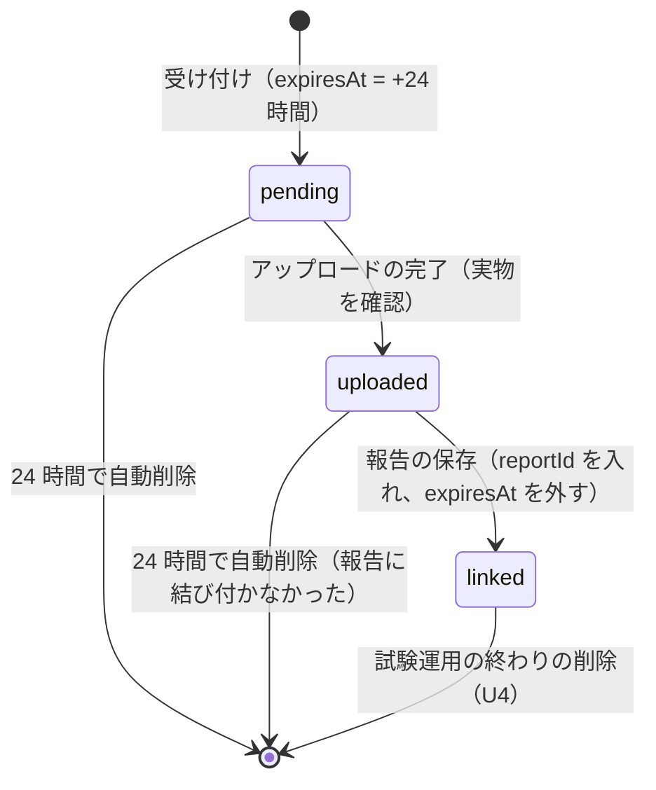
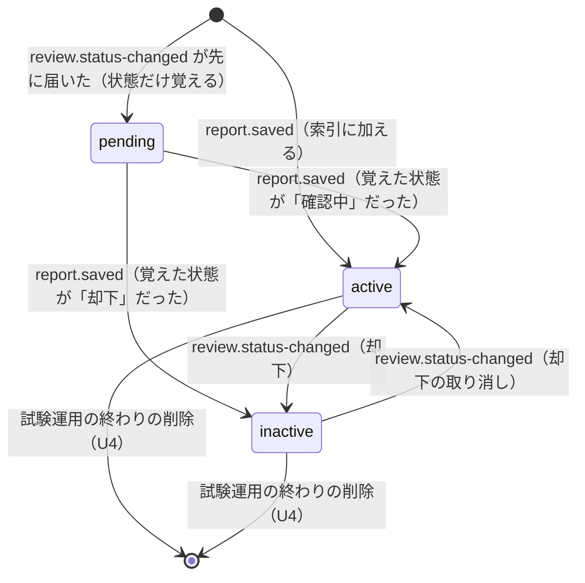
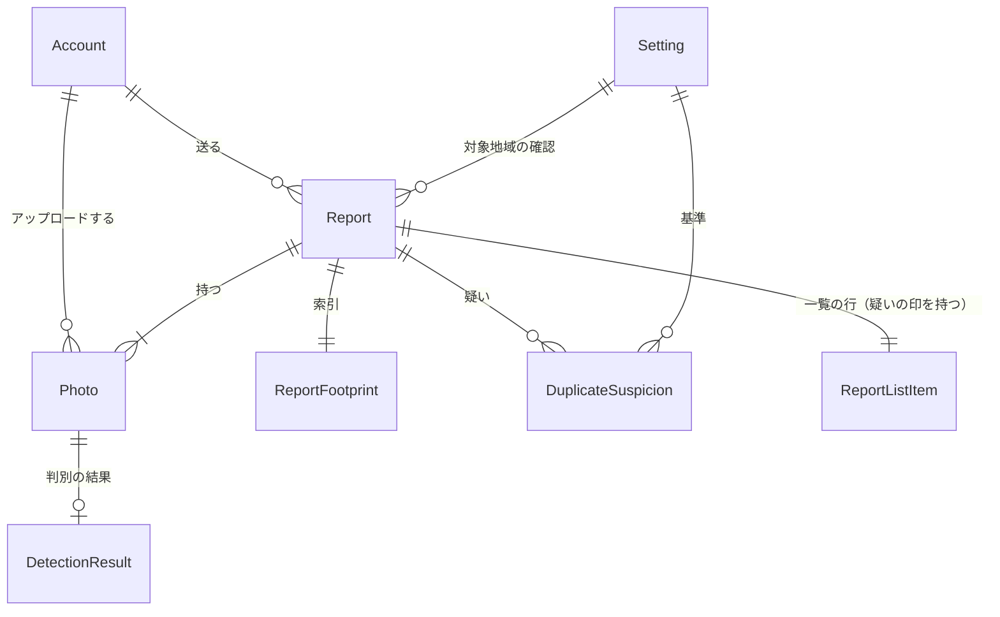

# Functional Spec（処理の流れ）— U2 `u2-report-duplicate`

入力: entities.md、rules.md、`construction/u1-skeleton/functional-design/functional-spec.md`（U1 の流れ。U2 は UC2 を置き換える）、`inception/user-stories/stories.md`（stories。U2 のストーリー: US2.2〜US2.11・US3.1〜US3.3・US7.1・US7.2）、`inception/units-generation/unit-of-work.md`（unit-of-work）・`unit-of-work-story-map.md`（unit-of-work-story-map）、`inception/requirements-analysis/requirements.md`（requirements）、`inception/domain-design/components.md`（components）、`inception/contract-design/contract-summary.md`（contract-summary）、functional-design-questions.md（Q1〜Q8）。

この文書は、処理の順番と状態の移り変わりの正本（source of truth）である。データの形は entities.md、判断の決まりは rules.md が正本で、ここの図と表はそれを読みやすくした写し。

## 1. U2 の範囲

| ストーリー | 内容 | U2 での範囲 |
|---|---|---|
| US2.2 | 写真を撮る・選ぶ | 全部（全身・尻尾、形式と大きさの確認、縮小） |
| US2.3 | 日時と場所が自動で入る | 全部 |
| US2.4 | 日時と場所を手で入れる | 全部 |
| US2.5 | 日時と場所の確認 | 全部（対象地域は四角い範囲。Q3） |
| US2.6 | 種類を自動で判別して直す | 全部 |
| US2.7 | クマの胸の写真を撮る | 全部 |
| US2.8 | 雌雄を選ぶ | 全部（U1 の選択を画面として独立させる） |
| US2.9 | 成獣／幼獣と捕獲の方法を選ぶ | 全部 |
| US2.10 | 内容を確かめて送る | 全部 |
| US2.11 | 報告の作成をやめる | 全部 |
| US3.1 | 重複の疑いを見つける | 全部（場所と時間の基準） |
| US3.2 | 送る前に重複の疑いを知る | 全部 |
| US3.3 | ほぼ同時に送られた報告も見つける | 全部 |
| US7.1 | 同じ写真・ほぼ同じ写真を見つける | **次の版に回す**（Q1） |
| US7.2 | クマの月の輪で同じ個体を見つける | **次の版に回す**（Q1） |

U1 の UC2（写真 1 枚で報告を送る）は、U2 の UC8（完全な報告）に置き換わる。U1 で作ったログイン・一覧・承認・知らせの処理は、そのまま使う。

## 2. 流れ

### UC8 完全な報告を送る（US2.2〜US2.11・US3.2）

ハンターが報告を作る流れ。通常 7 ステップ、クマのときは 8 ステップ（FR2.1）。各画面に「戻る」がある。

| ステップ | 画面 | 画面ですること | サーバーですること |
|---|---|---|---|
| 1/7 | 全身の写真 | 案内と例の図を出し、「撮る」「選ぶ」。形式（JPEG・PNG・HEIC）と大きさ（15 MB まで）を確かめ、撮影情報を読み取ってから長辺 2,048 px の JPEG に縮小する | 写真を受け付け、アップロード用の URL を返す。アップロードの完了で実物を確かめ、**種類を判別して結果を返す**（BR2.2・BR2.9・BR6.2） |
| 2/7 | 尻尾の写真 | 同じ手順（判別はしない） | 写真を受け付ける（BR6.2） |
| 3/7 | 種類の確認 | 判別できたらその種類を選んだ状態で「AI の判定（92%）」と出す。判別できなければ何も選ばない。ハンターが直せる（BR6.4） | — |
| 4/8 | 胸の写真（クマのときだけ） | 月の輪が写るよう案内する。「撮れなかった」で先に進める（BR2.17） | 写真を受け付ける |
| 4/7（クマは 5/8） | 雌雄 | 「オス」「メス」「不明」の大きなボタン。選ばないと次に進めない | — |
| 5/7（クマは 6/8） | 成獣／幼獣 | 「成獣」「幼獣」。選ばないと次に進めない | — |
| 6/7（クマは 7/8） | 捕獲の方法 | 「わな」「銃」「その他」。選ばないと次に進めない | — |
| 7/7（クマは 8/8） | 内容の確認と送信 | 写真と全項目を一覧で出し、各項目に「直す」。捕獲日時・捕獲場所は写真の撮影情報から入れ（BR2.10）、無ければ手入力を求める（BR2.11）。日時と場所の確認（BR2.15・BR2.16）を画面でも行い、満たさなければ理由を出して送信ボタンを押せなくする | 送信を受け付ける（下記 UC9） |

「戻る」で前の画面に戻っても、選んだ写真と入力は残る（AC2.2.5）。作成をやめるときは確認を出す（BR2.19）。

### UC9 報告の送信（US2.10・US3.2）

```
1. 送信のキー（submissionKey）を確かめる（BR2.6）
   └ すでに保存済み → 同じ reportId を返して終わり（200）
   └ 同じキーが処理中 → 409 SUBMISSION_IN_PROGRESS（2 秒後に送り直し）
2. 報告できるハンターか確かめる（BR2.1。C10 で Accounts に問い合わせ、従事者番号と表示名を受け取る）
3. 写真を確かめる（BR2.3・BR2.14・BR2.17・BR2.18）
   └ 自分の写真で、アップロード済みで、どの報告にも結び付いておらず、24 時間以内
   └ 全身と尻尾がそろい、クマなら胸の写真か「胸の写真なし」
4. 日時と場所を確かめる（BR2.15・BR2.16。対象地域は Settings から読む）
5. 重複の疑いを確かめる（BR7.1。confirmedNotDuplicate=false のときだけ）
   └ 疑いあり → 保存せず 409 DUPLICATE_SUSPECTED（種類・日時・おおよその距離だけを返す。BR7.3）
6. 保存する（manualEntry と自動判別の記録を入れる。BR2.12・BR2.20）
7. 写真に reportId を入れ、expiresAt を外す（BR2.13）
8. report.saved の知らせを送る（BR2.7。C12）
```

ハンターが「別の個体なので送る」を選ぶと、同じ送信のキーで `confirmedNotDuplicate=true` にして送り直す。5 を飛ばして保存する（BR7.2）。

### UC10 重複の疑いの問い合わせ（送信の前。US3.2）

```
1. Reporting が C9（POST /internal/v1/duplicate-checks）で問い合わせる
   （種類・捕獲日時・捕獲場所。reportId はまだない）
2. Settings から基準を読む（BR8.10）
3. 「種類＋捕獲日」の索引から前後 3 日分を読む（BR8.3）
4. active=true の相手ごとに、距離と時間差を計算する（BR8.1・BR8.2・BR8.7）
5. 当たった相手の種類・捕獲日時・おおよその距離（100 m 単位）だけを返す（BR7.3）
   └ 記録は作らない。知らせも送らない（BR8.5）
```

### UC11 重複の疑いの判定（保存のあと。US3.1・US3.3）

```
1. report.saved の知らせを受ける（処理済みの eventId は無視する）
2. 索引（ReportFootprint）に自分を加える（行がすでにあれば、却下の知らせが先に届いている。
   種類・場所・捕獲日時を入れて savedReceived=true にし、先に覚えた active は残す。BR8.11）
3. Settings から基準を読み、前後 3 日分の相手を読む（基準の読み出しは部品の身元の証明で呼ぶ。BR8.3・BR9.1）
4. savedReceived=true かつ active=true の相手ごとに、疑いを 2 行作る（自分→相手、相手→自分。BR8.4・BR8.6）
5. 行ごとに duplicate.suspected の知らせを送る（C14。受け手は ReportCatalog〈U3〉）
```

疑いの印は Reporting の報告（`Report`）には書き戻さない。DuplicateDetection から Reporting への経路が約束にないため（レビュー R-01）。印の正本は `DuplicateSuspicion`（依頼元は C5 で読む）で、一覧の印は `ReportListItem.duplicateSuspected`（C14 の知らせで更新される）。

ほぼ同時に送られた 2 件は、どちらの知らせでも相手が索引にいるため、両方に印が付く（AC3.3.1）。既存の相手にも同じ印が付く（AC3.3.2）。

### UC12 却下・取り消しによる索引の出し入れ（AC3.1.5）

```
1. review.status-changed の知らせを受ける（U1 で作った Review が送る。C13）
2. 索引の行がない → savedReceived=false の行を作り、状態だけを先に覚える（BR8.11）
   └ この行は種類・場所・捕獲日時を持たないため、索引から引かれず、比べる相手にならない
3. 行がある → status=rejected で active=false（比べる相手から外す。BR8.7）
4. previousStatus=rejected かつ undone=true → active=true（相手に戻す）
5. 覚えている lastStatusEventAt より古い知らせは無視する（contract-summary 2.5）
6. すでに付いた疑い（DuplicateSuspicion）は変えない（BR8.8。Q7）
```

**知らせの順番が入れ替わったとき**（contract-summary 2.5）。`report.saved`（Reporting が送る）と `review.status-changed`（Review が送る）は別の送り手から届くため、却下が先に届くことがある。そのときは 2 の経路で状態だけを先に覚え、`report.saved` が届いたときに 1 つの索引にまとめる（UC11 の手順 2）。この仕組みがないと、却下された報告が `active=true` のまま索引に加わり、比べる相手から外れない。

### UC13 結び付かなかった写真の自動削除（US2.11・FR2.9）

```
1. 写真の受け付けで expiresAt=uploadedAt + 24 時間を入れる（判別の結果も同じ）
2. 報告の保存で expiresAt を外す（BR2.13）
3. 期限を過ぎた記録と実物は、仕組みが自動で消す（自分で動かす処理は作らない。Q4）
4. 消え残った写真は、送信のときの 24 時間の確認（BR2.14）で使えない
```

### UC14 重複の疑いの相手の一覧（依頼元。AC4.2.2・AC3.3.2）

```
1. 依頼元が GET /v1/duplicates/{reportId} を呼ぶ（C5。依頼元だけ。BR8.9）
2. その報告の疑いの行を返す（相手の reportId・距離・時間差・kind）
3. 相手の報告の状態（確認中・承認・却下）を一緒に返す（BR8.8。Q7）
```

U1 で「U2 の疑いの知らせが届けば表示される」としていた AC4.2.2 は、この入口で満たす。画面での見比べは U3 の RequesterApp が作る。

## 3. 状態の移り変わり

### 写真の状態（Photo）



<!-- Text fallback: 写真は受け付けで「待ち」になり 24 時間の期限が付く。アップロードが終わると「アップロード済み」。報告に結び付くと期限が外れ、結び付かないまま 24 時間たつと自動で消える。結び付いた写真は U4 の削除まで残る。 -->

### 報告の状態（U1 から変わらない）

報告の状態（確認中・承認・却下）は Review が持ち、U1 の functional-spec のとおり。U2 は状態を変えない。重複の疑いは状態とは別で、確認中・承認・却下のどれでも付きうる。

### 重複の疑いの索引（ReportFootprint.active）



<!-- Text fallback: 報告が保存されると索引に加わり、比べる相手になる。却下されると相手から外れ、却下が取り消されると戻る。却下の知らせが保存の知らせより先に届いたときは、状態だけを先に覚えた「待ち」の行になり、保存の知らせが届いたときに、覚えた状態に応じて比べる相手になるか外れるかが決まる。削除は U4 で行う。 -->

## 4. データの関係（entities.md から作った写し）



<!-- Text fallback: アカウントは報告と写真を持つ。報告は写真を 2〜3 枚持ち、全身の写真だけが判別の結果を 1 つ持つ。報告ごとに索引が 1 つあり、疑いは報告を複数の相手と結ぶ。一覧の行（U1 で作った ReportListItem）が重複の疑いの印を持つ。設定は、対象地域の確認と重複の基準に使う。 -->

## 5. 決まりのまとめ（rules.md から作った写し）

| 決まり | 内容 |
|---|---|
| BR2.10〜BR2.12 | 撮影情報からの日時・場所、手入力、手入力の印 |
| BR2.13・BR2.14 | 24 時間の自動削除、古い写真を使わせない確認 |
| BR2.15〜BR2.18 | 捕獲日時と対象地域の確認、必須の項目、クマと胸の写真 |
| BR2.19・BR2.20 | 作成をやめるときの確認、自動判別の記録 |
| BR6.1〜BR6.5 | 判別の基準 80%、呼ぶ時機、失敗しても止めない、直せる、読める人 |
| BR7.1〜BR7.4 | 送信の前の問い合わせ、確認後の送信、見せる範囲、やめる |
| BR8.1〜BR8.11 | 重複の基準と距離、候補の絞り方、保存後の再判定、重複の除去、却下の扱い、知らせの順番の入れ替わり、読める人、基準の適用 |
| BR9.1〜BR9.3 | 設定の権限、値の範囲、初期値 |

## 6. 例外と角のケース

| 状況 | 扱い | 決まり |
|---|---|---|
| 16 MB の写真・PDF を選んだ | 画面で理由を出して選び直す（送信しない） | BR2.2 |
| HEIC の写真 | 端末で JPEG に縮小してから送る。JPEG に変えられなければ理由を出す | BR2.2 |
| 撮影情報が全身になく尻尾にある | 尻尾の値を使う | BR2.10 |
| 両方の写真に撮影情報がない | 空欄を示し、日時は選択、場所は地図で指す。空のままでは送れない | BR2.11 |
| 9 日前に撮った写真 | 「捕獲日時が 7 日より前です」で送れない | BR2.15 |
| ちょうど 7 日前・ちょうど 5 分後 | 送れる（境界を含む） | BR2.15 |
| 対象地域の外 | 「対象地域の外です」で送れない | BR2.16 |
| 判別のサービスが失敗・時間切れ | 「判別できませんでした」で、手で選ぶ。作成は止まらない | BR6.3 |
| 判別が 79% | 何も選ばれていない状態 | BR6.1 |
| クマで「撮れなかった」 | 胸の写真なしで進む。月の輪の照合は行わない（次の版） | BR2.17 |
| クマ以外に胸の写真を送った | 拒む | BR2.18 |
| 写真を選び直した | 前の写真は残し、24 時間で自動的に消える。報告には最後の写真だけ結び付く | BR2.13・Q8 |
| 24 時間を過ぎたが消え残った写真で送信 | 「写真の期限切れ」で拒む | BR2.14 |
| 送信の途中で通信が切れた | 入力と写真は画面に残り、「もう一度」で同じ送信のキーで送り直す。報告は 1 件だけ | BR2.6 |
| ほぼ同時の 2 件が互いに当たる | 両方に印が付く | BR8.4 |
| 相手が却下された | 比べる相手から外れるが、すでに付いた印は残る | BR8.7・BR8.8 |
| 却下が取り消された | また相手に戻る | BR8.7 |
| 却下の知らせが保存の知らせより先に届いた | 状態だけを先に覚え、保存の知らせで 1 つの索引にまとめる。却下された報告は比べる相手にならない | BR8.11 |
| 古い状態の知らせがあとから届いた | 覚えている時刻より古い知らせは無視する | BR8.11 |
| 同じ知らせが 2 回届いた | 処理済みの eventId を無視する | BR8.6 |
| 写真の確認を通った直後に自動削除が割り込んだ | 報告に結び付ける書き込みが失敗し、報告は保存されない（送り直しで新しい写真を選ぶ） | BR2.13・BR2.14 |
| 設定の行がまだない | 初期値（1,000 m・24 時間・日本の範囲）を使う | BR9.3 |
| 自分の報告が疑いの相手だった | 相手の氏名・写真は見せない決まりは同じ。種類・日時・距離だけを返す | BR7.3 |

## 7. 約束（contract-summary）との違い

U2 の設計で、約束や上流の文書と変える点。**約束の文書（`contracts/openapi.yaml`・`asyncapi.yaml`）は Code Generation で更新する。**

| # | 対象 | 変える点 | 理由 |
|---|---|---|---|
| D-1 | requirements FR2.14、components の `Setting`、約束 C6 | 対象地域を「中心の地点と半径」から**四角い範囲（北・南・東・西）**に変える。C6 の「半径 0 より大」は「北 > 南 かつ 東 > 西」に変わる | 要件の初期値「北緯 20〜46 度・東経 122〜154 度」は四角い範囲で、円では表せない（Q3）。管理者の設定画面は U4 なので、U4 が作る前に形が決まる |
| D-2 | 約束 C12（`report.saved`）、components の ADR-012 | `placeName` は U2 でも空のまま。地図のサービスは使わない | 地名を求める外部のサービスは、12 か月の無料枠のあとに課金が始まる（Q2） |
| D-3 | 約束 C12・C14 の `photoHash`・`kind: photo`・`kind: moon-ring` | 形は残すが、U2 では値を入れず、その種類の疑いも作らない | US7.1・US7.2 を次の版に回した（Q1） |
| D-4 | 約束 C2（`POST /v1/photos`） | 受け付ける形式を JPEG だけにする（画面が縮小してから送るため） | FR2.12 が「端末で長辺 2,048 px の JPEG に縮小してから送る」と決めている。PNG・HEIC の確認は画面で行う |
| D-5 | 約束 C2（`POST /v1/reports`） | 422 の理由に「写真の期限切れ」を足す | 自動削除が遅れても古い写真を使わせない（BR2.14、Q4 の補い） |
| D-6 | 約束 C5（`GET /v1/duplicates/{reportId}`） | 応答に相手の報告の状態（確認中・承認・却下）を足す | 却下された相手の疑いを残すため、画面で状態が要る（BR8.8、Q7） |
| D-7 | 約束 C2（`GET /v1/reports/{reportId}`） | 報告の詳細に重複の疑いの印を**持たせない** | DuplicateDetection から Reporting へ書き戻す経路が約束にない。疑いは C5 で、一覧の印は C14 で届く（レビュー R-01） |

## Assumptions & Open Questions

- ステップの番号（7 と 8）は、クマを選んだ時点で切り替わる。種類の確認（3/7）までは 7 ステップと表示し、クマを選んで「次へ」を押すと 4/8 になる（AC2.7.1）。 [assumption]
- 雌雄の画面は U1 では種類と同じ画面にまとめていた。U2 で 1 画面 1 項目に分ける（FR2.1、unit-of-work の U1 の割り切り）。 [assumption]
- 対象地域の確認は、画面とサーバーの両方で行う（画面の確認だけでは信用しない。corner-checklist「Client-side rules」）。 [assumption]
- 判別の精度の確認（FR3.5。3 種類それぞれ 10 枚以上で 70% 以上）は Build and Test で記録する。この設計では基準（80%）と失敗時の扱いだけを決める。 [assumption]
- `duplicate.suspected` の受け手（ReportCatalog の一覧の印）は U3 で作る。U2 は知らせを送るところまで。 [assumption]
