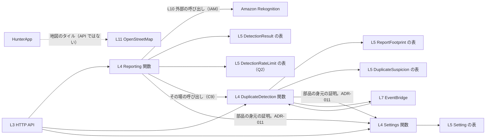

# Logical Components（論理的な構成要素）— U2 `u2-report-duplicate`

入力: `construction/u2-report-duplicate/nfr-requirements/`（performance・security・scalability・reliability・observability の要件、tech-stack-decisions）、`construction/u2-report-duplicate/functional-design/functional-spec.md`、`construction/u1-skeleton/nfr-design/logical-components.md`（U1 の構成要素。U2 はこれに足す）、`inception/domain-design/components.md`、`inception/contract-design/contract-summary.md`、nfr-design-questions.md（Q1〜Q5）。

U1 の構成要素（L1〜L9）はそのまま使う。U2 で足すのは、外部のサービスへの呼び出し（L10）と、新しい関数・表（L4・L5 に SpeciesDetection・DuplicateDetection・Settings が加わる）。

## 1. 構成要素の一覧（U2 で足すもの）

| # | 構成要素 | 役割 | U2 の部品 | 失敗したときの影響の範囲 |
|---|---|---|---|---|
| L4+ | 関数（Lambda、部品ごと） | SpeciesDetection・DuplicateDetection・Settings の処理 | 各部品 | その部品の API だけが失敗する（U1 の L4 の続き） |
| L5+ | データ（DynamoDB、部品ごとの表） | DetectionResult・ReportFootprint・DuplicateSuspicion・Setting・DetectionRateLimit（Q2） | 各部品 | その部品だけ（U1 の L5 の続き） |
| L10 | 外部の画像認識サービス（Amazon Rekognition） | 種類の判別 | SpeciesDetection | 判別だけが「判別できなかった」になる。報告の作成は止まらない |
| L11 | 地図のタイル（OpenStreetMap、外部） | 地図の表示（画面だけ。API は呼ばない） | HunterApp | 地図が表示できない（位置はキーボードで入力できる） |

## 2. 構成図（U1 からの差分）

<!-- Text fallback: Reporting の関数は Rekognition（外部）を呼び、判別の結果と呼び出し回数の記録をそれぞれの表に持つ。DuplicateDetection の関数は、Reporting からその場で呼ばれ、報告が保存された知らせ（EventBridge）も受けて索引と疑いの表を更新する。設定の読み書きは Settings 関数だけが Setting の表に触れ、Reporting と DuplicateDetection はどちらも Settings 関数を（部品の身元の証明を使って）呼び出す側に回り、表を直接読まない。ハンターの画面は、API を介さず地図のタイルを外部から直接取得する。 -->

## 3. 分け方の考え方（U2 で足すもの）

- **外部のサービスへの呼び出しは、呼ぶ関数（Reporting）の中に閉じる**: SpeciesDetection という論理的な部品の中身は「Reporting の関数が Rekognition を呼ぶ処理」であり、別の関数には分けない（機能設計で部品の責務は分けたが、配置は 1 つの関数にまとめる。小さな処理のために関数を増やすと、コールドスタートが増える）。
- **DuplicateDetection は独立した関数にする**: 送信の前（その場の呼び出し）と保存のあと（知らせ）の両方から呼ばれ、ロジックが Reporting より複雑なため分ける。
- **Setting の表に触れるのは Settings 関数だけにする**: security-design の NFR4.8 の認可の表は、呼び出し元を「Reporting」「DuplicateDetection」のように関数の単位で区切っており、表への直接のアクセスを前提にしていない。Reporting・DuplicateDetection はどちらも Settings 関数を ADR-011 の部品の身元の証明で呼ぶ側とし、表のスキーマや読み出しロジックの変更が Settings 関数の中だけで閉じるようにする（レビューの指摘。構成要素の境界と認可設計を一致させた）。
- **地図のタイルは API を経由しない**: 画面から外部に直接取得する。サーバー側の費用も処理も増えない。

## Assumptions & Open Questions

- SpeciesDetection の処理を Reporting の関数に含めるか、別の関数に分けるかは、Code Generation での実装の都合（束の大きさ、IAM の権限の分離）次第で見直せる。論理的な構成要素としての境界（部品の責務）は変わらない。 [assumption]
