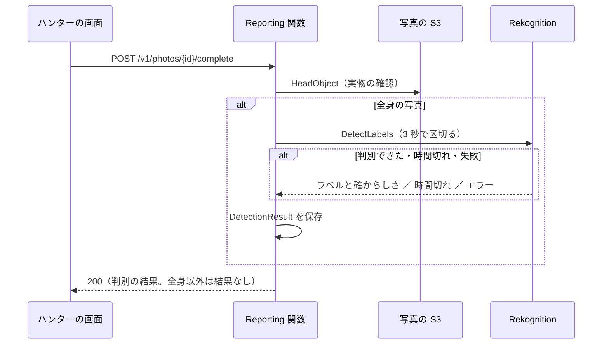
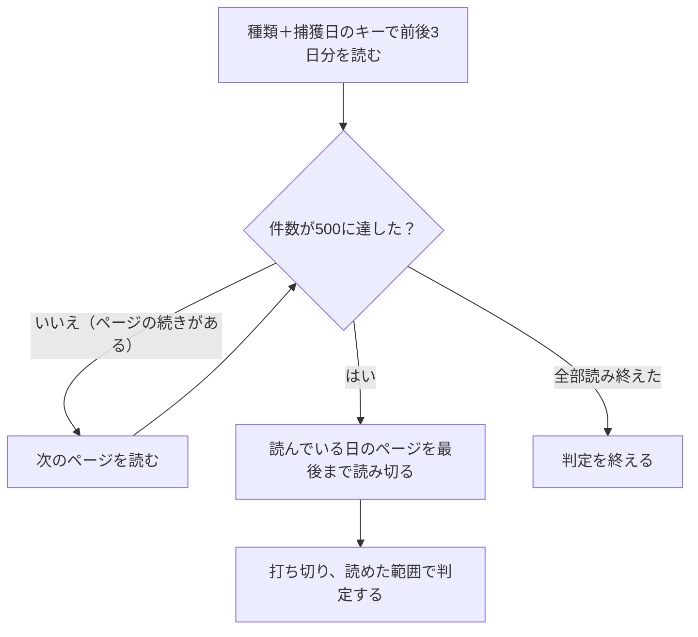

# Performance Design（性能の設計）— U2 `u2-report-duplicate`

入力: `construction/u2-report-duplicate/nfr-requirements/performance-requirements.md`（NFR2.6〜NFR2.14、NFR7.2〜NFR9.4）、logical-components.md、`construction/u2-report-duplicate/functional-design/rules.md`（BR2.10〜BR6.4、BR8.1〜BR8.11）、nfr-design-questions.md（Q1・Q3・Q5）。

## 1. アップロードの完了の時間の予算（NFR2.7）

<!-- Text fallback: アップロードの完了では、実物を確かめたあと、全身の写真なら Rekognition を 3 秒で区切って呼ぶ。結果（判別できた・時間切れ・失敗のいずれか）を記録して画面に返す。全身以外の写真は判別を呼ばない。 -->

時間の予算（NFR2.7 の 6 秒）: 起動の遅れ 1.5 秒 ＋ 実物の確認 0.3 秒 ＋ 判別 3 秒（時間切れの上限）＋ 記録の書き込み 1 秒 ＝ 最大 約 5.8 秒。

判別のサービスへの呼び出しに**サーキットブレーカーは入れない**（Q1）。3 秒の時間切れが、同時に複数の報告が待たされることへの十分な歯止めになる。試験運用の規模（同時 10 人以下）では、サーキットブレーカーの状態管理のほうが複雑さに見合わない。

## 2. 送信の時間の予算（U1 の続き。NFR2.2）

内訳は nfr-requirements の「送信の 10 秒（NFR2.2）の内訳」の表をそのまま使う（ここで新しく数え直さない。二重に数えるとレビューで指摘されたため）。

| 処理 | 見込み |
|---|---|
| 送信のキーの確認 | 0.1 秒以内 |
| 報告できるハンターかの確認（C10） | 2 秒で区切る |
| 写真の確認（2〜3 枚） | 0.5 秒以内 |
| 日時・場所の確認（Setting の読み出しを含む。Q の 2 節で Settings 関数を呼ぶ形にした分を含む） | 2 秒で区切る（C11） |
| 重複の問い合わせ（C9） | 2 秒で区切る（NFR2.9） |
| 保存と知らせの送信 | 1 秒以内 |
| **合計（最悪）** | **約 7.6 秒（nfr-requirements の「約 8 秒」と同じ内訳）** |

この合計はすでに 10 秒の画面の予算に収まっている（nfr-requirements の結論のとおり）。ただし、U1 でこの関数に設定した時間切れは **8 秒**（U1 の予算 5.8 秒に対する値）であり、U2 で足した設定の読み出しと重複の問い合わせの分だけ関数の中の処理が伸びるため、最悪時は 7.6 秒と 8 秒の時間切れの差が 0.4 秒しかない。ネットワークの揺らぎや DynamoDB のやり直し（SDK の標準リトライ）の分を見込むと心もとないため、**U2 で送信を受け付ける関数の時間切れを 9 秒に引き上げる**（最悪時でも約 1.4 秒の余裕。画面の予算 10 秒より 1 秒短く、API Gateway の 30 秒より短い）。

この関数は U1 からの既存のルート（写真の受け付け `POST /v1/photos`、完了 `POST /v1/photos/{id}/complete`）とも共有している。これらの処理時間の見込みは NFR2.6（3 秒以内）・NFR2.7（最悪約 5.8 秒）であり、どちらも 9 秒の時間切れより十分短いため、時間切れを 8 秒から 9 秒に引き上げても、これらのルートの挙動（成功までの時間、エラーの扱い）に変化はない。変わるのは、関数が本当に止まってしまったとき（ハング）に AWS が強制終了するまでの時間が 1 秒延びることだけで、無料枠への影響も無視できる（128〜256 MB・月間の呼び出し回数は数十件規模）。

## 3. 重複の判定の読み出し（NFR2.10、Q3）

<!-- Text fallback: 種類と捕獲日のキーで前後3日分を読み進め、件数が500に達したら、そのページを読み切ってから打ち切る。全部読み終えたら、そのまま判定を終える。 -->

500 件のちょうどで打ち切らない（Q3）のは、1 日分の索引の途中で止めると、同じ日の中で先に読んだ報告だけが判定の対象になり、結果が読む順に左右されるため。ページを読み切ることで、少なくとも 1 つの日の中では公平に判定する。

## 4. 関数のメモリ（NFR12.8、Q5）

| 関数 | メモリ | 理由 |
|---|---|---|
| Reporting（判別の呼び出しを含む） | 256 MB | 外部のサービスの呼び出しと画像の扱いがあるため |
| DuplicateDetection | 256 MB | ハバーサインの計算と、最大 500 件の読み出しを保持するため |
| Settings | 128 MB | 読み出し・値の確認だけ |

## Assumptions & Open Questions

- U2 で送信の関数の時間切れを 8 秒から 9 秒に引き上げることは、U1 の reliability-design の値（8 秒）を上書きする変更であり、Code Generation の時点で CDK の設定を直す必要がある。同じ関数が持つ写真の受け付け・完了のルートにも適用されるが、それらの見込み時間（3 秒・約 5.8 秒）には影響しない（上の説明のとおり）。 [assumption]
