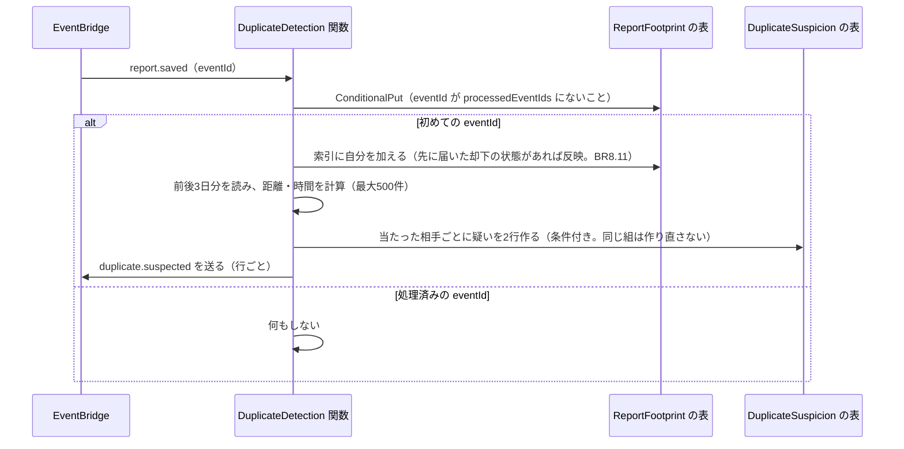

# Reliability Design（信頼性の設計）— U2 `u2-report-duplicate`

入力: `construction/u2-report-duplicate/nfr-requirements/reliability-requirements.md`（NFR10.9〜NFR10.17、NFR11.7〜NFR11.8）、logical-components.md、`construction/u1-skeleton/nfr-design/reliability-design.md`（U1 の設計。知らせの届け方・送信のキーの状態をここで引き継ぐ）、`construction/u2-report-duplicate/functional-design/rules.md`（BR2.13・BR2.14・BR7.1・BR8.1〜BR8.11）、nfr-design-questions.md（Q1）。

## 1. 外部のサービスが止まったときの扱い（NFR10.9・NFR10.10）

| 呼び出し | 時間切れ | 失敗したとき |
|---|---|---|
| Reporting → Rekognition（判別） | 3 秒 | `outcome=undetected、failureReason=timeout`（または `service-error`）として 200 を返す。サーキットブレーカーは入れない（Q1） |
| Reporting → DuplicateDetection（送信の前の問い合わせ。C9） | 2 秒 | 失敗・時間切れでもログに `errorCode=DUPLICATE_CHECK_FAILED` を残し、保存に進む（保存のあとの判定で見つかる） |
| Reporting/DuplicateDetection → Settings（設定の読み出し） | 1 秒 | 初期値（1,000 m・24 時間・日本の範囲）で続ける |

## 2. 保存のあとの重複の判定の確実さ（NFR10.15〜NFR10.17）

U1 の知らせの届け方（eventSent の印、最大 3 回のやり直し）を `report.saved` の送信にそのまま使う。保存のあとの判定（`report.saved` の受け手）の確実さ:

<!-- Text fallback: DuplicateDetection は report.saved を受けると、eventId が未処理であることを条件に索引へ自分を加える。前後3日分を読んで距離と時間を計算し、当たった相手ごとに疑いの行を条件付きで作って知らせを送る。処理済みのeventIdなら何もしない。 -->

| ID | 設計 |
|---|---|
| NFR10.15 | `ReportFootprint` の `processedEventIds` に eventId を条件付きで追加できたときだけ処理を進める（U1 の BR4.1 と同じ二重処理の防止）。知らせの順番の入れ替わりは BR8.11 のとおり `savedReceived` で吸収する |
| NFR10.16 | `report.saved` の配達は EventBridge の標準のやり直し（最大 24 時間・185 回）に任せる。失敗の置き場（DLQ）は U1 と同じく作らない（受け入れたリスク）。重複の判定自体が失敗したときは、その報告に疑いが付かないまま残ることを受け入れる（紙の確認に戻れるため） |
| NFR10.17 | 読み出しが 500 件に達したら、performance-design の打ち切り方（ページを読み切る）で判定を終え、ログに `errorCode=undefined`（正常）と件数を残す。判定自体は失敗にしない |

## 3. 写真のアップロードの確実さ（NFR10.12〜NFR10.14）

| ID | 設計 |
|---|---|
| NFR10.12 | 2〜3 枚のうち 1 枚が失敗しても、ほかの受け付け済みの写真はそのまま使える（Photo の記録は写真ごとに独立）。画面はその 1 枚だけをやり直す |
| NFR10.14 | 報告の保存と写真への `reportId` の書き込みは、U1 と同じく DynamoDB の `TransactWriteItems` で 1 つにまとめる。各写真の書き込みに「その写真の記録がまだあること」（`attribute_exists(photoId)`）を条件に加える。これは BR2.14 が確認する「24 時間以内かどうか」を時刻の比較でやり直すのではなく、BR2.13 の自動削除（TTL）が実際に消したかどうかをそのまま条件にする作り（確認と保存の間に TTL の削除が割り込んだ場合だけ失敗させる。レビュー R-05・R-06 の裏付け）。時刻を比較する条件にすると、24 時間ぎりぎりのタイミングで、まだ消えていない写真の書き込みがサーバーの時計のわずかなずれで失敗しうるため避ける。条件に合わない写真があれば、トランザクション全体が失敗し、報告は保存されない |

## 4. 保存期間（NFR11.7・NFR11.8）

| ID | 設計 |
|---|---|
| NFR11.7 | DetectionResult・ReportFootprint・DuplicateSuspicion は、TTL を設定しない（試験運用が終わるまで保存）。Photo・結び付かなかった DetectionResult だけが TTL の対象（scalability-design のとおり） |
| NFR11.8 | 結び付いた写真・判別の結果は、`RemovalPolicy: RETAIN`（U1 の表と同じ） |

## Assumptions & Open Questions

- Rekognition の呼び出しの SDK のやり直し（AWS SDK の既定のリトライ）は無効化せず使う。3 秒の時間切れは、アプリ側のタイムアウトとして SDK のやり直しより先に効くようにする（Code Generation で `AbortController` などを使う）。 [assumption]
