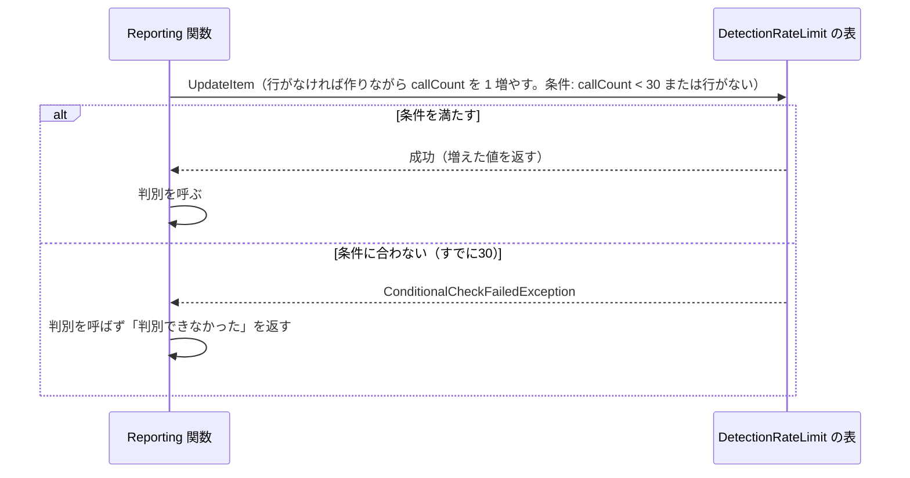

# Scalability Design（規模の設計）— U2 `u2-report-duplicate`

入力: `construction/u2-report-duplicate/nfr-requirements/scalability-requirements.md`（NFR1.4〜NFR1.5、NFR3.3〜NFR3.5、NFR12.5〜NFR12.8）、logical-components.md、nfr-design-questions.md（Q2・Q4・Q5）。

## 1. 判別の呼び出し回数の上限（NFR12.5、Q2）

<!-- Text fallback: 判別を呼ぶ前に、DetectionRateLimit の表の行（アカウントと日付の組）を、30 未満であることを条件に 1 増やす。条件を満たせば判別を呼び、満たさなければ呼ばずに「判別できなかった」を返す。 -->

`DetectionRateLimit` の表: キーは `accountId#date`（日本時間の日付、YYYY-MM-DD）。`callCount`（整数）と `ttl`（Unix 時間、作成から 2 日後）を持つ。TTL で自動的に消えるため、削除の処理を自分で作らない。

**その日最初の呼び出し（行がまだない）をアトミックに作る**: `UpdateItem` の更新式を `SET callCount = if_not_exists(callCount, :zero) + :one, ttl = if_not_exists(ttl, :ttlValue)` とし、条件式を `callCount < :limit OR attribute_not_exists(callCount)` にする。これにより「行を作る」と「1 増やす」が 1 回の条件付き書き換えで終わり、U4 の AdminCounter で 3 回見つかった「数えてから書く」形の競合（同時に 2 つの呼び出しがどちらも「行がない」と読んで、どちらも 1 からの行を上書きし合う）を避ける（レビューの指摘）。

## 2. 重複の判定の読み出し規模（NFR3.5、NFR12.6）

| 項目 | 見込み | 上限時の扱い |
|---|---|---|
| 試験運用の規模（1 日あたりの同じ種類の報告） | 数件 | 上限（500 件）に遠く届かない |
| 読み出しの単位 | DynamoDB のクエリ（`speciesDay` をキー、1 ページ約 100 件） | 複数ページにまたがる場合はページ単位で打ち切る（performance-design の Q3） |
| 読み出しに使う容量（RCU） | オンデマンドのため、使った分だけ課金（無料枠内） | 500 件でも無料枠（25 GB 相当の読み書き）を大きく下回る |

## 3. 自動削除の設定値（NFR12.7、Q4）

| 対象 | 設定 | 値 |
|---|---|---|
| Photo の表（DynamoDB） | TTL 属性 `expiresAt` | `uploadedAt + 24 時間`（Unix 時間） |
| DetectionResult の表（DynamoDB） | TTL 属性 `expiresAt` | Photo と同じ値を写す |
| 写真の S3 バケット | ライフサイクルルール | オブジェクトの作成から **1 日**で削除（S3 のライフサイクルは日単位の指定のみ） |

S3 のライフサイクルを「1 日」にしたのは、DynamoDB の TTL（最大 48 時間以内）より早く、または同程度に動く可能性があるためで、どちらが先に実行されても、報告に使えない写真（BR2.14 の 24 時間の確認）を参照することはない（Photo の記録が消えていなくても、24 時間を過ぎれば送信で拒まれる）。

## 4. 運用の制約（NFR12.8、Q5）

Reporting・DuplicateDetection の関数は 256 MB（performance-design のとおり）。Settings は 128 MB。

## Assumptions & Open Questions

- `DetectionRateLimit` の日付のキーは日本時間（JST）で切る（nfr-requirements の方針のとおり）。関数はタイムゾーンを明示して日付を計算する（サーバーの既定のタイムゾーンに依存しない）。 [assumption]
