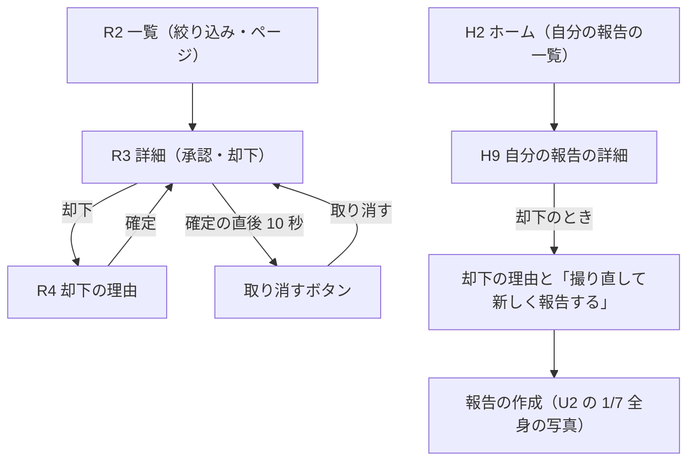

# Frontend Components（画面の部品）— U3 `u3-review-list`

入力: entities.md、rules.md、functional-spec.md、`construction/u1-skeleton/functional-design/frontend-components.md`（U1 の画面。U3 は依頼元の画面とハンターの詳細を拡張する）、`inception/refined-mockups/`（画面案・interaction-spec）、`inception/user-stories/stories.md`（stories）、`inception/contract-design/contract-summary.md`（contract-summary）、functional-design-questions.md（Q1〜Q6）。

U3 で変わるのは **依頼元の画面（一覧・詳細・却下）**と、**ハンターの報告の詳細**。報告の作成（U2）とログイン（U1）は変えない。

## 1. 画面の構成

<!-- Text fallback: 依頼元は一覧から詳細を開き、承認か却下をする。却下では理由の画面を通って確定し、確定の直後 10 秒だけ取り消せる。ハンターはホームの一覧から自分の報告の詳細を開き、却下されていれば理由を読んで、新しい報告の作成を始められる。 -->

## 2. 部品

### 新しく作る部品（UiKit）

| 部品 | 使う画面 | 状態・入力 | 決まり |
|---|---|---|---|
| `RejectReasonForm` | R4 却下の理由 | 理由 4 つの大きなボタン。「その他」を選ぶと文の入力（1〜200 文字、残り文字数を表示）。空白だけでは確定できない | BR3.8 |
| `UndoBar` | R3 詳細 | 確定の直後に出る「取り消す」。サーバーから受け取った `undoUntil` までの残り時間を数え、0 になったら消える。画面を開き直したときも、状態の読み出しが返す `undoUntil` から出し直す。ほかの人の画面には出ない | BR3.9・BR3.15 |
| `FilterBar` | R2 一覧 | 状態 3 つ・印 2 つの絞り込み（複数選べる）。選んだ条件と件数を表示。「条件を消す」 | BR4.5 |
| `ListPager` | R2・H2 一覧 | 「次のページ」「前のページ」、全件数（上限に達したときは「2,000 件以上」） | BR4.4・BR4.8 |
| `WaitingDays` | R2・H2 一覧 | 「送ってから n 日」。依頼元の一覧では 7 日を過ぎた確認中の報告に「7 日以上」の印。確認済みには出さない | BR4.9 |

### 手を入れる部品（U1 から）

| 部品 | 変える点 | 決まり |
|---|---|---|
| `DecisionBar` | 「承認」に加えて「却下」を出す。409 で「すでに確認済みです（承認、◯◯）」を出してボタンを消す。名前が無いときは「依頼元の担当者」と出す（利用者の ID は出さない） | BR3.3・BR3.12 |
| `ReportList` | 絞り込み（`FilterBar`）・日数（`WaitingDays`）・重複の疑いの印・手入力の印を出す。`placeName` が空のときは緯度・経度を出す。絞り込みで 0 件のときは「条件に合う報告はありません」（報告が 0 件のときの文言と分ける） | BR4.5・BR4.9・D-2 |
| `ReportDetail` | 却下のときは理由（「その他」の文も）を出す。ハンターの詳細には「撮り直して新しく報告する」を出し、内容を直すボタンは出さない | BR3.14 |
| `StatusChip` | 「却下」を足す（文字とアイコン。色だけに頼らない） | FR9.1 |

## 3. 画面が持つ状態

| 画面 | 持つ状態 | 消えるとき |
|---|---|---|
| R2 一覧 | 選んだ絞り込みの条件、表示中のページの位置（cursor） | 画面を離れたとき |
| R3 詳細 | `undoUntil`（取り消しの残り時間）。画面を開くたびに状態の読み出しから受け取り直す | 10 秒を過ぎたとき、取り消したとき |
| R4 却下の理由 | 選んだ理由、書いた文 | 確定・やめる |
| H9 ハンターの詳細 | なし（読むだけ） | — |

取り消しの残り時間は、画面が数えるだけ。受け付けの判断はサーバーが行う（BR3.9）。

## 4. API とのつなぎ

| 画面の操作 | API（contract-summary） |
|---|---|
| 依頼元の一覧（絞り込み・ページ） | C4 `GET /v1/catalog/reports?status=&flag=&cursor=` |
| ハンターの一覧 | C4 `GET /v1/catalog/my-reports?cursor=` |
| 詳細 | C2 `GET /v1/reports/{id}`、C3 `GET /v1/reviews/{id}` |
| 重複の疑いの相手（見比べ） | C5 `GET /v1/duplicates/{id}`（U2 が作る。相手の状態も返る） |
| 承認・却下 | C3 `PUT /v1/reviews/{id}/decision` |
| 取り消し | C3 `POST /v1/reviews/{id}/decision/undo` |

## 5. 入力の確かめ方

| 項目 | 画面での確認 | サーバーでの確認 |
|---|---|---|
| 却下の理由 | 選ばないと確定できない | 知らない値は拒む（BR3.8） |
| 「その他」の文 | 1〜200 文字。空白だけでは確定できない。残り文字数を表示 | 同じ確認（BR3.8） |
| 絞り込みの値 | 用意した選択肢だけを押せる | 知らない値は 400（BR4.5） |
| 取り消しの期限 | 残り時間が 0 でボタンを消す | 期限切れは 409 UNDO_EXPIRED（BR3.9） |
| 取り消しの二重送信 | 押したらボタンを押せない状態にする | すでに戻っていれば 409 ALREADY_UNDONE。画面はエラーを出さず、確認中の状態を出し直す（BR3.9・D-6） |

## 6. 使いやすさ（NFR7・NFR8）

| 項目 | U3 での守り方 |
|---|---|
| ボタンの大きさ | 64 px 以上（U1 の UiKit のまま）。却下の理由の 4 つ、絞り込みの選択肢も同じ |
| 状態の伝え方 | 「確認中・承認・却下」「重複の疑い」「手入力」「7 日以上」は、いずれも文字とアイコンで示す（色だけに頼らない） |
| 却下されたハンターへの伝え方 | 理由を責める言い方にせず、「次にどうすればよいか」（撮り直して新しく報告する）を並べて出す |
| 取り消し | 押し間違いを取り返せる 10 秒を、残り時間つきで見せる（destructive action への備え。corner-checklist「Screens and user input」） |
| キーボード操作 | 絞り込み・却下の理由・取り消しは、すべてキーボードで操作できる |

## Assumptions & Open Questions

- 却下の理由の文（`reasonText`）は、画面では文字としてそのまま表示する（記号や改行が画面の作りに影響しないようにする。corner-checklist「Text」）。 [assumption]
- 絞り込みの条件は画面の記憶領域に保存しない。画面を離れると消える（U1 と同じ方針）。 [assumption]
- 「7 日以上」の印と「送ってから n 日」の文言は、Refined Mockups の interaction-spec の言い回しに合わせる。 [assumption]
