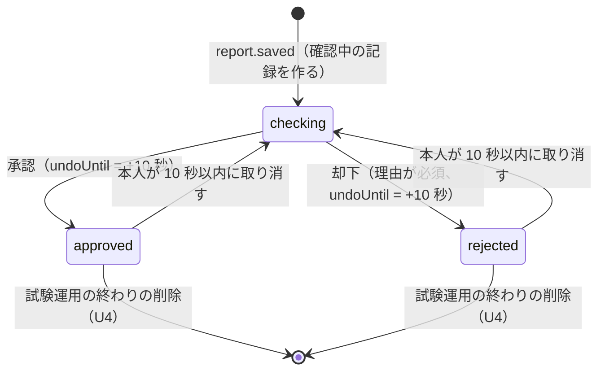
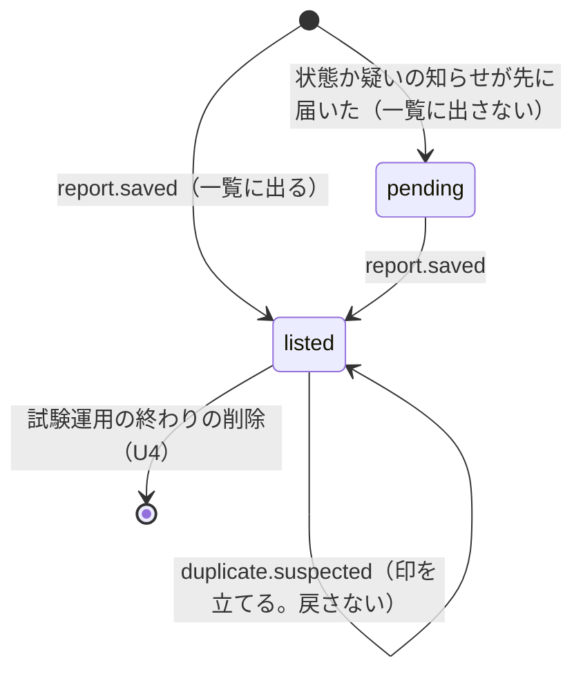
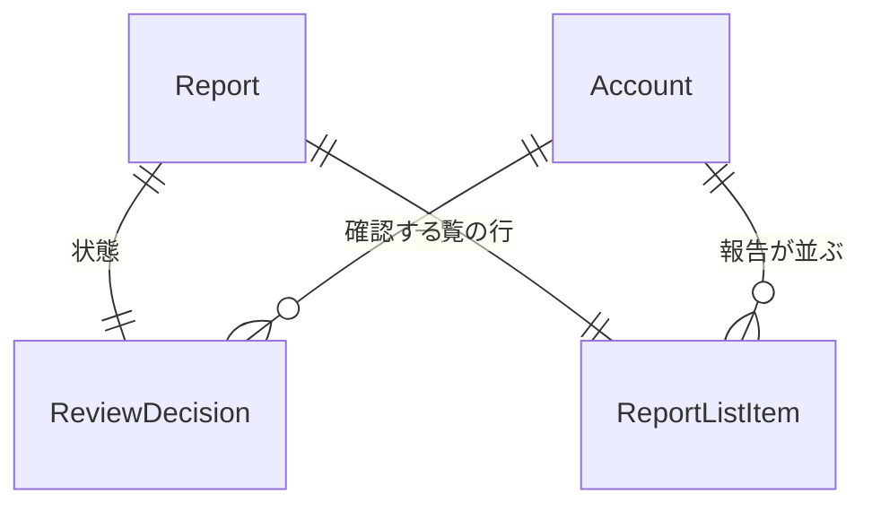

# Functional Spec（処理の流れ）— U3 `u3-review-list`

入力: entities.md、rules.md、`construction/u1-skeleton/functional-design/functional-spec.md`（U1 の流れ。U3 は UC3〜UC5 を拡張する）、`construction/u2-report-duplicate/functional-design/functional-spec.md`（U2 が送る `duplicate.suspected` の知らせ）、`inception/user-stories/stories.md`（stories。U3 のストーリー: AC4.1.2、US4.4〜US4.7、US5.2・US5.3）、`inception/units-generation/unit-of-work.md`（unit-of-work）・`unit-of-work-story-map.md`、`inception/requirements-analysis/requirements.md`（requirements）、`inception/domain-design/components.md`（components）、`inception/contract-design/contract-summary.md`（contract-summary）、functional-design-questions.md（Q1〜Q6）。

この文書は、処理の順番と状態の移り変わりの正本（source of truth）である。データの形は entities.md、判断の決まりは rules.md が正本で、ここの図と表はそれを読みやすくした写し。

## 1. U3 の範囲

| ストーリー | 内容 | U3 での範囲 |
|---|---|---|
| US4.1（AC4.1.2） | 報告の一覧の絞り込み | 全部（状態 3 種・印 2 種） |
| US4.4 | 理由を選んで却下する | 全部 |
| US4.5 | 承認・却下を取り消す | 全部（10 秒、本人だけ） |
| US4.6 | 2 人が同時に確認しても結果が 1 つになる | 全部 |
| US4.7 | 確認が遅れている報告に気づく | 全部（依頼元の一覧の「7 日以上」の印） |
| US5.2 | 却下の理由を見て、新しく報告する | 全部 |
| US5.3 | 確認待ちの日数を知る | 全部（催促はしない） |

U1 で作った承認・一覧・詳細と、U2 が送る重複の疑いの知らせを前提にする。U2 がまだなくても、約束どおりの試験用の知らせで試せる（unit-of-work の U3 の境界）。

## 2. 流れ

### UC15 却下する（US4.4）

```
1. 依頼元が報告の詳細を開く（status=checking のときだけ却下のボタンが出る。BR3.6）
2. 「却下」を押すと、理由の 4 つから選ぶ画面が出る
   （重複の疑い／写真が不十分／対象の地域・種類ではない／その他）
3. 「その他」を選んだときは、文（1〜200 文字）を書く。空のままでは確定できない（BR3.8）
4. 確定を押すと PUT /v1/reviews/{reportId}/decision（decision=rejected、reason、reasonText）
5. サーバー: 依頼元か（BR3.2）→ 記録があるか（BR3.7）→ 理由が揃っているか（BR3.8）
   → 確認中であることを条件に書き換える（BR3.3）
6. status=rejected、reason、reasonText、decidedByAccountId、decidedByName（BR3.12）、
   decidedAt、undoUntil=decidedAt + 10 秒 を入れる
7. review.status-changed をすぐ送る（status=rejected。BR3.13。C13）
8. 画面は「却下しました」と、10 秒のあいだ「取り消す」を出す
```

### UC16 取り消す（US4.5）

```
1. 確定から 10 秒のあいだ、操作した本人の画面に「取り消す」が出る
   （undoUntil をサーバーから受け取って表示する。ほかの人の画面には出ない。AC4.5.3）
   └ 画面を離れて戻っても、状態の読み出し（GET /v1/reviews/{id}）が本人にだけ undoUntil を返すため、
     10 秒以内ならボタンがもう一度出る（BR3.15）
2. POST /v1/reviews/{reportId}/decision/undo
3. サーバー: 「確認中でない」「本人」「期限内」の 3 つを条件にした 1 回の書き換えで戻す（BR3.9）
   └ 成功しなかったときだけ記録を読み直して理由を返す
      └ すでに確認中 → 409（本人の二重送信はここ。1 回目は成功している）
      └ 本人でない → 403
      └ 期限切れ → 409 UNDO_EXPIRED
4. status=checking に戻し、確認の記録（人・日時・理由・期限）を消す（BR3.10）
5. review.status-changed をすぐ送る（status=checking、previousStatus=直前の状態、undone=true）
6. 戻したあとは誰でも操作できる（AC4.6.3）
```

### UC17 同時の操作（US4.6）

```
1. 依頼元 A と B が同じ確認中の報告を開いている
2. A が承認する → 確認中であることを条件にした書き換えが成功し、A の操作が有効になる
3. B が却下を押す → 書き換えの条件（確認中）に合わないため 409 ALREADY_DECIDED
   └ 応答に、確認した人（decidedByName）と結果（status）を入れる
   └ 画面は「すでに確認済みです（承認、◯◯）」と出し、ボタンを消す（AC4.6.1）
4. A の取り消しの猶予（10 秒）の間も、B の操作は 409 のまま（BR3.11。AC4.6.2）
5. A が取り消して確認中に戻ったら、B は操作できる（AC4.6.3）
```

「先に受け付けた操作だけが有効」は、**確認中であることを条件にした 1 回の書き換え**で実現する（読んでから書くのではない。2 人が同時でも、条件に合う書き換えは 1 回しか成功しない）。

### UC18 一覧の絞り込みとページ分け（AC4.1.2・US4.7）

```
1. 依頼元が GET /v1/catalog/reports を呼ぶ（status と flag、cursor。C4）
2. 絞り込みの値を確かめる（知らない値は 400。BR4.5）
3. 送信の新しい順に読み進め、条件に合う行を集める（BR4.7）
   └ 条件に合う行が 50 件たまるか、読む上限（2,000 件）に達するまで
   └ savedReceived=false の行は一覧に出さない（BR4.2）
4. 条件に合う行を最後まで数えて全件数とする（上限に達したら「以上」の印を付ける。BR4.8）
5. 各行の「送ってから n 日」と「7 日以上」の印を、submittedAt と今の時刻から計算する（BR4.9）
6. 行・次のページの位置（cursor）・全件数を返す
```

ハンターの一覧（`GET /v1/catalog/my-reports`）は絞り込みを持たず、自分の報告だけを返す。日数の計算は同じで、7 日を過ぎた確認中の報告には「依頼元の確認に時間がかかっています。急ぐときは依頼元に連絡してください」を出す（AC5.3.2）。

### UC19 重複の疑いの印を受け取る（AC4.1.2 の印・AC3.3.2）

```
1. duplicate.suspected の知らせを受ける（送り手は U2 の DuplicateDetection。C14）
2. 処理済みの eventId なら何もしない（BR4.6）
3. 行がない → 先に行を作り（savedReceived=false）、印だけ覚えておく
   └ report.saved が届いたときに一覧に出る（U1 の BR4.1 と同じ組み立て方）
4. 行がある → duplicateSuspected=true にし、lastDuplicateEventAt を記録する
5. 一度立てた印は戻さない（相手が却下されても消さない。U2 の BR8.8 と合わせる）
```

### UC20 ハンターが却下の理由を見て、新しく報告する（US5.2）

```
1. ハンターが自分の報告の詳細を開く（GET /v1/reports/{id} と GET /v1/reviews/{id}）
2. status=rejected なら、状態と理由（other のときは文も）を表示する（BR3.14）
3. 「撮り直して新しく報告する」を押すと、報告の作成が全身の写真から始まる（AC5.2.2）
   └ 前の報告の内容は引き継がない（下書きを残さない決まりと合わせる。FR2.9）
4. 送った報告の内容を直すボタンは出さない（AC5.2.3）
```

## 3. 状態の移り変わり

### 報告の状態（ReviewDecision.status）— U1 から拡張



<!-- Text fallback: 報告が保存されると「確認中」になる。依頼元が承認か却下をすると、その状態に移り、10 秒間だけ本人が取り消して確認中に戻せる。10 秒を過ぎると戻せない。取り消しの猶予の間も、ほかの人は操作できない。削除は U4 で行う。 -->

状態が変わるたびに `review.status-changed` を送る（BR3.13）。却下は `status: rejected`、却下の取り消しは `previousStatus: rejected` かつ `undone: true` で表す（C13。別の知らせを作らない）。

### 一覧の行（ReportListItem）— U1 から拡張



<!-- Text fallback: 一覧の行は、報告が保存された知らせで一覧に出る。状態の知らせや重複の疑いの知らせが先に届いたときは、その内容だけを覚えた「待ち」の行になり、一覧には出ない。一覧に出たあとは、状態の知らせで状態が変わり、重複の疑いの知らせで印が立つ（印は戻らない）。削除は U4 で行う。 -->

## 4. データの関係（entities.md から作った写し）



<!-- Text fallback: 報告ごとに状態が 1 つと一覧の行が 1 つある。依頼元のアカウントは多くの報告を確認し、ハンターのアカウントの報告が一覧に並ぶ。 -->

## 5. 決まりのまとめ（rules.md から作った写し）

| 決まり | 内容 |
|---|---|
| BR3.2・BR3.3・BR3.5・BR3.7 | U1 から引き継ぐ（確認できる人、先着、読める人、記録の有無） |
| BR3.8 | 却下の理由と「その他」の文（1〜200 文字） |
| BR3.9〜BR3.11 | 10 秒の取り消し、戻し方、猶予の間はほかの人を止める |
| BR3.12〜BR3.15 | 確認した人の名前、知らせをすぐ送る、却下の理由の表示、本人への取り消しの残り |
| BR4.2〜BR4.4 | U1 から引き継ぐ（一覧の読める人、ページ分け） |
| BR4.5〜BR4.8 | 絞り込みの決まり、印、実現の仕方、全件数 |
| BR4.9・BR4.10 | 日数と「7 日以上」の印、催促をしないこと |

## 6. 例外と角のケース

| 状況 | 扱い | 決まり |
|---|---|---|
| 「その他」で文が空白だけ | 空として扱い、確定できない | BR3.8 |
| 「その他」の文が 201 文字 | 拒む（画面でも確定を押せない） | BR3.8 |
| 却下の理由に知らない値 | 拒む | BR3.8 |
| 11 秒後に「取り消す」を押した | 409 UNDO_EXPIRED。画面はボタンを消して状態を出し直す | BR3.9 |
| 本人以外が取り消そうとした | 403。そもそもボタンを出さない（undoUntil を返さない） | BR3.9・BR3.15 |
| 本人が「取り消す」を二度押した | 1 回目だけが成功し、2 回目は 409 ALREADY_UNDONE。「本人ではない」とは返らない。画面はエラーを出さず、確認中の状態を出し直す | BR3.9・D-6 |
| 確定の直後に画面を離れて戻った | 10 秒以内なら「取り消す」がもう一度出る | BR3.15 |
| 書き換えが成功しなかった操作 | 状態の知らせを送らない（1 回の変化につき知らせは 1 回） | BR3.13 |
| U1 が保存した記録に利用者の ID が残っていた | 読み出しのときに「依頼元の担当者」に置き換えて返す | BR3.12 |
| A が承認した直後に B が却下 | 409 ALREADY_DECIDED。「すでに確認済みです（承認、◯◯）」 | BR3.3 |
| A の猶予の 10 秒の間に B が操作 | 409 のまま（猶予は本人のためのもの） | BR3.11 |
| A が取り消したあとに B が承認 | 受け付ける | BR3.10 |
| 確認した人の名前が証明にない | 「依頼元の担当者」と表示する（利用者の ID は出さない） | BR3.12 |
| 確認の記録がまだない報告を操作 | 404 REVIEW_NOT_READY。「少し待ってからもう一度」 | BR3.7 |
| 絞り込みで 0 件 | 「条件に合う報告はありません」（報告が 0 件のときの文言とは分ける） | BR4.2・BR4.5 |
| 絞り込みで 2,000 件を超えた | そこまでの件数と「以上」を返し、画面は「2,000 件以上」と出す | BR4.8 |
| cursor が壊れている | 400 | BR4.4 |
| ちょうど 7 日の確認中の報告 | 印を付けない（7 日 1 時間で付く） | BR4.9 |
| 確認済み（承認・却下）で 7 日を過ぎた | 印も日数も出さない | BR4.9 |
| 重複の疑いの知らせが保存の知らせより先 | 印だけ覚え、保存の知らせで一覧に出る | BR4.6 |
| 同じ疑いの知らせが 2 回届いた | 処理済みの eventId を無視する | BR4.6 |
| 確認が遅れている | 画面の文字と印だけ。メールも通知も送らない | BR4.10 |
| ハンターが他人の報告の状態を読もうとした | 403 | BR3.5 |

## 7. 約束（contract-summary）との違い

U3 の設計で、約束や上流の文書と変える点。**約束の文書（`contracts/openapi.yaml`・`asyncapi.yaml`）は Code Generation で更新する。**

| # | 対象 | 変える点 | 理由 |
|---|---|---|---|
| D-1 | 約束 C4（`GET /v1/catalog/reports`） | 応答の全件数に「これ以上ある」の印を足す | 絞り込みのときに読む上限（2,000 件）を置くため（Q1・Q2。無料枠を守る） |
| D-2 | 約束 C4（`GET /v1/catalog/reports`・`my-reports`） | 行に緯度・経度を足す | `placeName` が空のあいだ（U2 の Q2）、一覧で場所を示すため |
| D-3 | 約束 C3（`PUT /v1/reviews/{reportId}/decision`） | `reasonText` の長さを 1〜200 文字と決める | Q6 |
| D-4 | U1 で動いているコード（Review） | `decidedByName` が無いときに利用者の ID を入れていたのを「依頼元の担当者」に直し、**読み出しのときにも ID の形を置き換える**。すでに `dev` に保存された記録は作り直さない | 利用者の ID を画面に出さないため（Q5。U1 のレビューの Minor の指摘の解消、レビュー R-02） |
| D-5 | 約束 C3（`GET /v1/reviews/{reportId}`） | 応答に `undoUntil` を足す（本人が 10 秒以内のときだけ） | 確定の直後に画面を離れて戻っても取り消せるようにするため（レビュー R-04） |
| D-6 | 約束 C3（`POST /v1/reviews/{reportId}/decision/undo`） | 応答に `409 ALREADY_UNDONE`（すでに確認中に戻っている）を足す。C3 はこれまで `403` と `409 UNDO_EXPIRED` だけだった | 取り消しを「条件にした 1 回の書き換え」にしたため、本人の二重送信を「期限切れ」や「本人ではない」と区別して返す必要がある（レビュー R-01・R-06） |

## Assumptions & Open Questions

- 絞り込みで 0 件のときの文言は、報告がまだ 1 件もないときの「報告はまだありません」と分ける（「条件に合う報告はありません」）。利用者が「壊れている」と誤解しないため（corner-checklist「Collections」）。 [assumption]
- 「取り消す」のボタンは、サーバーから受け取った `undoUntil` までの残り時間で画面が消す。画面の時計がずれていても、受け付けの判断はサーバーが行う。 [assumption]
- U3 は U2 と並行して作れる。`duplicate.suspected` の知らせを受け取る側（BR4.6）は、約束 C14 の形どおりの試験用の知らせで試す。 [assumption]
- 却下された報告から新しく報告するとき（AC5.2.2）、前の内容は引き継がない。下書きを残さない決まり（FR2.9）と、報告は送信後に直せない決まり（AC5.2.3）に合わせるため。 [assumption]
