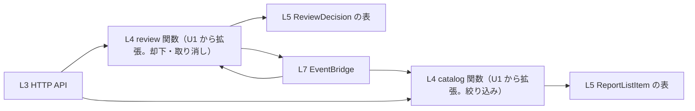

# Logical Components（論理的な構成要素）— U3 `u3-review-list`

入力: `construction/u3-review-list/nfr-requirements/`（performance・security・scalability・reliability・observability の要件）、`construction/u3-review-list/functional-design/functional-spec.md`、`construction/u1-skeleton/nfr-design/logical-components.md`（U1 の構成要素。U3 はこれに項目を足すだけ）、nfr-design-questions.md（Q1）。

U3 は**新しい構成要素を作らない**。U1 からある **2 つの既存の関数**（`review`・`catalog`）と、ReviewDecision・ReportListItem の表（L5）に、処理と項目を足すだけ（Q1）。

> **訂正（Infrastructure Design のレビューで判明）**: 本書は当初「Review と ReportCatalog はすでに同じ関数にまとまっている」という前提で書かれていたが、U1 の infrastructure-specification.md を確認すると、実際には `review`（承認、ReviewDecision の表だけの IAM 権限）と `catalog`（一覧、ReportListItem の表だけの IAM 権限）は**別々の関数**だった。Q1-A の本来のねらい（U3 のために新しい関数を増やさない）は変わらないが、「どちらの既存関数に置くか」を下のとおり訂正する。物理的な配置の最終的な正本は `construction/u3-review-list/infrastructure-design/infrastructure-specification.md`。

## 1. 構成要素の一覧（U3 での変化）

| # | 構成要素 | U1 の役割 | U3 で足す処理 | 失敗したときの影響の範囲 |
|---|---|---|---|---|
| L4（既存） | `review` 関数（Lambda） | 承認 | 却下・取り消しの処理を足す（Q1-A） | 変わらない（この部品の API だけが失敗する） |
| L4（既存） | `catalog` 関数（Lambda） | 一覧の読み出し | 絞り込みの処理を足す（Q1-A） | 変わらない（この部品の API だけが失敗する） |
| L5（既存） | ReviewDecision の表（DynamoDB） | 状態（承認・確認中） | `reason`・`reasonText`・`undoUntil` を本番の項目にする（entities.md）。`review` 関数だけが読み書きする | 変わらない |
| L5（既存） | ReportListItem の表（DynamoDB） | 一覧の行 | `duplicateSuspected`・`location`・`lastDuplicateEventAt` を本番の項目にする。絞り込みの読み出しが増える。`catalog` 関数だけが読み書きする | 変わらない |

U2 の DuplicateDetection のように「送信の前とあとの両方から呼ばれ、ロジックが複雑」という独立の理由が、却下・取り消し・絞り込み一覧にはない（どれも各部品自身の API の内側で完結する）ため、U1 の「部品ごとに 1 つの関数」の原則どおり、関数を増やさない（Q1-A）。却下・取り消しは `review` の既存の責務（承認）の延長であり、絞り込みは `catalog` の既存の責務（一覧）の延長であるため、どちらも新しい関数を作らずに済む。

## 2. 構成図（U1 からの差分）

<!-- Text fallback: review関数とcatalog関数はU1からの別々の既存の関数のまま。reviewは承認に加えて却下・取り消しを受け、ReviewDecisionの表だけを読み書きする。catalogは一覧に加えて絞り込みを受け、ReportListItemの表だけを読み書きする。状態が変わるたびにreview関数がEventBridgeへ知らせを送る。U2の重複の疑いの知らせ（duplicate.suspected）はcatalog関数が受ける。 -->

## 3. 分け方の考え方（U3 での判断）

- **却下・取り消しを `review` 関数に含める**: 承認と同じ「確認中であることを条件にした 1 回の書き換え」という同じパターンのコードであり、別の関数に分ける理由（外部サービスの呼び出し、別のアクセスパターンなど）がない（Q1-A）。
- **絞り込みを `catalog` 関数に含める**: 一覧の読み出しという既存の責務の延長であり、新しい関数を作る理由がない。読み出しの量は増える（最大 2,000 件）が、`catalog` 関数自身の時間切れの予算の中で収まる（performance-design の NFR2.12）。
- U1 と同じく、ReviewDecision・ReportListItem という 2 つの表は Review・ReportCatalog という論理的な役割（owner）のとおり、物理的にも別々の関数がそれぞれの表だけに触れる（IAM の境界が部品の境界と一致する）。

## Assumptions & Open Questions

- 絞り込み一覧の読み出し量が将来さらに増えたときの対処（索引を足すなど）は Q1-B として機能設計に記録済み。試験運用の規模では不要。 [assumption]
