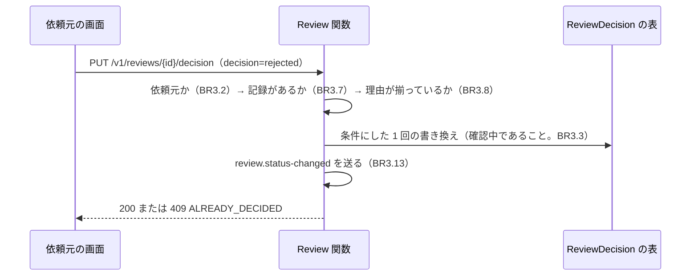
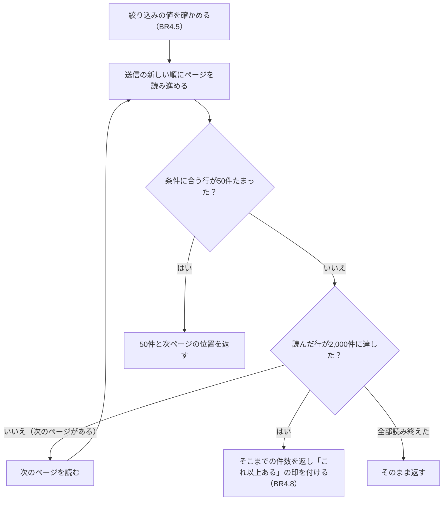

# Performance Design（性能の設計）— U3 `u3-review-list`

入力: `construction/u3-review-list/nfr-requirements/performance-requirements.md`（NFR2.12〜NFR2.14、NFR7.5〜NFR7.7）、logical-components.md、`construction/u3-review-list/functional-design/rules.md`（BR3.8〜BR3.15、BR4.5〜BR4.9）、nfr-design-questions.md（Q2）。

## 1. 却下・取り消しの時間の予算（NFR2.13・NFR2.14）

<!-- Text fallback: 却下は、依頼元かどうか・記録があるか・理由が揃っているかを確かめたあと、確認中であることを条件にした1回の書き換えで状態を変え、知らせを送って応答する。承認と同じ形。 -->

| 処理 | 見込み |
|---|---|
| 権限・記録・理由の確認（メモリ上の計算） | 0.1 秒以内 |
| 条件にした 1 回の書き換え（DynamoDB） | 0.2 秒以内（SDK のやり直しを含めても 1 秒以内） |
| 知らせの送信（EventBridge、最大 3 回のやり直し） | 最大 1.8 秒 |
| **合計（最悪）** | **約 3 秒** |

この内訳は、U1 の承認（NFR2.3「条件付きの書き込み 1 回と EventBridge への送信、最悪で約 3 秒」）とまったく同じ形で、U1 と同じく**知らせの送信（最大 3 回のやり直し）を待ってから 200 を返す**（U1 の reliability-design の届け方をそのまま踏襲。応答を返す前に知らせの送信が終わっているため、画面は 200 を受け取った時点で「却下しました」の表示に進める）。NFR2.13 の目標（3 秒以内）と同じ値で、通常は書き換えが 1 秒未満で終わるため、実際にはこれより大きく下回る。

**取り消し（NFR2.14、2 秒以内）だけは、却下・承認と異なる届け方にする**: NFR2.14 が「条件にした 1 回の書き換えだけなので承認より速い」という理由で目標を 2 秒にしている以上、承認・却下と同じ「最大 3 回のやり直しを待つ」届け方では、知らせの送信（最大 1.8 秒）が支配的になり、書き換えの速さという前提が活きない（絶対の最悪値が約 2.8 秒になり、目標を上回る）。そこで取り消しは、**知らせの送信を 1 回だけ試し、結果を待たずに応答する**設計に変える（reliability-design.md §2 で詳細を定める）。

| 処理 | 見込み |
|---|---|
| 条件にした 1 回の書き換え（DynamoDB） | 0.2 秒以内（SDK のやり直しを含めても 1 秒以内） |
| 知らせの送信（EventBridge、1 回だけ試す。結果を待たず応答する） | 0.5 秒以内（この 1 回の呼び出し自体の時間切れ） |
| **合計（最悪）** | **約 1.5 秒** |

NFR2.14 の目標（2 秒以内）に対して約 0.5 秒の余裕があり、却下・承認（最大 3 回のやり直しを待つ分、最悪約 3 秒）より確かに速い、という NFR2.14 自身の前提とも一致する。1 回の送信が失敗した場合は `eventSent=false` のまま応答を返し、U1 の `audit.recorded` の送信失敗と同じ「ログに残して本来の操作は止めない」扱いにする（reliability-design.md §2）。

関数のメモリ・時間切れは U1 の `review` 関数の設定（128 MB、時間切れ 8 秒）を変えない。却下・取り消しの処理はいずれも U1 の承認より軽いかほぼ同じで、`review` 関数に足したことによる時間切れへの影響はない。

## 2. 絞り込み一覧の読み出しの性能（NFR2.12、Q2）

**担当する関数（logical-components.md の訂正のとおり）**: 絞り込み一覧の処理は、却下・取り消し（§1）とは別の、既存の `catalog` 関数に足す（U1 からすでに一覧の読み出しを担当している関数）。以下の性能見込みは `catalog` 関数自身の時間切れの予算の中で評価する。

<!-- Text fallback: 絞り込みの値を確かめたあと、送信の新しい順にページを読み進め、条件に合う行が50件たまるか、読んだ行が上限の2,000件に達するまで続ける。上限に達したら、その時点までの件数に「これ以上ある」の印を付けて返す。 -->

**読み出し中の一時的な失敗の扱い（Q2-A）**: DynamoDB の 1 ページの読み出しが一時的なエラー（スロットリングなど）で失敗したときは、AWS SDK の標準のやり直し（最大 3 回、指数のバックオフ）に任せる。それでも失敗したときは、**そこまでに読めたページの行で打ち切り**、全件数には「これ以上ある可能性がある（見積もり）」の印を付けて返す。一覧の呼び出し自体を 502 で失敗させない（U2 の重複判定が 500 件で打ち切る設計と同じ考え方。一覧を見られないより、不完全でも見られるほうを優先する）。

この打ち切りは、上限（2,000 件）に達したときの打ち切り（BR4.8）と同じ応答の形（「これ以上ある」の印）を使い、画面側の扱いを 1 種類にする。

時間の見込みは nfr-requirements の「2. 絞り込みの読み出しの見込み」の表のとおり（最悪でも約 1.6 秒、3 秒の予算に収まる見込み）。この見積もりは暫定であり、dev の実測で確定する（nfr-requirements のとおり、届かなければまずメモリを 256 MB に引き上げる。NFR12.9）。

## 3. 画面の性能（NFR7.5〜NFR7.7）

| ID | 設計 |
|---|---|
| NFR7.5 | 「取り消す」の残り時間の表示は、状態の読み出し（`GET /v1/reviews/{id}`）が返した `undoUntil`（絶対時刻）と、画面が応答を受け取った時点の `Date.now()` の差から計算する。タイマーの起点をサーバーの絶対時刻に固定し、以後はブラウザの `setInterval` で 1 秒ごとに再計算するだけで、再度サーバーに問い合わせない |
| NFR7.6 | 絞り込みの選択（状態・印）のボタンは、U1 の UiKit の寸法（64px 以上）をそのまま使う。複数選択の見た目（チェックの印）は MUI の `ToggleButtonGroup` の選択済みスタイルで表す |
| NFR7.7 | 同時の操作で弾かれた（409）応答を受けた画面は、エラー用の赤い表示コンポーネントを使わず、一覧・詳細の再読み込みで状態を出し直す（409 の応答に含まれる `decidedByName`・`status` をその場で使い、再読み込みを待たずに「すでに確認済みです」の文言だけ即時に出してもよい） |

## Assumptions & Open Questions

- 却下の知らせの送信は、U1 の承認と同じく応答を返す前に最大 3 回のやり直しを待つ。取り消しだけは 1 回の送信だけ試して応答を返す、異なる届け方にした（NFR2.14 が「書き換えだけだから速い」という前提で目標を 2 秒にしていることと、設計の実際の処理経路を一致させるため）。失敗時の扱いは reliability-design.md §2 のとおり。 [assumption]
