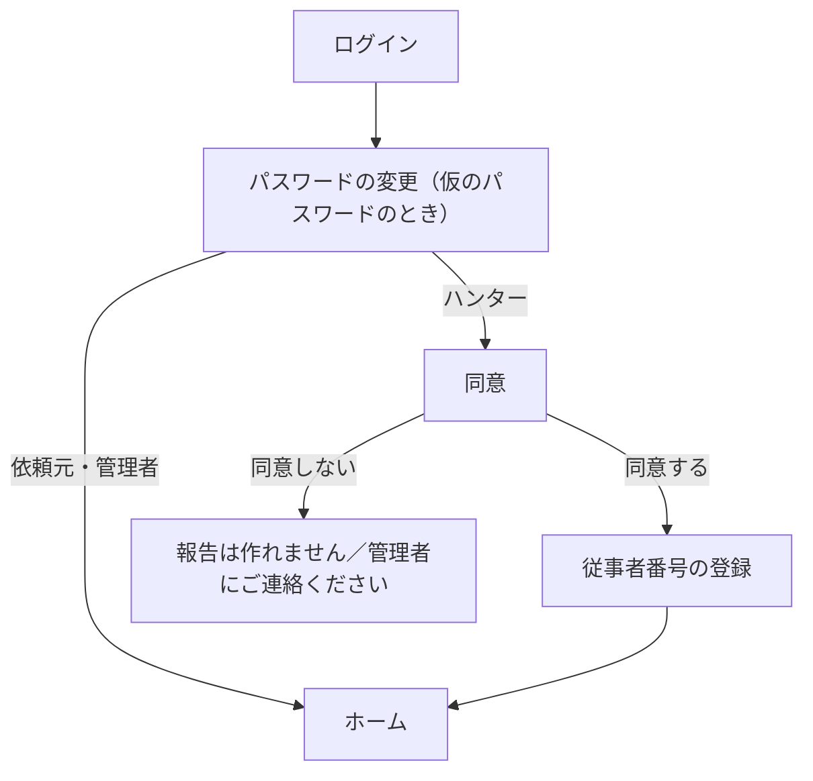
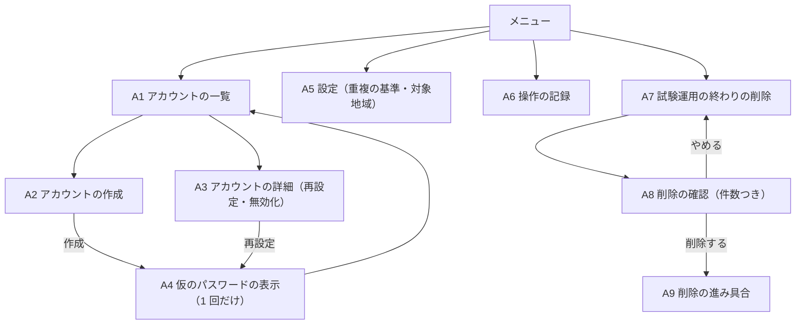

# Frontend Components（画面の部品）— U4 `u4-accounts-admin`

入力: entities.md、rules.md、functional-spec.md、`construction/u1-skeleton/functional-design/frontend-components.md`（U1 の画面）、`construction/u3-review-list/functional-design/frontend-components.md`（U3 の画面）、`inception/refined-mockups/`（画面案・interaction-spec）、`inception/user-stories/stories.md`（stories）、`inception/contract-design/contract-summary.md`（contract-summary）、functional-design-questions.md（Q1〜Q6）。

U4 では **AdminApp（管理者の画面）を新しく作り**、ハンター・依頼元の画面に**初回の手続き**を足す。報告の作成（U2）と確認・一覧（U1・U3）は変えない。

## 1. 画面の構成

### 初回の手続き（HunterApp・RequesterApp）

<!-- Text fallback: ログインのあと、仮のパスワードならパスワードの変更の画面に進む。依頼元と管理者はそのままホームへ、ハンターは同意、従事者番号の登録の順に進んでからホームへ行く。同意しない場合は、報告を作れない旨と「管理者にご連絡ください」が表示される。 -->

### 管理者の画面（AdminApp・新規）

<!-- Text fallback: 管理者の画面は、アカウントの一覧から作成と詳細（パスワードの再設定・無効化）に進む。作成と再設定のあとは仮のパスワードが 1 回だけ表示される。メニューからは、アカウントの一覧、設定、操作の記録、試験運用の終わりの削除に行ける。削除は件数つきの確認を経て、進み具合の画面に進む。 -->

## 2. 部品

### 新しく作る部品（UiKit）

| 部品 | 使う画面 | 状態・入力 | 決まり |
|---|---|---|---|
| `PasswordChangeForm` | パスワードの変更 | 新しいパスワード（8 文字以上・英字と数字）。満たさないあいだは確定できず、理由を出す | BR11.4 |
| `ConsentPanel` | 同意 | 同意する内容（氏名・位置・写真を依頼元に見せる）を読める形で出し、「同意する」「同意しない」。同意しないと、理由と「管理者にご連絡ください」 | BR11.5 |
| `HunterNumberForm` | 従事者番号 | 数字 1〜20 桁。空では登録できない | BR11.6 |
| `AccountTable` | A1 アカウントの一覧 | 役割・表示名・ID・状態。自分自身と最後の管理者には無効化のボタンを出さない。一覧を開いたときに、有効な管理者の数のずれがあれば直す（レビュー R-10） | BR11.1・BR11.9 |
| `AccountForm` | A2 作成 | 役割・表示名・ID（依頼元は所属も）。ID が重なると「この ID は使われています」 | BR11.2 |
| `TempPasswordPanel` | A4 仮のパスワード | 1 回だけ表示する。閉じると二度と見られない旨を添える。写しやすい形（区切りつき）で出す | BR11.3 |
| `SettingsForm` | A5 設定 | 距離・時間・対象地域（北・南・東・西）。範囲を外れると項目ごとに理由を出す | BR9.2 |
| `AuditTable` | A6 操作の記録 | 日時・操作した人・操作の種類・対象・結果。新しい順・50 件・次のページ。利用者の ID は出さない | BR12.1・BR12.3 |
| `DeleteConfirm` | A8 削除の確認 | 「報告 n 件と写真を削除します。よろしいですか？」＋「削除する」「やめる」 | BR13.2 |
| `DeleteProgress` | A9 削除の進み具合 | 部品ごとに「終わった・失敗した・待ち」と消した件数を出す。失敗した部品から再実行できる。5 つが終わったら件数を数え直し、0 件でなければ「削除のあとに新しい報告が届きました。もう一度削除してください」を出す | BR13.1 |

### 手を入れる部品（U1・U3 から）

| 部品 | 変える点 | 決まり |
|---|---|---|
| `AppShell` | 管理者のときだけ、メニューに「アカウント」「設定」「操作の記録」「データの削除」を出す | BR11.1 |
| `LoginForm` | ログインの応答の 3 つの印（パスワードの変更・同意・従事者番号）を見て、次の画面に振り分ける | BR11.7 |

## 3. 画面が持つ状態

| 画面 | 持つ状態 | 消えるとき |
|---|---|---|
| 初回の手続き | どの手続きまで済んだか（ログインの応答と `GET /v1/me` から取り直す） | 手続きが全部済んだとき |
| A4 仮のパスワード | 仮のパスワード（応答から受け取った 1 回だけの値） | 画面を閉じたとき（保存しない） |
| A5 設定 | 入力中の値 | 保存・やめる |
| A6 操作の記録 | 表示中のページの位置（cursor） | 画面を離れたとき |
| A9 削除の進み具合 | どの部品まで終わったか、消した件数 | 画面を離れたとき（やり直すときは最初から押し直す） |

仮のパスワードは、画面の記憶領域にもブラウザの履歴にも残さない（BR11.3）。

## 4. API とのつなぎ

| 画面の操作 | API（contract-summary） |
|---|---|
| パスワードの変更 | C1 `PUT /v1/me/password` |
| 同意 | C1 `PUT /v1/me/consent` |
| 従事者番号の登録 | C1 `PUT /v1/me/hunter-number` |
| 手続きの状態の確認 | C1 `GET /v1/me` |
| アカウントの一覧・作成 | C1 `GET /v1/admin/accounts`、`POST /v1/admin/accounts` |
| パスワードの再設定 | C1 `POST /v1/admin/accounts/{id}/password-reset` |
| 無効化・有効化 | C1 `PUT /v1/admin/accounts/{id}/status` |
| 設定の読み書き | C6 `GET /v1/admin/settings`、`PUT /v1/admin/settings` |
| 操作の記録 | C7 `GET /v1/admin/audit-entries?cursor=` |
| データの削除（5 つ） | C4・C3・C5・C17・C2 の `POST /v1/admin/*-data`（訂正。Code Generation。infrastructure-specification.md・実装と合わせた。d60e400a） |

## 5. 入力の確かめ方

| 項目 | 画面での確認 | サーバーでの確認 |
|---|---|---|
| 新しいパスワード | 8 文字以上・英字と数字。満たさないと確定できない | 同じ確認（BR11.4） |
| 従事者番号 | 数字 1〜20 桁。空では登録できない | 同じ確認（BR11.6） |
| アカウントの作成 | 役割・表示名・ID が必須。依頼元は所属も | 同じ確認＋ID の重なり（BR11.2） |
| 設定の値 | 距離 1 m 以上・時間 1 時間以上・北 > 南・東 > 西 | 同じ確認（BR9.2） |
| 無効化 | 自分自身と最後の管理者にはボタンを出さない | 同じ確認（BR11.9。画面を信用しない） |

## 6. 使いやすさ（NFR7・NFR8）

| 項目 | U4 での守り方 |
|---|---|
| ボタンの大きさ・文字 | 管理者の画面も U1 の UiKit に合わせる（64 px 以上・20 px 以上） |
| 同意の文 | 何に同意するのかを短い文と箇条書きで示す。小さな文字の長文にしない |
| 仮のパスワード | 読み上げやすい文字にし、区切って表示する（紙に書き写すため） |
| 取り返しのつかない操作 | 「すべて削除」は件数つきの確認を必ず挟む（corner-checklist「Destructive action」） |
| 状態の伝え方 | アカウントの状態（有効・無効）も、削除の進み具合も、文字とアイコンで示す |
| キーボード操作 | 管理者の画面のすべての操作をキーボードで行える |

## Assumptions & Open Questions

- 管理者の画面は、ハンター・依頼元と同じ画面の中にメニューとして置くか、別の画面として配る（4 つ目の S3 と CloudFront）かを、Infrastructure Design で決める。U1 は画面を 2 つ配る構成にしている。 [assumption]
- `AuditTable` の「操作の種類」は、`report.submitted` のような英語の値を日本語の言い回し（「報告の送信」）に置き換えて表示する。対応表は Code Generation で作る。 [assumption]
- `DeleteProgress` は画面が状態を持つだけで、サーバーは進み具合を覚えない。画面を閉じたあとにやり直すときは、最初から押し直す（各入口が何度呼んでも同じ結果になるため、問題にならない。BR13.1）。 [assumption]
