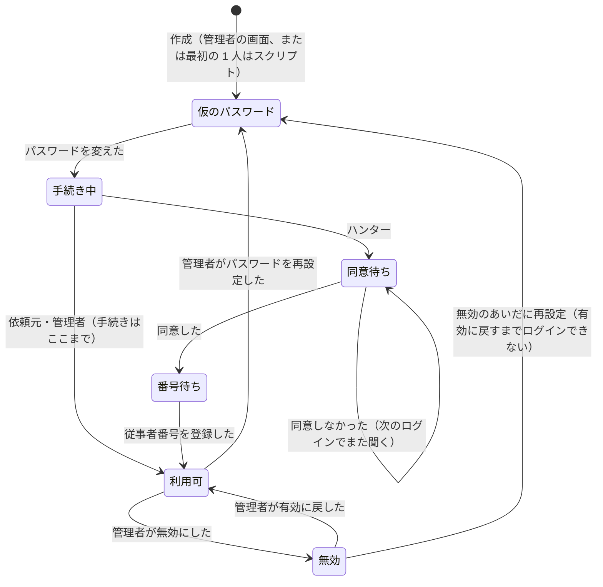
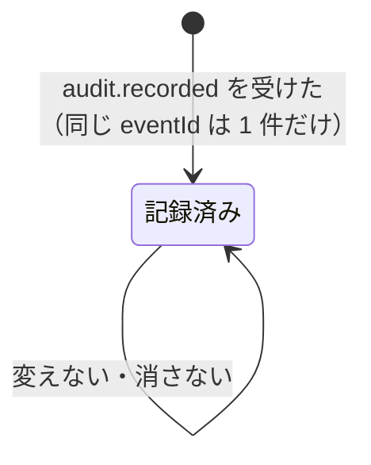
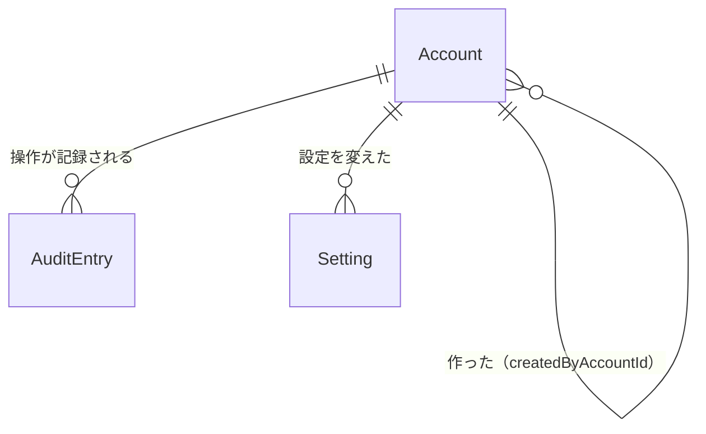

# Functional Spec（処理の流れ）— U4 `u4-accounts-admin`

入力: entities.md、rules.md、`construction/u1-skeleton/functional-design/functional-spec.md`（U1 のログインとスクリプト）、`construction/u2-report-duplicate/functional-design/functional-spec.md`（U2 の Setting）、`construction/u3-review-list/functional-design/functional-spec.md`（U3 の確認）、`inception/user-stories/stories.md`（stories。U4 のストーリー: US1.2〜US1.5・US6.1〜US6.6）、`inception/units-generation/unit-of-work.md`（unit-of-work）・`unit-of-work-story-map.md`、`inception/requirements-analysis/requirements.md`（requirements）、`inception/domain-design/components.md`（components）・`decisions.md`（ADR-006）、`inception/contract-design/contract-summary.md`（contract-summary）、functional-design-questions.md（Q1〜Q6）。

この文書は、処理の順番と状態の移り変わりの正本（source of truth）である。データの形は entities.md、判断の決まりは rules.md が正本で、ここの図と表はそれを読みやすくした写し。

## 1. U4 の範囲

| ストーリー | 内容 | U4 での範囲 |
|---|---|---|
| US1.2 | 初めてのログインでパスワードを変える | 全部 |
| US1.3 | 利用の同意をする | 全部（「同意しない」は「管理者にご連絡ください」） |
| US1.4 | 捕獲従事者の番号を登録する | 全部 |
| US1.5 | ログインしたままにする | 全部（30 日、無効化の反映） |
| US6.1 | アカウントを作る | 全部（最初の管理者はスクリプト） |
| US6.2 | パスワードを再設定する | 全部 |
| US6.3 | アカウントを無効にする・戻す | 全部 |
| US6.4 | 重複の基準と対象地域を設定する | 全部（U2 が作った読み出しに、変更の操作を足す） |
| US6.5 | 試験運用の終わりにデータを削除する | 全部（部品ごとの入口を順に呼ぶ） |
| US6.6 | 操作の記録を見る | 全部（AuditLog を新しく作る） |

U4 で、U1 のスクリプトによるアカウントの作成は**管理者の画面に置き換わる**（スクリプトは最初の管理者を作るためだけに残る）。

## 2. 流れ

### UC21 初回の手続き（US1.2〜US1.4）

```
1. 仮のパスワードでログインする（POST /v1/session）
   └ 応答に mustChangePassword・consentRequired・hunterNumberRequired が入る（C1・BR11.7）
2. mustChangePassword=true → パスワードの変更の画面だけを出す（ほかに進めない。BR11.4）
   └ 8 文字以上・英字と数字（PUT /v1/me/password）。満たさなければ理由を出す
   └ 変えたら mustChangePassword=false
3. ハンターで consentRequired=true → 同意の画面
   └ 「同意する」（PUT /v1/me/consent）→ consentedAt を記録し、次へ（AC1.3.1）
   └ 「同意しない」→ 報告を作れない旨と「管理者にご連絡ください」を出す（AC1.3.2）
     └ 次のログインでまた同意の画面が出る（AC1.3.3）
4. ハンターで hunterNumberRequired=true → 従事者番号の画面
   └ 数字 1〜20 桁（PUT /v1/me/hunter-number）。空では登録できない（AC1.4.2）
5. すべて済んだらホームへ（依頼元と管理者は 2 まで）
```

### UC22 アカウントを作る（US6.1）

```
1. 管理者が管理者の画面を開く（管理者以外は開けない。BR11.1。AC6.1.4）
2. 役割・表示名・ID（依頼元は所属も）を入れて「作成」
3. サーバー: 項目を確かめる（BR11.2）
   └ 所属がない依頼元 → 422（AC6.1.2）
   └ ID が重なる → 409（AC6.1.3。ID が重ならないことを条件にした 1 回の書き込み）
4. 仮のパスワードを作り、mustChangePassword=true でアカウントを作る（BR11.3）
   └ 認証のサービス側では「変更を求めない」状態で設定する（ログインが別の応答にならないように。レビュー R-01）
   └ 認証のサービス側の `name` に displayName を入れる（U3 の「確認した人」の表示がここから取る。レビュー R-04）
   └ 役割が管理者なら、有効な管理者の数を 1 増やす。アカウントの書き込みと同じまとまりで行う（レビュー R-07・R-10）
5. 応答で仮のパスワードを 1 回だけ返す（AC6.1.1）。保存も記録もしない
6. audit.recorded（action=account.created）を送る（BR12.5）
7. 管理者がアプリの外で本人に渡す（FR1.8）
```

### UC23 パスワードを再設定する（US6.2）

```
1. 管理者がアカウントの一覧から「パスワードの再設定」を押す
2. 新しい仮のパスワードを作り、mustChangePassword=true に戻す（BR11.3）
   └ 古いパスワードではログインできなくなる（AC6.2.1）
3. 応答で 1 回だけ返す。audit.recorded（action=account.password-reset）を送る
4. 本人は次のログインで変更を求められる（AC6.2.2。UC21 の 2）
```

### UC24 アカウントを無効にする・戻す（US6.3）

```
1. 管理者がアカウントの一覧から「無効にする」を押す
2. サーバー: 自分自身か（BR11.9）→ 対象が管理者なら、「数が 2 以上である」ことを条件に 1 減らす書き換えと、
   status=disabled にする書き換えを、1 つのまとまった書き込みで行う（BR11.9。レビュー R-02・R-10）
   └ 自分自身、または書き換えが成功しない（＝最後の 1 人）なら 422（画面にもボタンを出さない。Q5）
   └ 数えてから書く形にしない。2 人が同時に互いを無効にすると、両方通って 0 人になりうるため
   └ 片方だけが成ることはない（数が減ったのに有効なまま、は起きない）
3. 報告・確認の記録・一覧には触れない（BR11.10。AC6.3.3）
4. audit.recorded（action=account.disabled）を送る
5. ログイン中だった人は、証明の期限（1 時間）が切れたときに出し直せず、ログイン画面に移る（AC6.3.2・BR11.8）
6. 「有効に戻す」で status=active に戻る（AC6.3.4）。管理者なら有効な数を 1 増やす
```

### UC25 重複の基準と対象地域を変える（US6.4）

```
1. 管理者が設定の画面を開く（GET /v1/admin/settings）
2. 距離・時間・対象地域（北・南・東・西）を直して「保存」（PUT /v1/admin/settings）
3. サーバー: 値の範囲を確かめる（BR9.2）
   └ 距離に 0 や負の数 → 422「1 m 以上を入れてください」（AC6.4.3）
4. 保存し、updatedByAccountId と updatedAt を入れる（BR9.4）
5. audit.recorded（action=settings.updated）を送る
6. 変えた基準は、変えたあとに送られる報告から使う（AC6.4.1。U2 の決まり）
```

### UC26 試験運用の終わりにデータを削除する（US6.5）

```
1. 管理者が「すべて削除」を押す
2. 報告の件数を数えて「報告 n 件と写真を削除します。よろしいですか？」（BR13.2。AC6.5.1）
   └ 「やめる」→ 何もしない（AC6.5.3）
3. 「削除する」→ 部品ごとの入口を順に呼ぶ（BR13.1。Q2）
   <!-- 訂正（Code Generation）: infrastructure-specification.md がこの5つをPOST・末尾reporting-dataで決めており、
        実装（backend・CDK・frontend・テスト）もそちらで一貫している。この節の元の記述（DELETE・report-data）は
        古い。食い違いは人に確認し、実装済みのPOST側に合わせてここを直した（d60e400a） -->
   ① POST /v1/admin/catalog-data（一覧）
   ② POST /v1/admin/review-data（確認の記録）
   ③ POST /v1/admin/duplicate-data（索引と疑い）
   ④ POST /v1/admin/detection-data（判別の結果）
   ⑤ POST /v1/admin/reporting-data（報告と写真）
4. 各入口は消した件数を返し、もう何も無くても 0 件で成功する（何度押しても同じ結果。BR13.1）
5. 画面は、どこまで終わったかを出す。失敗したらその部品からやり直せる
6. 部品ごとに audit.recorded（action=data.deleted、detail に件数）を送る（BR13.4）
7. 5 つが終わったら、報告と一覧の件数をもう一度数えて 0 件であることを確かめる（レビュー R-05）
   └ 0 件でなければ「削除のあとに新しい報告が届きました。もう一度削除してください」と出す（AC6.5.2 に到達できるように）
8. アカウントと操作の記録は消さない（BR13.3・BR12.4。Q3）
```

知らせを受け取る側（①〜④）から先に消し、報告と写真（⑤）を最後にする。報告が残っていれば、途中で失敗してもやり直せる。

### UC27 操作の記録を見る（US6.6）

```
1. 管理者が GET /v1/admin/audit-entries を呼ぶ（管理者以外は拒む。BR12.1）
2. occurredAt の新しい順に 50 件と次のページの位置を返す（AC6.6.3）
3. 各行は「日時・操作した人・操作の種類・対象・結果」（BR12.3）
   └ 依頼元の承認なら「承認・依頼元の名前・日時・報告」（AC6.6.1）
   └ パスワードの再設定も残っている（AC6.6.2）
   └ パスワードそのものは入っていない（AC6.6.3）
```

### UC28 操作の記録を作る（NFR14）

```
1. audit.recorded の知らせを受ける（送り手はすべての部品。C15）
2. その eventId の記録がすでにあれば何もしない（BR12.2）
3. 日時・操作した人・操作の種類・対象の ID・結果と、最小限の detail だけを記録する（BR12.3）
4. 作った記録は、あとから変えない・消さない（BR12.4）
```

U1〜U3 の部品はすでに `audit.recorded` を送る形になっており、**受け手が U4 でできて初めて記録が残る**（unit-of-work の「AuditLog は U4 で作る」）。

## 3. 状態の移り変わり

### アカウントの状態（Account）



<!-- Text fallback: アカウントは仮のパスワードの状態で作られ、本人がパスワードを変えると手続き中になる。依頼元と管理者はそこで利用可になる。ハンターは同意と従事者番号の登録を経て利用可になる。同意しなかった場合は、次のログインでまた同意を求められる。管理者は利用可のアカウントを無効にでき、有効に戻せる。パスワードの再設定をすると、また仮のパスワードの状態に戻る。 -->

無効にしても、そのアカウントが送った報告・確認の記録・一覧の行は残る（BR11.10）。

### 操作の記録（AuditEntry）



<!-- Text fallback: 操作の記録は、知らせを受けたときに 1 件だけ作られ、そのあとは変わらず、消されることもない。試験運用の終わりの削除でも残る。 -->

## 4. データの関係（entities.md から作った写し）



<!-- Text fallback: アカウントは、管理者が作ったアカウントを指す関係を持つ。1 人の操作が多くの記録になる。管理者が設定を変えると、その人がアカウントとして記録される。 -->

## 5. 決まりのまとめ（rules.md から作った写し）

| 決まり | 内容 |
|---|---|
| BR11.1〜BR11.3 | 管理者だけが入れる、作成の必須の項目、仮のパスワード |
| BR11.4〜BR11.7 | 初回の手続き（パスワード・同意・従事者番号）とその順番 |
| BR11.8 | 30 日のログインの保持と、無効にしたアカウントの締め出し |
| BR11.9〜BR11.11 | 自分自身と最後の管理者、無効にしても報告は残る、最初の管理者 |
| BR12.1〜BR12.5 | 操作の記録の読める人、作り方、残す範囲、消さないこと、対象の操作 |
| BR13.1〜BR13.4 | 「すべて削除」の順番とやり直し、件数の確認、消さないもの、記録 |
| BR9.2・BR9.4 | U2 から引き継ぐ（設定の値の範囲、変更の記録） |

## 6. 例外と角のケース

| 状況 | 扱い | 決まり |
|---|---|---|
| 7 文字のパスワードを入れた | 「8 文字以上で、英字と数字を含めてください」。変わらない | BR11.4 |
| 仮のパスワードのままホームに行こうとした | パスワードの変更以外は拒む（403） | BR11.4 |
| 「同意しない」を押した | 報告を作れない旨と「管理者にご連絡ください」。次のログインでまた聞く | BR11.5 |
| 同意していないハンターが報告を送った | 422（U1・U2 の報告の決まり） | BR11.5 |
| 従事者番号を空で登録 | 「番号を入れてください」 | BR11.6 |
| 所属を選ばずに依頼元を作成 | 422「所属を選んでください」 | BR11.2 |
| すでにある ID で作成 | 409「この ID は使われています」 | BR11.2 |
| 同じ ID で 2 人が同時に作成 | ID が重ならないことを条件にした書き込みで、1 人だけ成功 | BR11.2 |
| ハンターが管理者の画面を開こうとした | 403。画面にも入口を出さない | BR11.1 |
| 管理者が自分を無効にしようとした | 422。ボタンも出さない | BR11.9 |
| 有効な管理者が 1 人だけで、その人を無効にしようとした | 422 | BR11.9 |
| 無効にしたハンターの報告 | 一覧にも詳細にも残る | BR11.10 |
| ログイン中に無効にされた | 証明の期限（1 時間）が切れたときに出し直せず、ログイン画面へ | BR11.8 |
| 31 日ぶりに開いた | ログイン画面へ | BR11.8 |
| 報告の作成中にログインが切れた | 「ログインが切れました。作成中の内容は消えました」 | BR11.8 |
| 設定の距離に 0 や負の数 | 422「1 m 以上を入れてください」 | BR9.2 |
| 対象地域で北 ≤ 南 を入れた | 422（項目ごとの理由を出す） | BR9.2 |
| 削除の途中で 1 つ失敗した | どこまで終わったかを出し、その部品からやり直せる | BR13.1 |
| もう何も無い状態で削除を押した | 0 件を返して成功する（何度押しても同じ結果） | BR13.1 |
| 削除のあとに遅れて知らせが届いた | 行が作り直されることがある。同じ順でもう一度削除する | BR13.1 |
| 削除しても残るもの | アカウントと操作の記録 | BR13.3・BR12.4 |
| 削除の最中に新しい報告が届いた | 終わったあとに数え直し、0 件でなければもう一度削除するよう促す | BR13.1 |
| 2 人の管理者が同時に互いを無効にした | 有効な数を条件にした書き換えで、1 人だけ成功する（0 人にならない） | BR11.9 |
| 管理者を作ったのに数が増えていない | 作成（画面・スクリプトの両方）で 1 増やす。増やさないと誰も無効にできなくなる | BR11.2・BR11.11 |
| 数を減らしたあとに落ちた | 1 つのまとまった書き込みなので、片方だけが成ることはない | BR11.9 |
| それでも数がずれた | 管理者がアカウントの一覧を開いたときに数え直して直す（定期の処理は作らない） | BR11.9 |
| 管理者を作ったが認証のサービスに name を入れ忘れた | U3 の「確認した人」が名前を出せない。作成のときに必ず入れる | BR11.2 |
| 同じ `audit.recorded` が 2 回届いた | eventId で 1 件だけ作る | BR12.2 |
| 操作した人のアカウントを無効にした | 記録の `actorName` は写しなので、そのまま読める | BR12.3 |

## 7. 約束（contract-summary）との違い

U4 の設計で、約束や上流の文書と変える点。**約束の文書（`contracts/openapi.yaml`・`asyncapi.yaml`）は Code Generation で更新する。**

| # | 対象 | 変える点 | 理由 |
|---|---|---|---|
| D-1 | U1 のスクリプトと U1 の決まり（BR5.1） | スクリプトに `admin` の役割を足す（U1 では「管理者は U4 で作る」として対象外だった） | 最初の管理者を誰も作れないという抜けを埋めるため（Q1） |
| D-2 | 約束 C1（`PUT /v1/admin/accounts/{accountId}/status`） | 応答に `422 LAST_ADMIN` と `422 CANNOT_DISABLE_SELF` を足す。C1 は `204` だけだった | 最後の管理者と自分自身を無効にできないようにするため（Q5・BR11.9） |
| D-3 | 約束 C1（`PUT /v1/me/password`・`PUT /v1/me/consent`・`PUT /v1/me/hunter-number` 以外のすべて） | 仮のパスワードのままの利用者には `403 PASSWORD_CHANGE_REQUIRED` を返す | 変更するまで何もできないようにするため（BR11.4。AC1.2.1 をサーバー側でも守る） |
| D-4 | 約束 C1（`GET /v1/admin/accounts`） | 一覧の行に `role` と `status` を返すと明記する（数えるため） | 「有効な管理者が 1 人だけ」の判定に要る（BR11.9） |
| D-5 | 約束 C7（`GET /v1/admin/audit-entries`） | 行に `outcome`（成功・失敗）と `actorName` を返すと明記する。利用者の ID は返さない | 記録を読む人が「何が起きたか」を判断できるようにし、利用者の ID を画面に出さないため（Q6・BR12.3） |
| D-6 | 約束 C15（`audit.recorded` の知らせ） | 知らせの中身に `actorName` と `outcome` を足す。`actorAccountId` と `occurredAt` は、知らせの共通の外側（contract-summary 2.4 の EventEnvelope）がすでに持っているため足さない | 操作の記録に「誰の名前で」「結果はどうだったか」を残すのに要る。受け手（AuditLog）が送り手に問い合わせて補う経路はない（レビュー R-03・R-09） |
| D-7 | 約束 C1（`POST /v1/session`） | 仮のパスワードでも、証明と 3 つの印を返す形を保つ（認証のサービスの「新しいパスワードが必要」という応答は使わない） | 「仮のパスワードかどうか」は MonsterNote 自身が覚え、使えなくするのは BR11.4 の決まりで行う（レビュー R-01） |
| D-8 | U1 の決まり（BR4.2。「依頼元以外403」） | `GET /v1/catalog/reports` を管理者にも開く（`requireRole(caller, 'requester', 'admin')`） | 「すべて削除」の確認画面（BR13.2・AC6.5.1）が「報告 n 件」の件数を見せる必要があり、この道以外に件数を読む手段がないため。Code Generation中に自己発見。人に確認のうえ修正（0ea1d331） |

## Assumptions & Open Questions

- U4 で管理者の画面ができたあとも、U1 のスクリプトは残す（最初の管理者を作るため、および AWS の環境を作り直したときのため）。 [assumption]
- 「同意しない」を選んだハンターのアカウントは、管理者が無効にするまで有効なまま残る（ログインはできるが報告は作れない）。FR10.5 のとおり、無効にするのは管理者の判断。 [assumption]
- 削除は試験運用を止めてから行う前提とする。止めずに行うと、遅れて届いた知らせで行が作り直されることがある（BR13.1 でやり直せる）。 [assumption]
- 操作の記録の件数は、試験運用の規模（数人・数百件の報告）では数千件程度にとどまる。ページ分けは 50 件で足りる。 [assumption]
- 操作の記録に残る個人情報は表示名だけ。試験運用そのものを終えるときは、AWS の環境ごと片付ける（`cdk destroy`）ことで記録も消える。記録だけを先に消す入口は作らない（レビュー R-06）。 [assumption]
- 有効な管理者の数（`AdminCounter`）を変えるのは 3 か所だけ: 管理者を作ったとき（画面・スクリプト）に 1 増やす、無効にしたときに 1 減らす、有効に戻したときに 1 増やす。管理者以外のアカウントでは触れない（レビュー R-07）。いずれもアカウントの書き換えと 1 つのまとまった書き込みにする（レビュー R-10）。 [assumption]
- ずれの直しは、管理者がアカウントの一覧を開いたときに数え直して行う。定期の処理は作らない（レビュー R-10）。 [assumption]
- `audit.recorded` を送るのは U1〜U3 の部品がすでに作っている形だが、U1 の Code Generation の時点では「計画のステップにないため送っていない」と記録されている（U1 の観察日誌）。U4 で受け手を作るとき、送る側が実際に送っているかを確かめる必要がある。 [assumption]
