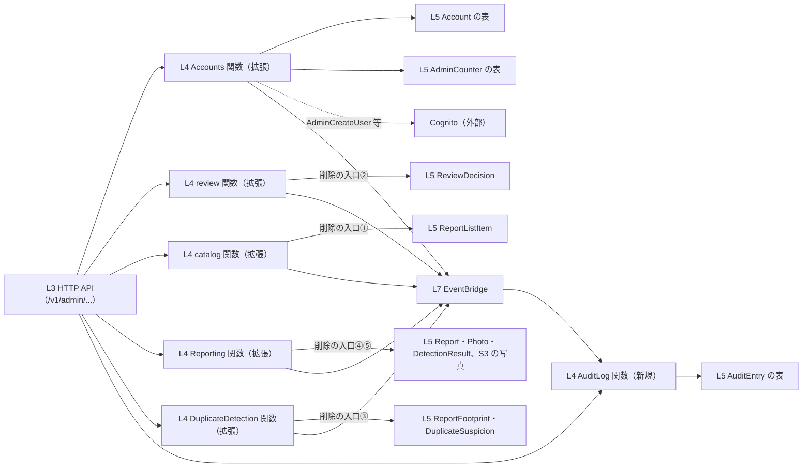

# Logical Components（論理的な構成要素）— U4 `u4-accounts-admin`

入力: `construction/u4-accounts-admin/nfr-requirements/`（performance・security・scalability・reliability・observability の要件）、`construction/u4-accounts-admin/functional-design/`（rules の BR11〜BR13、entities）、`construction/u1-skeleton/nfr-design/logical-components.md`（U1 の構成要素）、nfr-design-questions.md（Q1）。

U4 は、既存の部品の関数に処理を足すことを基本とし（Q1-A）、新しく作るのは AuditLog の関数と、AdminCounter・AuditEntry の 2 つの表だけ。

> **訂正（U3 の Infrastructure Design レビューで判明した事実にそろえる）**: U1 の実際の構成は `review`（承認。ReviewDecision の表だけ）と `catalog`（一覧。ReportListItem の表だけ）が**別々の関数**（U3 の infrastructure-design で確定）。本書は当初「Review 関数（ReportCatalog を含む）」という誤った前提で書かれていたため、下の表・構成図をこの事実に合わせて訂正する。「すべて削除」の入口を新しい関数を増やさずに置く、という Q1-A 本来のねらいは変わらない。

## 1. 構成要素の一覧（U4 での変化）

| # | 構成要素 | 既存の役割 | U4 で足す処理 | 新しい表 |
|---|---|---|---|---|
| L4（既存） | Accounts 関数 | ログイン・証明の出し直し | アカウントの作成・無効化・有効化・パスワードの再設定（管理者の画面から）。AdminCounter の読み書き | AdminCounter |
| L4（既存） | `review` 関数 | 承認・却下・取り消し | 「すべて削除」の入口②（ReviewDecision を消す） | — |
| L4（既存） | `catalog` 関数 | 一覧・絞り込み | 「すべて削除」の入口①（ReportListItem を消す） | — |
| L4（既存） | Reporting 関数（SpeciesDetection を含む） | 送信・写真の受け付け | 「すべて削除」の入口④⑤（DetectionResult・Report・Photo を消す） | — |
| L4（既存） | DuplicateDetection 関数 | 重複の判定 | 「すべて削除」の入口③（ReportFootprint・DuplicateSuspicion を消す） | — |
| L4（新規） | AuditLog 関数 | — | `audit.recorded` の受け手、操作の記録の一覧（`GET /v1/admin/audit-entries`） | AuditEntry |
| L4（既存） | Settings 関数 | 設定の読み出し | 設定の変更（`PUT /v1/admin/settings`）、変更の記録 | — |

削除の順番（BR13.1）と担当の対応: ①一覧（ReportCatalog）→ `catalog` 関数、②確認の記録（Review）→ `review` 関数、③重複の索引と疑い（DuplicateDetection）→ DuplicateDetection 関数、④判別の結果（SpeciesDetection）・⑤報告と写真（Reporting）→ どちらも Reporting 関数（U2 の決定により SpeciesDetection は Reporting 関数の中のモジュール。1 つの関数が 2 つの論理的な削除対象を順に処理する）。

削除の入口を既存の部品の関数に足す理由（Q1-A）: 削除は「その部品の自分のデータを消す」処理であり、すでにその部品のデータへの読み書き権限を持つ関数に足すほうが、新しい関数に同じ権限を複製するより IAM の構成がシンプルになる。管理者の操作という性格の違いは、認可の確認（role=admin、security-design）で区別し、関数を分ける理由にはしない。

AuditLog だけ新しい関数にするのは、どの既存の部品にも属さない、U4 で新設する部品（components.md のとおり）だからで、Q1 の対象外（元から新設が前提）。

## 2. 構成図（U1〜U3 からの差分）

<!-- Text fallback: 管理者向けのAPIは、Accounts・review・catalog・Reporting・DuplicateDetectionの各既存関数に削除やアカウント管理の処理を足す形で受ける。review関数はReviewDecisionの削除（順番②）、catalog関数はReportListItemの削除（順番①）を担当し、互いの表には触れない。Reporting関数はReport・Photo・DetectionResultの削除（順番④⑤）、DuplicateDetection関数はReportFootprint・DuplicateSuspicionの削除（順番③）を担当する。Accounts関数はCognito（外部の認証サービス）も呼ぶ。各部品はaudit.recordedの知らせをEventBridge経由で送り、新設のAuditLog関数が受けて記録を作る。 -->

## 3. 分け方の考え方（U4 での判断）

- **削除は部品の境界を越えない**: 「すべて削除」の実行順（BR13.1）は部品をまたぐオーケストレーションに見えるが、各部品の削除処理はその部品の表にしか触れない。5 つの入口を順番に呼ぶ調整（進み具合の表示、やり直し）は画面（AdminApp）が行い、サーバー側に調整役の関数を新しく作らない（単純さを優先する）。
- **AdminCounter は Accounts が持つ**: 管理者の数という値は Account の付随情報であり、Accounts 以外の部品がこの表に触れることはない（entities.md の owner のとおり）。
- **AuditLog は読み取り専用の受け手**: 他の部品のデータを変更する権限を一切持たない（IAM ロールは `audit.recorded` の受信と AuditEntry への書き込みだけに絞る）。

## Assumptions & Open Questions

- 削除の入口を各既存関数に足すことで、関数ごとの IAM ロールに「自分の表を削除してよい」権限が増える。通常の API 呼び出し（読み出し・ハンターからの送信など）の権限とは別のアクション（`dynamodb:BatchWriteItem` など）として明確に分け、Infrastructure Design で最小権限を確認する。 [assumption]
