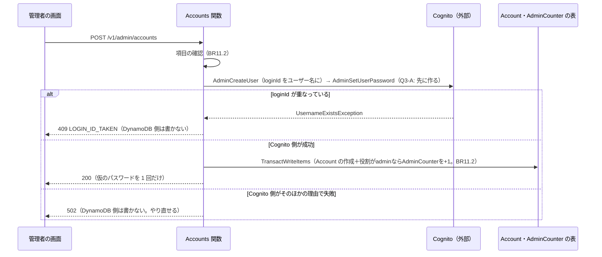
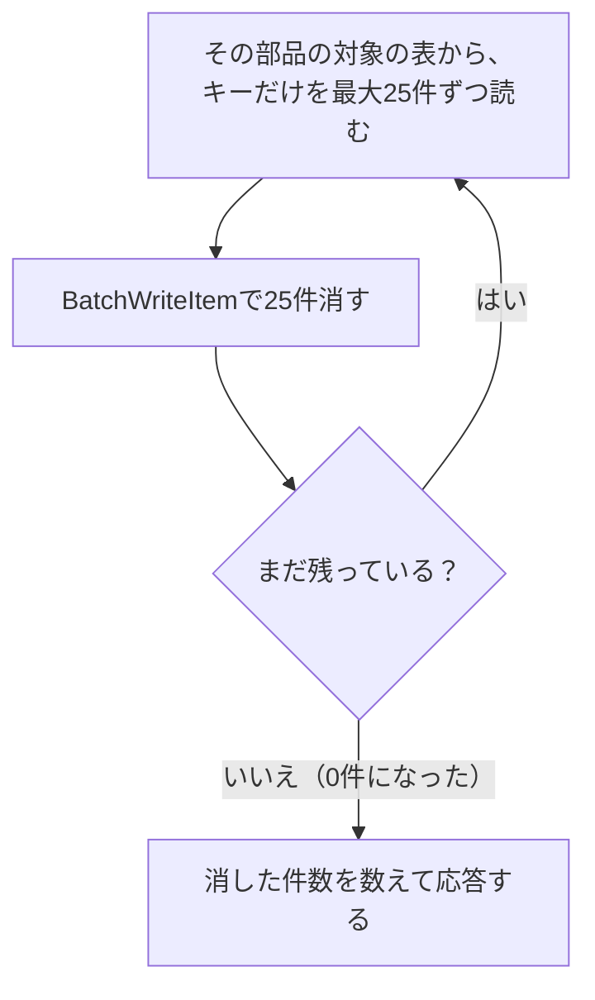

# Performance Design（性能の設計）— U4 `u4-accounts-admin`

入力: `construction/u4-accounts-admin/nfr-requirements/performance-requirements.md`（NFR2.15〜NFR2.18、NFR7.8〜NFR9.5）、logical-components.md、`construction/u4-accounts-admin/functional-design/rules.md`（BR11.2〜BR11.3、BR13.1〜BR13.4）、nfr-design-questions.md（Q2・Q3）。

## 1. アカウントの一覧・操作の記録の一覧（NFR2.15・NFR2.17）

U1 の一覧（NFR2.1：表を 1 回のクエリで読む、scan は作らない）と同じ作り方。アカウントは 20 人以下、操作の記録は月 300 件程度（NFR3.9）の規模のため、1 ページ 50 件の読み出しは余裕を持って 3 秒の予算に収まる。新しい索引の設計は不要（既存の「作成日時」「発生日時」の並びをそのまま使う）。

## 2. アカウントの作成・パスワードの再設定の時間の予算（NFR2.16、Q3）

<!-- Text fallback: アカウント作成は、項目を確かめたあと、先にCognito側の利用者を作り、成功すればDynamoDB側（AccountとAdminCounter）を1つのトランザクションで書く。Cognito側が失敗したらDynamoDB側は書かずにエラーを返し、やり直せるようにする。 -->

| 処理 | 見込み |
|---|---|
| 項目の確認（メモリ上） | 0.1 秒以内 |
| Cognito の呼び出し（`AdminCreateUser`・`AdminSetUserPassword` の 2 回） | 1 秒以内（それぞれ 0.5 秒程度の目安） |
| DynamoDB の `TransactWriteItems`（Account・AdminCounter） | 0.3 秒以内（SDK のやり直しを含めても 1 秒以内） |
| **合計（最悪）** | **約 2.1 秒** |

NFR2.16 の目標（3 秒以内）に対して約 0.9 秒の余裕がある。

> **Code Generation 向けの注記（BR11.2 の実現方法）**: 機能設計の BR11.2 は「ID が重ならないことを条件にした 1 回の書き込みで作る」と書いているが、**この「1 回の書き込み」は上のシーケンス図の `AdminCreateUser` 呼び出しを指す**。`loginId` を Cognito のユーザー名としてそのまま使うため、重複は Cognito が `UsernameExistsException` で拒む。**DynamoDB 側（Account の表）に `loginId` を条件にした書き込みや、一意性確認用の別の項目・表を追加で実装してはならない**（reliability-design.md §1 で検討し、撤回した設計）。BR11.2・entities.md（`loginId: unique: true`）が定める結果（ID は重ならない、重なれば 409 LOGIN_ID_TAKEN）はこの設計で満たされる。パスワードの再設定（`POST /v1/admin/accounts/{accountId}/password-reset`）は Cognito の `AdminSetUserPassword` 1 回と、Account の `mustChangePassword` を立てる更新だけなので、作成よりさらに軽い（最悪でも 2 秒未満）。

**Cognito 呼び出しの順番（Q3-A）**: 先に Cognito 側を作り、成功してから DynamoDB 側を書く。`loginId` を Cognito のユーザー名としてそのまま使うため、**`loginId` の一意性は Cognito 自身の `UsernameExistsException` で保証され、DynamoDB 側に別の一意性確認の仕組みを作る必要がない**（reliability-design.md §1）。DynamoDB 側が失敗した場合、Cognito 側にはアカウントが残るが、同じ `loginId` でもう一度作ろうとすると Cognito 側で重複エラーになるため、管理者がその状態に気づける（機能設計の Assumptions のとおり）。この順番により、「DynamoDB にだけ存在し、ログインできないアカウント」という気づきにくい不整合（逆順にした場合に起こりうる）を避ける。

## 3. 「すべて削除」の時間の予算（NFR2.18、Q2）

試験運用の期間の累計件数は「数百件」の見込み（NFR3.10）。設計では、安全側に見て**最大 1,000 件程度**を計画の目安とする。DynamoDB の `BatchWriteItem` は 1 回の呼び出しで最大 25 件までのため、1,000 件を消すには最大 40 回ほどのバッチ呼び出しが要る（Q2-A: 1 回の API 呼び出しの中でループして全部消し終えてから応答する）。

<!-- Text fallback: 対象の表からキーを最大25件ずつ読み、BatchWriteItemで消すのを、残りがなくなるまで繰り返す。終わったら消した件数を応答する。 -->

| 処理 | 1 回あたりの見込み | 1,000 件での合計見込み |
|---|---|---|
| キーの読み出し（25 件ずつ、Query） | 10〜30 ミリ秒 | 40 回で 0.4〜1.2 秒 |
| `BatchWriteItem`（25 件） | 10〜50 ミリ秒（一部の失敗の再試行を含めても 100 ミリ秒以内） | 40 回で 0.4〜4 秒 |
| Reporting の削除（上の処理に加え、S3 の `DeleteObjects` で写真を消す。1 回最大 1,000 件） | 1 回 100〜300 ミリ秒 | 1〜数回で 1 秒未満 |
| **合計（最悪、Reporting 以外）** | | **約 1〜5 秒** |
| **合計（最悪、Reporting）** | | **約 2〜6 秒** |

NFR2.18 の目標（10 秒以内）に対して十分な余裕がある見込み。実際の件数（試験運用の規模では数百件）ではさらに短い。

**関数の時間切れの見直し**: 削除の入口は、Review・Reporting・DuplicateDetection の各既存関数に足す（logical-components.md、Q1-A）。このうち **Reporting 関数は U2 の設計で時間切れを 9 秒に設定済み**（U2 の performance-design）。**DuplicateDetection は、U1 の「知らせの受け手の関数は 10 秒」という既定の設定（U1 の reliability-design）のまま**、U2 では変更していない。削除の最悪見込み（約 2〜6 秒）はどちらの既存設定にも収まるが、件数が設計の目安（1,000 件）を超えた場合の余裕が乏しいため、**Review・Reporting・DuplicateDetection の 3 関数の時間切れを、U4 で揃えて 15 秒に引き上げる**（NFR2.18 の 10 秒の目標に対して 5 秒の余裕を持たせる値。API Gateway の 30 秒より短い）。

この引き上げが、各関数のほかのルート（Reporting の送信・写真の受け付け、Review の承認・却下・取り消し・一覧、DuplicateDetection の重複の判定）に与える影響:

| 関数 | 現在の設定 | 既存のルートの最悪見込み | 15 秒への引き上げの影響 |
|---|---|---|---|
| Reporting | 9 秒（U2） | 送信: 約 7.6 秒（U2）、写真の完了: 約 5.8 秒（U1） | どちらも 15 秒より十分短く、挙動に変化はない |
| Review | 8 秒（U1） | 承認・却下: 約 3 秒（U1・U3）、取り消し: 約 2.8 秒（U3）、一覧: 3 秒の予算（実測は数百ミリ秒〜1.6 秒。U3） | 同上 |
| DuplicateDetection | 10 秒（U1。知らせの受け手の既定） | 重複の判定: NFR2.10 の目標どおり 10 秒以内（最大 500 件の読み出しを含む。U2） | 既存の目標（10 秒）そのものには変化がなく、15 秒への引き上げは単に外枠の余裕を広げるだけ |

いずれも実際の処理時間が大きく変わるわけではないため、時間切れの引き上げは「本当に止まってしまったとき（ハング）に AWS が強制終了するまでの時間が延びる」以上の影響はない（U2 のレビューで確認した考え方と同じ）。

## 4. 画面の性能（NFR7.8〜NFR9.5）

| ID | 設計 |
|---|---|
| NFR7.8 | 仮のパスワードの表示コンポーネントは、4 文字ごとに `-` を挟んで等幅フォントで表示する（例: `ab3d-ef7g-hk2m`）。文字サイズ 20px 以上は MUI の `Typography variant="h6"` 相当を使う |
| NFR7.9 | 「すべて削除」の確認画面は、件数を `Typography variant="h3"` 程度の大きさで表示し、「削除する」ボタンは MUI の `color="error" variant="outlined"`（目立たせない）、「やめる」は `variant="contained"`（既定の目立つ配置）にする |
| NFR7.10 | 削除の進み具合は、5 つの部品名と状態（待ち・実行中・終わった・失敗）を `Stepper` コンポーネントで表す。1 つの入口が終わるごとに次へ進める（Q2-A の設計により、1 回の呼び出しが終わった時点でその部品は完了か失敗かが確定する） |
| NFR9.5 | AdminApp のビルド対象を Chrome・Edge の最新版に限定する（Vite の `browserslist` 設定を HunterApp・RequesterApp と分ける）。E2E（Playwright）の対象ブラウザも AdminApp だけこの 2 つに絞る |

## Assumptions & Open Questions

- Cognito の `AdminCreateUser`・`AdminSetUserPassword` 1 回あたりの見込み（0.5 秒程度）は一般的な目安であり、dev の実測で確定する。 [assumption]
- 削除の計画の目安（1,000 件）を試験運用の実際の累計が超えた場合は、関数の時間切れ（15 秒）の見直しか、1 回の API 呼び出しあたりの処理件数に上限を設ける見直し（Q2-B の方式への変更）を検討する。 [assumption]
