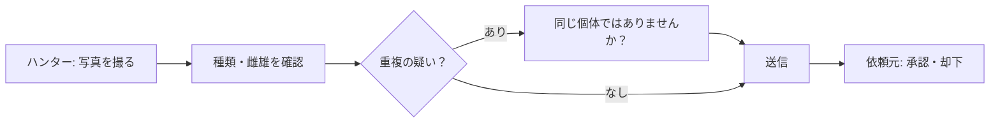

# Initiative Brief（企画書）— MonsterNote

入力: `ideation/intent-capture/intent-statement.md`（intent-statement）、`ideation/intent-capture/stakeholder-map.md`（stakeholder-map）、`ideation/market-research/competitive-analysis.md`（competitive-analysis）・`market-trends.md`・`build-vs-buy.md`、`ideation/feasibility/feasibility-assessment.md`（feasibility-assessment）・`constraint-register.md`（constraint-register）・`raid-log.md`、`ideation/scope-definition/scope-document.md`（scope-document）・`intent-backlog.md`（intent-backlog）、`ideation/rough-mockups/wireframes.md`（wireframes）・`user-flow.md`、approval-handoff-questions.md（Q1〜Q5）。Team Formation（team-assessment）は、開発者 1 人＋AI のためスキップした。

## 1. 意図と課題

山から野生動物が街に出てきて、さまざまな被害が出ている。害獣を捕獲・駆除したハンターは、成果を依頼元（市町村の担当課・猟友会）に報告して賞金を受け取る。MonsterNote は、その報告を写真付きで出し、依頼元が確認するための Web アプリである（intent-statement）。

一番の課題は、同じ個体を何度も登録して賞金を二重に受け取ろうとする人がいることである。

| 利用者 | 得られる価値 |
|---|---|
| ハンター（高齢の人が多い） | スマホ・タブレットから、大きなボタンと選択式で、少ない入力で報告できる |
| 依頼元（市町村の担当課・猟友会） | 報告を確認して承認・却下できる。重複の疑いに気づける |

決める人は開発者（プロダクトオーナー本人）。ハンターと依頼元は意見を出す人（stakeholder-map）。

成功基準（試験運用で 3 つすべてを満たす）:
1. ハンター 3 人以上が、それぞれ 1 件以上の報告を写真付きで出し、依頼元がすべてを確認できた
2. わざと同じ個体を 2 回報告したテストで、重複の疑いが見つかった
3. MonsterNote の AWS 費用が月 100 円以内

## 2. 市場の確認

- 既存の捕獲報告アプリ（スマートHOKAKU、ラクログ、ディアナなど）はある。ただし公開情報では、同じ個体の重複登録を見つける製品は確認できなかった（competitive-analysis。仮説: 差別化の余地がある）。
- MonsterNote の強み: ① 重複の自動検出と、送信前にハンター本人へ知らせること ② 高齢のハンターでも迷わない操作 ③ 運用費がほぼかからないこと。
- 業務で使うだけなら既存製品を買う方がやや有利。それでも、目的が AI-DLC の学習と教材化のため、自分で作る（build-vs-buy）。

## 3. 実現性とリスク

結論は**条件付きで実現可能**。1 か月以内に出すには機能を絞る必要があり、Scope Definition で絞った（feasibility-assessment）。

| 主なリスク | 対策 |
|---|---|
| 1 か月に間に合わない | 機能を絞った（Must 8・Should 2） |
| 写真から雌雄を自動判別できない | 最初の版はハンターが選ぶ（「不明」も可） |
| 捕獲後の写真で種類が正しく判別されない | 早い段階で実際の写真で試す。ハンターが直せる |
| 別の角度から撮った同じ個体を見逃す | 場所・日時の近さ、マーキング・尻尾と組み合わせる。最終判断は依頼元 |
| ハンターの個人情報・位置情報の扱い | 利用開始時の同意。見せる相手を限る |

守る制約は constraint-register の 20 件。主なもの: 費用は月 100 円以内、常に課金されるサービスは使わない、共用アカウントの別プロジェクト（mononoke）に触れない、デプロイ前に人へ確認する、秘密情報をコミットしない。

これらのリスクと対策は、このまま受け入れた（Q2）。

## 4. 範囲

最初の版（試験運用。ハンター数人と、市町村の担当課・猟友会の 2 組織）の範囲（scope-document、intent-backlog）:

| 区分 | 機能 |
|---|---|
| Must | F1 登録・ログイン・同意・捕獲従事者の番号 ／ F2 写真付きの報告 ／ F3 種類の判別と修正 ／ F4 雌雄の選択 ／ F6 重複の疑いの検出（場所・日時） ／ F9 送信前の通知 ／ F10 依頼元の確認 ／ F13 交付金の項目 |
| Should（余裕があれば） | F7 重複の検出（写真） ／ F8 クマの月の輪の照合 |
| 次の版 | F5 雌雄の自動判別 ／ F11 お客様による履歴の参照 ／ F12 レポートの出力 |
| 範囲の外 | 賞金の支払い ／ 圏外での報告の作成 |

作る順番: 価値が先。「ハンターが報告する → 依頼元が確認する」の流れを最初に通し、種類の判別・交付金の項目、重複の検出の順に足す。

## 5. 画面のイメージ

詳しくは wireframes と user-flow。

- ハンター: ログイン（初回は同意と従事者番号）→ ホーム（大きな「報告する」ボタンと、自分の報告の一覧）→ 1 画面に 1 つずつ進む報告の作成（全身の写真 → 尻尾の写真 → 種類の確認 →〈クマなら胸の写真〉→ 雌雄の選択 → 内容の確認）→ 送信完了
- 送信前に重複の疑いがあれば「同じ個体ではありませんか？」と表示する。「別の個体なので送る」か「送るのをやめる」を選ぶ
- 依頼元: 報告の一覧（確認中・重複の疑いで絞り込む）→ 詳細 → 承認・却下（パソコンとスマホの両方で使う）
- 文字は 20px 以上、ボタンは高さ 64px 以上。Google のマテリアルデザインに沿う

<!-- Text fallback: ハンターが写真を撮り、種類と雌雄を確認する。重複の疑いがあれば「同じ個体ではありませんか？」と確認してから送信し、なければそのまま送信する。依頼元が承認か却下をする。 -->

画面案は目指す姿と合っている。残った小さな指摘（却下理由「その他」の自由記入、下書きがスマホの中にしか残らないこと）は要件の段階で扱う（Q4）。

## 6. 体制と約束

- 体制: 開発者 1 人＋AI。チームを組まないため Team Formation はスキップした。
- 期間: 1 か月以内（Q3）
- 費用: AWS の費用は MonsterNote の分で月 100 円以内（Q3）
- 関係者の合意: 決める人（開発者本人）として、ここまでの意図と範囲に同意した。ハンターと依頼元には試験運用の前に説明する（Q1）

## 7. 判断: Go

**Go。Inception（要件・設計）に進む**（Q5）。

Inception に引き継ぐ確認事項:
- Must の 8 件が 1 か月に収まるかを、Delivery Planning で見積もる（intent-backlog）
- 国の交付金の実績報告に必要な項目と書式を、最新のマニュアルで確かめる（raid-log の I2）
- 却下の理由の選択肢、「その他」の自由記入、下書きを残す場所（user-flow、Q4）
- 圏外での利用が本当に要らないかを、試験運用の前に確かめる（competitive-analysis）

## Assumptions & Open Questions

- 試験運用の件数は月 50 件未満、写真は月 150 枚程度とした見込み（raid-log の A1）で、費用の見通しはこの件数に基づく。 [assumption]
