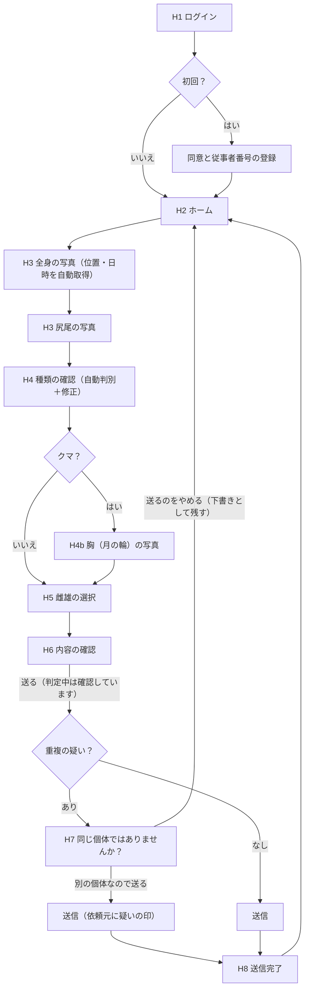
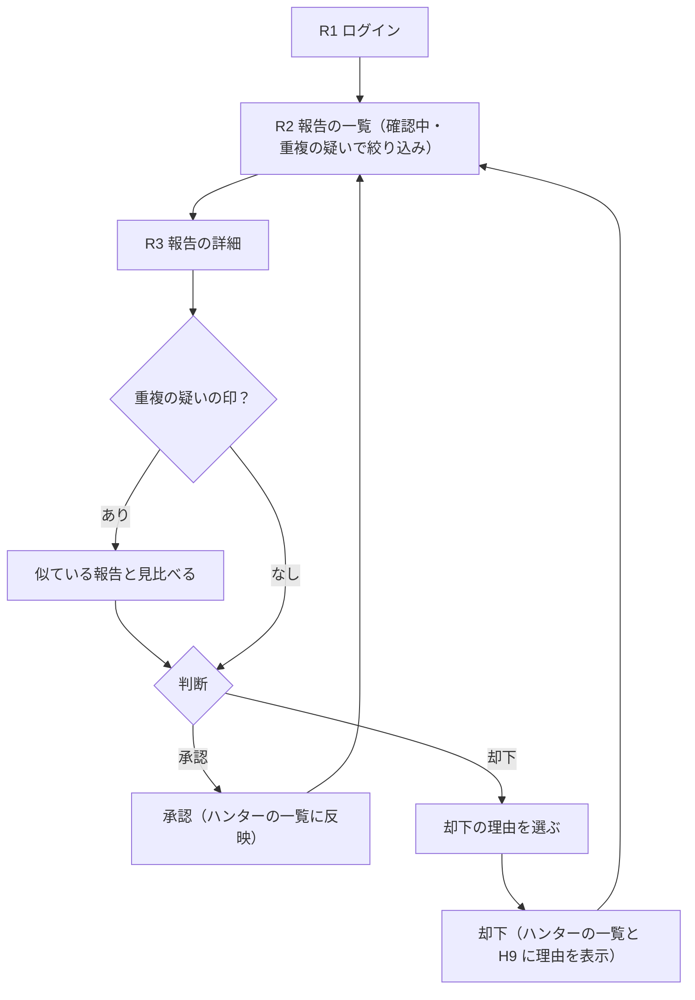

# User Flow — MonsterNote 最初の版

入力: `ideation/intent-capture/intent-statement.md`（intent-statement）、`ideation/scope-definition/scope-document.md`（scope-document）、`ideation/scope-definition/intent-backlog.md`（intent-backlog）、wireframes.md、rough-mockups-questions.md（Q1〜Q8）。

## 1. ハンターの報告の流れ（中心の流れ）



<!-- Text fallback: ログイン後、初回なら同意と従事者番号を登録してホームへ。ホームから全身、尻尾の写真を撮り（位置と日時は自動）、種類を確認する。クマなら胸の写真を追加し、雌雄を選び、内容を確認する。重複の疑いがあれば「同じ個体ではありませんか？」を表示し、送るなら依頼元に疑いの印付きで送信、やめるならホームへ戻る。疑いがなければそのまま送信し、送信完了からホームへ戻る。 -->

| 流れ | 内容 |
|---|---|
| 担当 | ハンター |
| きっかけ | 害獣を捕獲・駆除した |
| 成功 | 報告が送られ、ホームの一覧に「確認中」で表示される |
| 送るのをやめたあと | 写真と入力内容は下書きとしてホームの一覧に残る → 開くと内容の確認（H6）から再開、または削除 |
| 確認が長引いたとき | ホームと H9 に「送ってから n 日」。7 日を過ぎたら依頼元に連絡するよう案内（アプリからの催促はしない）。依頼元の一覧では 7 日以上の報告に印 |
| 却下のあと | ホームの一覧で「却下」の報告を開く（H9）→ 却下の理由を見る → 「撮り直して新しく報告する」で H3 から新しい報告を作る |
| エラーの流れ | 位置が取れない → 位置情報をオンにする手順 → 撮り直し ／ 送信できない → 内容を残したまま「もう一度」 ／ 種類を判別できない → 手で選ぶ |

## 2. 依頼元の確認の流れ



<!-- Text fallback: 依頼元はログインして報告の一覧を開き、確認中や重複の疑いで絞り込む。詳細を開き、重複の疑いの印があれば似ている報告と見比べる。承認するか、理由を選んで却下し、結果はハンターの一覧に反映され、依頼元は一覧に戻る。 -->

| 流れ | 内容 |
|---|---|
| 担当 | 依頼元（市町村の担当課・猟友会） |
| きっかけ | 確認待ちの報告がある |
| 成功 | 報告が承認または却下され、ハンターの一覧に反映される（賞金の支払いはアプリの外） |
| エラーの流れ | 操作を誤った → 数秒間の「取り消す」で戻す ／ 読み込めない → 「もう一度」 |

## 3. 画面の構成（情報の並び）

```
Hunter
  +-- H1 Login (first time: consent, hunter ID)
  +-- H2 Home
        +-- New report: H3 body -> H3 tail -> H4 kind -> (H4b chest) -> H5 sex -> H6 check -> (H7 suspect) -> H8 done
        +-- My reports (list, state) -> H9 My report detail (state, reject reason, new report)

Requester
  +-- R1 Login
  +-- R2 Report list (filter: checking / approved / rejected / suspect)
        +-- R3 Report detail (photos, data, suspect, approve / reject)
```

<!-- Text fallback: ハンター側はログイン（初回は同意と従事者番号）とホームがあり、ホームから新しい報告（全身、尻尾、種類、クマなら胸、雌雄、確認、重複の疑い、完了）と自分の報告の一覧に進む。依頼元側はログイン、報告の一覧（絞り込み）、報告の詳細（写真、内容、重複の疑い、承認・却下）。 -->

ハンター側は、報告の作成を除き、どの画面もホームから 1 回の操作で届く（ホームの一覧 → 自分の報告の詳細 H9）。報告の作成は 1 本道のステップ（通常 5、クマのときは 6）。依頼元側は一覧と詳細の 2 階層。

## 4. 成功基準との対応（scope-document）

| 成功基準 | 対応する流れ |
|---|---|
| 1. ハンター 3 人以上が写真付きで報告し、依頼元がすべてを確認 | 1 の流れ（H1〜H8）と 2 の流れ（R1〜R3） |
| 2. 同じ個体を 2 回報告したテストで疑いが見つかる | 1 の流れの H7 と、2 の流れの「重複の疑いの印」 |
| 3. 費用が月 100 円以内 | 画面の流れには関係しない（constraint-register の費用の制約で守る） |

## Assumptions & Open Questions

- 却下の理由の選択肢（重複・写真が不十分・その他）は、依頼元に確認して要件の段階で決める。 [assumption]
