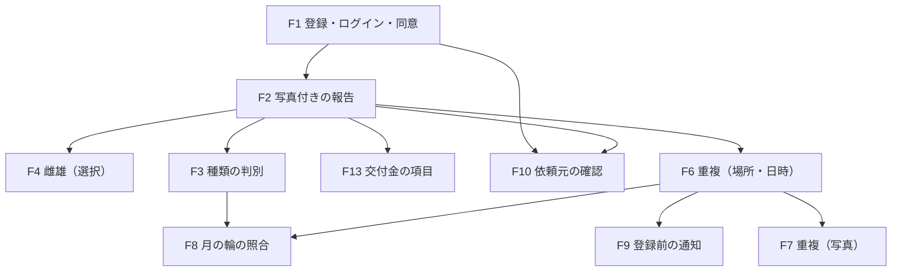

# Intent Backlog — MonsterNote

入力: `ideation/intent-capture/intent-statement.md`（intent-statement）、`ideation/feasibility/feasibility-assessment.md`（feasibility-assessment）、`ideation/feasibility/constraint-register.md`（constraint-register）、scope-document.md、scope-definition-questions.md（Q1〜Q7）。

この一覧は、後の Inception で要件と作業単位（Unit）に分ける元になる「作業のかたまり」（proto-Unit）である。

## 1. 優先度付きの一覧（MoSCoW）

| 順 | # | 機能 | 優先度 | 実現性 | 依存 | 成功基準との関係 |
|---|---|---|---|---|---|---|
| 1 | F1 | ハンターの登録・ログイン・利用開始時の同意・捕獲従事者の番号 | Must | 高 | なし | 指標 1（ハンター 3 人以上） |
| 2 | F2 | 写真付きの報告（位置・日時の自動取得、撮影の案内） | Must | 高 | F1 | 指標 1 |
| 3 | F4 | 雌雄の記録（ハンターが選ぶ。「不明」も可） | Must | 高 | F2 | — |
| 4 | F10 | 依頼元による報告の確認（承認・却下） | Must | 高 | F1・F2 | 指標 1（依頼元がすべて確認） |
| 5 | F3 | 写真からの種類の判別とハンターによる修正 | Must | 中 | F2 | — |
| 6 | F13 | 国の交付金の実績報告に使える項目の記録 | Must | 中 | F1・F2 | — |
| 7 | F6 | 重複の疑いの検出（場所・日時の近さ） | Must | 高 | F2 | 指標 2（重複テスト） |
| 8 | F9 | 登録前にハンターへ重複の疑いを知らせる | Must | 高 | F6 | — |
| 9 | F7 | 重複の疑いの検出（同じ写真・ほぼ同じ写真） | Should | 中 | F6 | 指標 2 を強める |
| 10 | F8 | クマの月の輪による個体の照合 | Should | 低 | F3・F6 | 指標 2 を強める |
| — | F5 | 雌雄の自動判別 | Won't（次の版） | 低 | F4 | — |
| — | F11 | お客様による報告履歴の参照 | Won't（次の版） | 中 | F1・F10 | — |
| — | F12 | レポート（PDF など）の出力 | Won't（次の版） | 中 | F10 | — |

指標 3（月 100 円以内）は特定の機能ではなく、すべての機能が constraint-register の費用の制約（C-C1〜C-C4）を守ることで満たす。

並び順は「価値が先」（Q4）: 報告→確認の流れ（F1・F2・F4・F10）を先に通し、判別・交付金の項目（F3・F13）、重複検出（F6・F9）、余裕があれば F7・F8 の順に足す。

## 2. 依存関係

<!-- Text fallback: F1 が F2 の前提。F2 から F4、F3、F13、F10、F6 に分かれる。F10 は F1 にも依存する。F6 から F9 と F7 に進む。F8 は F3 と F6 の両方に依存する。 -->

## 3. 期限との関係

全体で 1 か月以内（Q5）。Must の 8 件で 1 か月の大半を使う見込み（仮定）。Should の 2 件は、Must がすべて終わった後に残った時間で挑戦する。

## Assumptions & Open Questions

- Must の 8 件が 1 か月の中に収まるかは、Inception の Delivery Planning で見積もって確かめる。 [assumption]
