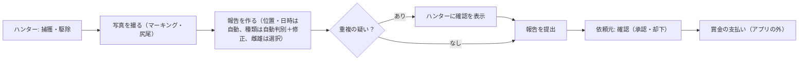

# Scope Document — MonsterNote 最初の版（試験運用）

入力: `ideation/intent-capture/intent-statement.md`（intent-statement）、`ideation/feasibility/feasibility-assessment.md`（feasibility-assessment）、`ideation/feasibility/constraint-register.md`（constraint-register）、scope-definition-questions.md の回答（Q1〜Q7）。

## 1. 最初の版の目的

害獣を捕獲・駆除したハンターが写真付きで報告し、依頼元（市町村の担当課・猟友会）が確認する流れを、1 か月以内に試験運用できる状態にする。同じ個体の重複登録を見つけて、賞金の二重取りを防ぐ（intent-statement）。

成功基準（intent-statement の Success Metrics）:
1. ハンター 3 人以上が、それぞれ 1 件以上の報告を写真付きで提出し、依頼元がすべてを確認（承認・却下）できた
2. わざと同じ個体を 2 回報告したテストで、重複の疑いが見つかった
3. MonsterNote の AWS 費用が月 100 円以内（タグ別に確認）

## 2. 範囲に入るもの（In）

| # | 機能 | 優先度 |
|---|---|---|
| F1 | ハンターの登録・ログイン・利用開始時の同意・捕獲従事者の番号 | Must |
| F2 | 写真付きの報告（位置・日時の自動取得、国のマニュアルに沿った撮影の案内: マーキング・尻尾の写真） | Must |
| F3 | 写真からの種類の判別（クマ・イノシシ・シカ）と、ハンターによる修正 | Must |
| F4 | 雌雄の記録（ハンターが大きなボタンで選ぶ。「不明」も可） | Must |
| F6 | 重複の疑いの検出（場所・日時の近さ） | Must |
| F9 | 登録前にハンターへ重複の疑いを知らせる | Must |
| F10 | 依頼元による報告の確認（承認・却下） | Must |
| F13 | 国の交付金の実績報告に使える項目の記録 | Must |
| F7 | 重複の疑いの検出（同じ写真・ほぼ同じ写真） | Should |
| F8 | クマの月の輪による個体の照合（余裕があれば挑戦し、間に合わなければ次の版） | Should |

## 3. 範囲に入らないもの（Out: 次の版で検討）

| # | 機能 | 理由 |
|---|---|---|
| F5 | 雌雄の自動判別（自前の写真解析ロジック） | 実現性が低く、1 か月では難しい（feasibility-assessment）。最初の版はハンターが選ぶ（Q1） |
| F11 | お客様（導入を検討する自治体）による報告履歴の参照 | 1 か月の期限を守るため次の版に回す（Q3） |
| F12 | 報告をレポート（PDF など）にまとめて出力 | 同上（Q3） |
| — | 圏外での報告の作成 | 不要（Feasibility の Q6） |
| — | 賞金の支払い | アプリの外で行う（Intent Capture の Q11） |

注: F11 を次の版に回したため、ハンターの同意（F1）は、次の版でお客様に履歴を見せる前提として最初の版から取っておく。

## 4. 作る順番

価値が先（Q4）。

1. 「ハンターが報告する → 依頼元が確認する」の一連の流れを最初に通す（F1・F2・F10、F4 の手動選択）
2. 種類の判別と修正（F3）、交付金の実績報告の項目（F13）を足す
3. 重複の疑いの検出と登録前の通知（F6・F9）を足す
4. 余裕があれば F7、F8 の順に挑戦する

## 5. 期限と制約

- 全体で 1 か月以内。機能ごとの期限はない（Q5、Feasibility の Q7・Q8）。
- 守る制約は constraint-register の 20 件（費用は月 100 円以内、常時課金のリソースを使わない、mononoke のリソースに触れない、デプロイ前に人へ確認、秘密情報をコミットしない など）。

## 6. 価値の流れ（Value Stream）

<!-- Text fallback: ハンターが捕獲・駆除し、マーキングと尻尾を含む写真を撮る。報告を作る際、位置と日時は自動、種類は自動判別と修正、雌雄は選択。重複の疑いがあればハンターに確認を表示してから提出し、なければそのまま提出する。依頼元が承認・却下し、賞金はアプリの外で支払う。 -->

## Assumptions & Open Questions

- F8（クマの月の輪の照合）は、捕獲後の写真で使えるかが未確認のため、挑戦しても次の版に回る可能性がある。 [assumption]
