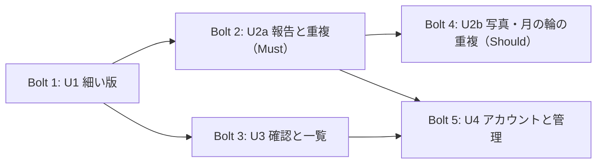

# Bolt Plan（作る順の計画）— MonsterNote

入力: `inception/requirements-analysis/requirements.md`（requirements）、`inception/user-stories/stories.md`（stories）、`inception/refined-mockups/mockups.md`（mockups）、`inception/domain-design/components.md`（components）、`inception/units-generation/unit-of-work.md`（unit-of-work）・`unit-of-work-dependency.md`（unit-of-work-dependency）・`unit-of-work-story-map.md`（unit-of-work-story-map）、`inception/contract-design/contract-summary.md`（contract-summary）、`inception/practices-discovery/team-practices.md`（team-practices）、delivery-planning-questions.md（Q1〜Q8）。

**Bolt**（ボルト）は、1 つ以上の Unit（作る単位）をまとめて、動くものができるところまで一通り作る 1 回分の作業。**細い版**（walking skeleton、ウォーキングスケルトン）は、部品がつながることを確かめるために本当の機能より先に作る、端から端まで一通り動く最小の版。

## 1. 全体の流れ

<!-- Text fallback: Bolt 1（U1 細い版）が最初。そのあと Bolt 2（U2 の Must の部分）と Bolt 3（U3）を同時に進める。Bolt 4（U2 の Should の部分）は Bolt 2 のあと。Bolt 5（U4）は Bolt 2 と Bolt 3 のあと。Bolt 4 は時間が足りなければ次の版に回す。 -->

| 順 | Bolt | Unit | 同時に進めるもの | 細い版 |
|---|---|---|---|---|
| 1 | Bolt 1 | U1 `u1-skeleton` | なし | 🦴 はい |
| 2 | Bolt 2 | U2 `u2-report-duplicate` の Must の部分（U2a） | Bolt 3 | — |
| 2 | Bolt 3 | U3 `u3-review-list` | Bolt 2 | — |
| 3 | Bolt 4 | U2 `u2-report-duplicate` の Should の部分（U2b） | Bolt 5 と同時でもよい | — |
| 3 | Bolt 5 | U4 `u4-accounts-admin` | Bolt 4 と同時でもよい | — |

Bolt 4 と Bolt 5 は、Bolt 2 と Bolt 3 が終わってから進める。Bolt 4（Should）は、1 か月の残りが足りなければ次の版に回す（scope-document）。

**Unit と Bolt の関係の注意**: AI-DLC の Construction が作る順に使うのは、unit-of-work-dependency の依存関係（U1 → U2・U3 → U4）である。この計画は、その依存の中での経済的な理由（なぜこの順か）と、各 Bolt の完了条件を記録するもの。U2 を Bolt 2 と Bolt 4 に分けるのは、U2 の作業の中での区切り（Should を後に回せるようにするため）で、Unit は U2 のまま 1 つである。

## 2. Construction の進め方（設定）

| 設定 | 値 | 理由 |
|---|---|---|
| 進め方の単位 | ステージごと（stage-major。設計の各ステージを全 Unit まとめて進める） | U2 と U3 を同時に進めるため（Q4・Q7） |
| コードの生成 | 同時に進める（swarm。依存のない Unit を別々の作業ブランチで同時に作る） | 同上 |
| 確認の区切り | 区切りごとに人が確認する（Construction Checkpoints: enabled） | team-practices |
| 細い版 | U1 は、ほかの Unit より先に設計からコードの生成まで通し、dev で動くことを人が確かめて承認してから次に進む（進め方の設定に関係なく） | team-practices、org.md |

## 3. 各 Bolt

### Bolt 1 — U1 `u1-skeleton`（細い版） 🦴

- **Unit**: U1
- **ストーリー**: US1.1、US2.1、US4.1、US4.2、US4.3、US5.1
- **確かめる構成の部分**: ログインの証明（Accounts と認証のサービス）→ 写真の受け付け（期限付きのアップロード用 URL と写真の保存場所）→ 報告の保存（Reporting とデータベース）→ 「報告が保存された」知らせ（Review・ReportCatalog に届く仕組み）→ 一覧と承認（ReportCatalog・Review）→ 2 つの画面（HunterApp・RequesterApp）の公開
- **完了の条件**:
  - 6 ストーリーの受け入れ基準を満たすテストが通る（TDD、行カバレッジ 80% 以上）
  - 手元で `npm run verify` が通る
  - 人の確認のあと dev にデプロイし、`npm run smoke` が通る
  - 手順書で作ったハンターと依頼元のアカウントで、「ログイン → 写真 1 枚の報告 → 依頼元が承認 → ハンターの一覧に承認」を実際に操作して確かめる
  - MonsterNote のタグ別の費用を請求コンソールで確かめ、月 100 円に収まる見込みであることを記録する（Q6）
  - すべてのリソースにタグ、Lambda のメモリ 128〜256 MB、ログの保存期間 14 日以内、API の流量の制限（project.md）
- **確かめること（仮説）**: 1 つの CDK アプリ・Lambda・1 つの API の入口・知らせの仕組みで、報告から承認までがつながり、無料枠の中で動く。
- **見せるもの（デモ）**: スマホで写真 1 枚の報告を送り、パソコンの依頼元の画面で承認し、スマホの一覧が「承認」に変わる。

### Bolt 2 — U2a 報告と重複（Must）

- **Unit**: U2（Must の部分）
- **ストーリー**: US2.2〜US2.11、US3.1〜US3.3
- **中の順**: 種類の判別（US2.6）と重複の判定（US3.1〜US3.3）を先に作り、そのあと報告の作成の残りの画面（Q7 の A）
- **完了の条件**:
  - 13 ストーリーの受け入れ基準を満たすテストが通る（TDD、行カバレッジ 80% 以上）
  - 種類の判別: 「判別できた」（80% 以上）と「判別できなかった」の両方の流れが動く（試験用の写真の正答率は確かめない。Q8）
  - 重複の判定: 800 m・24 時間・種類違い・境界（1,000 m・24 時間ちょうど）・ほぼ同時の 2 件のテストが通る
  - dev にデプロイして（人の確認のあと）、7・8 ステップの報告と重複の疑いの確認を実際に操作して確かめる
  - 種類の判別（AWS の画像認識サービス）の呼び出し回数と費用を確かめ、月 100 円に収まる見込みを記録する（Q6）
- **確かめること（仮説）**: 高齢のハンター向けの 7・8 ステップの報告が最後まで送れ、同じ個体の 2 回目の報告に重複の疑いが付く（成功の判定②）。
- **見せるもの**: 同じ地点・同じ日のイノシシを 2 回報告し、2 回目に「同じ個体ではありませんか？」が出る。

### Bolt 3 — U3 確認と一覧

- **Unit**: U3
- **ストーリー**: US4.1（絞り込み）、US4.4〜US4.7、US5.2・US5.3
- **完了の条件**:
  - 7 ストーリーの受け入れ基準を満たすテストが通る（TDD、行カバレッジ 80% 以上）
  - 同時の操作（先着）、10 秒の取り消し、知らせの順番の入れ替わり（contract-summary 2.5）のテストが通る
  - 重複の疑いの印は、約束どおりの試験用の知らせ（`duplicate.suspected`）で確かめる（Bolt 2 と同時に作るため）。Bolt 2 と Bolt 3 の両方を取り込んだあと、dev で実際の知らせでも確かめる
  - dev にデプロイして（人の確認のあと）、却下・取り消し・絞り込みを実際に操作して確かめる
- **確かめること（仮説）**: 市町村と猟友会の 2 人が同じ報告を操作しても結果が 1 つになり、ハンターに却下の理由が伝わる。
- **見せるもの**: 2 つのブラウザで同じ報告を同時に承認・却下し、後の人に「すでに確認済みです」が出る。

### Bolt 4 — U2b 写真・月の輪の重複（Should）

- **Unit**: U2（Should の部分）
- **ストーリー**: US7.1、US7.2
- **完了の条件**: 2 ストーリーの受け入れ基準を満たすテストが通る。dev で同じ写真の 2 回目の報告に「重複の疑い（写真）」が付く。月の輪の照合が間に合わなければ US7.2 を次の版に回し、その判断を記録する。
- **確かめること（仮説）**: 写真の使い回しを、場所・日時の判定とは別の手がかりで見つけられる。
- **見せるもの**: 同じ写真で 2 回報告し、2 回目に写真の重複の印が付く。
- **注意**: 1 か月の残りが足りなければ、この Bolt ごと次の版に回す（Must ではない）。

### Bolt 5 — U4 アカウントと管理

- **Unit**: U4
- **ストーリー**: US1.2〜US1.5、US6.1〜US6.6
- **完了の条件**:
  - 10 ストーリーの受け入れ基準を満たすテストが通る（TDD、行カバレッジ 80% 以上）
  - 管理者の画面でアカウントを作り、そのアカウントで初回の手続き（パスワード変更 → 同意 → 従事者番号）を通る
  - 試験運用の終わりの削除で、5 つの部品のデータがすべて消えることを dev で確かめる（人の確認のあと）
  - 試験運用に入る前の最終確認として、MonsterNote のタグ別の費用を確かめる（Q6）
- **確かめること（仮説）**: 手順書なしで、管理者が画面だけで試験運用の参加者を準備・管理できる。
- **見せるもの**: 管理者がハンターのアカウントを作り、そのハンターが初回の手続きを終えて報告する。

## 4. 要件の変更（Q8）

| 要件 | 変更前 | 変更後 | 理由 |
|---|---|---|---|
| requirements FR3.5（種類の判別の精度） | 3 種類各 10 枚以上の写真で確かめ、結果を Build and Test で記録する | 試験用の写真は集めず、精度（正答率 70% 以上の目標）は試験運用で確かめる。Build and Test では、判別の仕組みが動くこと（判別できた・できなかったの両方の流れ）だけを確かめる | 人の判断（Q5・Q8）。試験用の写真を集める手間を省く。判別できなくてもハンターが直せるため、報告は作れる |

この変更は Delivery Planning の決定として記録する。Build and Test と試験運用の計画は、この表に従う。

## Assumptions & Open Questions

- Bolt 2 と Bolt 3 を同時に進めるため、取り込みのときに CDK のスタックや API の定義で衝突することがある。衝突を直す時間を、1 か月の中で見込んでおく。 [assumption]
- 各 Bolt の日数は見積もっていない（開発者 1 人＋AI で、AI の作業の速さがまだ分からないため）。Bolt 1 の実績で、残りが 1 か月に収まるかを見直す。 [assumption]
