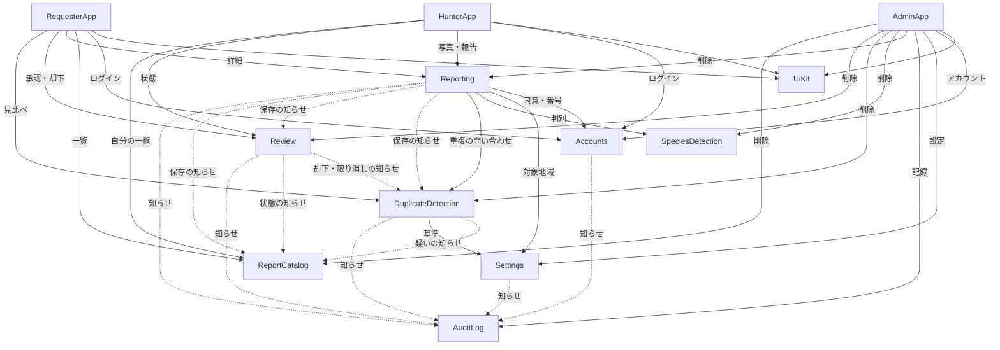
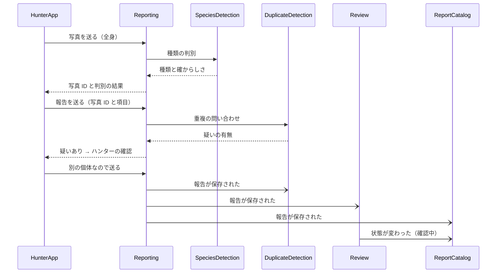

# Components（部品の一覧）— MonsterNote

入力: `inception/requirements-analysis/requirements.md`（requirements）、`inception/user-stories/stories.md`（stories）、`inception/practices-discovery/team-practices.md`（team-practices）、`inception/refined-mockups/mockups.md`・`design-system-mapping.md`（画面案）、domain-design-questions.md（Q1〜Q6）。

部品（コンポーネント）は、自分たちで書くプログラムのまとまりである。データベース・写真の保存場所・AWS の画像認識サービスなどは「部品が使う外部のもの」として書く。部品をどこに配置するか（サーバーの形、コードの置き場所）は Units Generation で、技術の選び方は NFR と Infrastructure の各ステージで決める。

データ（エンティティ）は「持ち主の部品・識別子・項目の名前・他の部品のデータへの参照」だけを書く。型や制約は Functional Design で決める。

## 共通の決まり

- **役割の確認（ADR-007）**: ログインしたときに Accounts が発行する「ログインの証明」に、利用者の ID・役割・所属が入る。API を持つ各部品は、呼ばれるたびにこの証明が正しいかを確かめ、中の役割で操作を許すかを決める（画面で隠すだけでなく、各部品の API でも確かめる。requirements NFR4）。そのため、各部品は役割の確認のために Accounts を呼ばない。証明の有効期限は 1 時間で、無効にしたアカウントは 1 時間以内に使えなくなる（FR10.4）。
- **部品どうしの呼び出しの証明（ADR-011）**: 画面から呼ばれた部品がほかの部品をその場で呼ぶとき（例: Reporting → DuplicateDetection）は、画面から受け取った利用者のログインの証明をそのまま渡す。呼ばれた部品も同じ証明で役割を確かめる。知らせで動く処理には利用者の証明がないため、知らせには操作した利用者の ID を載せ、受け手は「MonsterNote の部品が送った知らせだけ」を受け付ける（外から知らせを送り込めないようにする）。
- **知らせ（イベント）**: 点線の矢印・`style: event` は、送り手が「〜が起きた」と知らせ、受け手があとで処理する呼び方。知らせが失われたときの影響と、確実に届ける方法は NFR Design で決める（ADR-008）。
- **「報告が保存された」知らせの中身（ADR-012）**: 報告 ID、ハンターの ID と表示名、種類、捕獲日時、捕獲場所（緯度・経度と地名）、手入力の印、送信日時、全身の写真の ID。ハンターの表示名は、Reporting が同意の確認のときに Accounts から受け取ったものを載せる。地名は、Reporting が保存のときに地図のサービスで緯度・経度から求める（求められないときは空にし、一覧では緯度・経度を表示する）。

## Part A — 部品の一覧（機械が読む形）

```yaml
components:
  - name: Accounts
    summary: 利用者のアカウント・役割・所属・同意・従事者番号を管理し、ログインの証明を発行する
    behaviour: >
      管理者だけがアカウントを作成・無効化・有効化・パスワードの再設定をできる。作成と再設定では仮のパスワードを発行し、
      次のログインで変更を求める。パスワードは 8 文字以上で英字と数字を含む。ハンターは初回に同意と従事者番号の登録を
      済ませるまで報告できない。依頼元には所属（市町村の担当課／猟友会）が必須。ログインすると、利用者の ID・役割・所属を入れた
      ログインの証明（有効期限 1 時間）を発行し、最後の利用から 30 日はログインの状態を保って証明を出し直す。
      無効にしたアカウントには証明を出し直さない（1 時間以内に使えなくなる）。操作のたびに知らせを送る。
    responsibilities:
      - アカウントの作成・無効化・有効化・パスワードの再設定（FR1.1・FR1.8・FR10.1・FR10.3・FR10.4）
      - ログイン・ログアウト・ログインの証明の発行と期限（FR1.2・FR1.6・FR1.7）
      - 役割と所属を証明に入れる（FR1.3・NFR4）
      - 同意と従事者番号の登録（FR1.4・FR1.5）
    depends_on:
      - component: AuditLog
        interaction: アカウントの作成・無効化・再設定の知らせを送る
        style: event
    dependents:
      - component: Reporting
        interaction: 報告者が同意済みのハンターか確かめ、従事者番号と表示名を受け取る（表示名は一覧用。ADR-012）
      - component: HunterApp
        interaction: ログイン、パスワード変更、同意、従事者番号の登録
      - component: RequesterApp
        interaction: ログイン、パスワード変更
      - component: AdminApp
        interaction: ログイン、アカウントの管理
    external_dependencies:
      - name: 利用者の認証のサービス
        kind: third-party-api
        purpose: ID・パスワードの確認とログインの証明の発行
      - name: データベース
        kind: database
        purpose: アカウントの保存
    entities:
      - name: Account
        identifier: accountId
        attributes: [loginId, displayName, role, organization, status, mustChangePassword, consentedAt, hunterNumber, createdAt]

  - name: Reporting
    summary: ハンターの写真と報告を受け付け、内容を保存する
    behaviour: >
      写真の受け付けと報告の送信の 2 段で動く（ADR-009）。
      ① 写真の受け付け: ハンターが写真を選ぶたびに、HunterApp が写真を Reporting に送る。Reporting は形式・大きさを確かめて、
      「まだ報告に結び付いていない写真」（reportId が空、送ったハンターの ID を持つ）として保存する。全身の写真なら SpeciesDetection に
      判別を頼み、結果を画面に返す。
      ② 報告の送信: 同意済みのハンターが、受け付け済みの写真の ID と項目を送る。捕獲日時は送信の時刻より 5 分を超えて未来であってはならず、
      7 日より前であってもならない。捕獲場所は対象地域の中でなければならない（画面でも確かめるが、ここでも必ず確かめる）。
      DuplicateDetection にその場で重複の疑いを問い合わせ、疑いがあればハンターの確認（別の個体なので送る）を受けてから保存する。
      保存のときに写真へ reportId を入れる。同じ送信を 2 回受けても報告は 1 件だけ作る。保存したら「報告が保存された」知らせを送る。
      送った報告の内容は直せない。
      報告に結び付かないまま 24 時間たった写真は、写真と判別の結果ごと自動で消す（下書きは残さない。FR2.9）。
      ハンターは自分の報告と写真だけを読める。報告の作成に必要な対象地域を、画面に返す。
    responsibilities:
      - 写真の受け付け（形式・大きさ）と撮影情報の記録、種類の判別の依頼（FR2.2・FR2.3・FR2.12・FR3.1）
      - 報告の作成と保存、二重送信の防止（FR2.1・FR2.4〜FR2.11・FR2.13）
      - 捕獲日時・捕獲場所の確認（FR2.14）
      - 交付金の項目の記録（FR5.1〜FR5.3）
      - 報告の詳細と写真の読み出し（FR8.3・FR9.2・FR9.4）
      - 結び付かなかった写真の自動削除、試験運用の終わりの報告と写真の削除（FR2.9・FR10.2）
    depends_on:
      - component: Accounts
        interaction: 報告者が同意済みのハンターか確かめ、従事者番号と表示名を受け取る（表示名は「報告が保存された」知らせに載せる。ADR-012）
        style: sync
      - component: Settings
        interaction: 対象地域を読む（自分の確認と、画面へ返すため）
        style: sync
      - component: SpeciesDetection
        interaction: 全身の写真の種類の判別を頼む／結び付かなかった写真の判別の結果を消してもらう
        style: sync
      - component: DuplicateDetection
        interaction: 送信の前に重複の疑いをその場で問い合わせる
        style: sync
      - component: DuplicateDetection
        interaction: 報告が保存されたことを知らせる（索引への追加と保存後の再判定のため）
        style: event
      - component: Review
        interaction: 報告が保存されたことを知らせ、確認待ちの記録を作ってもらう
        style: event
      - component: ReportCatalog
        interaction: 報告が保存されたことを知らせ、一覧に加えてもらう
        style: event
      - component: AuditLog
        interaction: 報告の送信の知らせを送る
        style: event
    dependents:
      - component: HunterApp
        interaction: 写真の受け付け、報告の送信、自分の報告の詳細、対象地域
      - component: RequesterApp
        interaction: 報告の詳細と写真
      - component: AdminApp
        interaction: 試験運用の終わりの削除
    external_dependencies:
      - name: 写真の保存場所
        kind: object-store
        purpose: 縮小した写真の保存と、期限付きの表示用 URL の発行
      - name: データベース
        kind: database
        purpose: 報告と写真の情報の保存
      - name: 地図のサービス
        kind: third-party-api
        purpose: 捕獲場所の緯度・経度から地名を求める（一覧の表示用）
    entities:
      - name: Report
        identifier: reportId
        attributes: [hunterAccountId, hunterNumber, capturedAt, capturedAtSource, location, placeName, locationSource, species, autoDetectionId, sex, ageClass, captureMethod, chestPhotoMissing, submittedAt, submissionKey]
        references:
          - entity: Account
            owned_by: Accounts
            relationship: 各報告は 1 人のハンターが送る
          - entity: DetectionResult
            owned_by: SpeciesDetection
            relationship: 各報告は、全身の写真の自動判別の結果を 1 つ指す（判別できなかった場合も結果として残る）
      - name: Photo
        identifier: photoId
        attributes: [uploadedByAccountId, reportId, kind, storageKey, exifCapturedAt, exifLocation, sizeBytes, uploadedAt]
        references:
          - entity: Account
            owned_by: Accounts
            relationship: 各写真は 1 人のハンターが送る（報告に結び付く前も持ち主が分かる）

  - name: SpeciesDetection
    summary: 写真から種類（クマ・イノシシ・シカ）と確からしさを出す
    behaviour: >
      3 種類のうち確からしさが最も高いものが 80% 以上なら「判別できた」、未満なら「判別できなかった」とする。
      判別のサービスが失敗・時間切れのときも「判別できなかった」として結果を返し、報告の作成は止めない。
      しきい値は初期値で、後から変えられる。頼まれたら、写真ごと・すべての判別の結果を消す。
    responsibilities:
      - 写真の種類の判別と確からしさの算出（FR3.1・FR3.3・FR3.5）
      - 判別の結果の保存（FR3.4）
      - 判別の結果の削除（結び付かなかった写真の分、試験運用の終わり）（FR2.9・FR10.2）
    depends_on: []
    dependents:
      - component: Reporting
        interaction: 全身の写真の種類の判別、結び付かなかった写真の結果の削除
      - component: AdminApp
        interaction: 試験運用の終わりの削除
    external_dependencies:
      - name: AWS の画像認識サービス
        kind: third-party-api
        purpose: 写真に写った動物のラベルと確からしさの取得
      - name: データベース
        kind: database
        purpose: 判別の結果の保存
    entities:
      - name: DetectionResult
        identifier: detectionId
        attributes: [photoId, outcome, species, confidence, rawLabels, detectedAt]
        references:
          - entity: Photo
            owned_by: Reporting
            relationship: 各判別の結果は 1 枚の写真についてのもの

  - name: DuplicateDetection
    summary: 距離・時間（Should では写真・月の輪）の基準で、同じ個体の疑いを見つける
    behaviour: >
      同じ種類で、大円距離（地球の半径 6,371 km）が基準以内かつ捕獲日時の差が基準以内の報告を重複の疑いとする（境界を含む）。
      却下された報告は比べる相手にしない。基準は Settings から読み、変えたあとに送られる報告から使う。
      送信の前の問い合わせにはその場で答える。「報告が保存された」知らせを受けたら自分の索引（ReportFootprint）に加え、
      もう一度判定して、ほぼ同時に送られた報告どうしと相手の報告にも印を付ける。
      「報告が却下された」知らせで索引から外し、「却下が取り消された」知らせで索引に戻す（ADR-003）。
      疑いを付けたら「重複の疑いが付いた」知らせを送る。ハンターへの答えには、相手の種類・日時・おおよその距離だけを入れ、氏名・写真は入れない。
      依頼元だけが疑いの相手の一覧を読める。
    responsibilities:
      - 送信の前の重複の判定（FR6.1・FR6.2・FR7.1）
      - 保存のあとの再判定と、双方への印（FR6.4・FR7.2）
      - 基準の適用（FR6.3）
      - 重複の疑いの相手の一覧（依頼元の見比べ用）（FR8.3）
      - 写真の重複・月の輪の照合（Should）（FR11.1・FR12.1）
      - 試験運用の終わりの自分のデータの削除（FR10.2）
    depends_on:
      - component: Settings
        interaction: 距離と時間の基準を読む
        style: sync
      - component: ReportCatalog
        interaction: 重複の疑いが付いたことを知らせ、一覧の印を付けてもらう
        style: event
      - component: AuditLog
        interaction: 重複の疑いを付けた知らせを送る
        style: event
    dependents:
      - component: Reporting
        interaction: 送信の前の問い合わせ、保存の知らせ
      - component: Review
        interaction: 却下と却下の取り消しの知らせ
      - component: RequesterApp
        interaction: 報告の重複の疑いと、見比べる相手の一覧
      - component: AdminApp
        interaction: 試験運用の終わりの削除
    external_dependencies:
      - name: データベース
        kind: database
        purpose: 索引と重複の疑いの保存
    entities:
      - name: ReportFootprint
        identifier: reportId
        attributes: [species, location, capturedAt, active, photoHash]
        references:
          - entity: Report
            owned_by: Reporting
            relationship: 各索引は 1 件の報告の場所・日時・種類の写し
      - name: DuplicateSuspicion
        identifier: suspicionId
        attributes: [reportId, matchedReportId, kind, distanceMeters, hoursApart, phase, detectedAt]
        references:
          - entity: Report
            owned_by: Reporting
            relationship: 各疑いは 2 件の報告（本人と相手）を結ぶ

  - name: Review
    summary: 依頼元の承認・却下・取り消しと、報告の状態を管理する
    behaviour: >
      「報告が保存された」知らせで、確認中の記録を作る。承認・却下は依頼元だけができ、状態が確認中のときだけ受け付ける
      （先に受け付けた操作だけが有効。後の操作には、誰がどう確認したかを返す）。却下には 4 つの理由のどれかが必要で、
      「その他」は文が必須。確定から 10 秒間は、操作した本人だけが取り消して確認中に戻せる。取り消しの間は他の人の操作を受け付けない。
      状態が変わるたびに「状態が変わった」知らせを送る。却下の確定のときに「報告が却下された」、却下の取り消しのときに
      「却下が取り消された」知らせを送る。ハンターは自分の報告の状態と理由だけを読める。
    responsibilities:
      - 報告の状態（確認中・承認・却下）の管理（FR8.4・FR8.7）
      - 取り消しと同時の操作の決まり（FR8.5・FR8.6）
      - 却下の理由（FR8.4・FR9.2）
      - 試験運用の終わりの自分のデータの削除（FR10.2）
    depends_on:
      - component: DuplicateDetection
        interaction: 却下と却下の取り消しを知らせ、比べる相手から外す・戻すをしてもらう
        style: event
      - component: ReportCatalog
        interaction: 状態が変わったことを知らせ、一覧の状態を更新してもらう
        style: event
      - component: AuditLog
        interaction: 承認・却下・取り消しの知らせを送る
        style: event
    dependents:
      - component: Reporting
        interaction: 報告の保存の知らせ
      - component: HunterApp
        interaction: 自分の報告の状態と却下の理由
      - component: RequesterApp
        interaction: 承認・却下・取り消し
      - component: AdminApp
        interaction: 試験運用の終わりの削除
    external_dependencies:
      - name: データベース
        kind: database
        purpose: 確認の記録の保存（確認中のときだけ書ける条件付きの更新）
    entities:
      - name: ReviewDecision
        identifier: reportId
        attributes: [status, reason, reasonText, decidedByAccountId, decidedAt, undoUntil, submittedAt]
        references:
          - entity: Report
            owned_by: Reporting
            relationship: 各確認の記録は 1 件の報告の状態
          - entity: Account
            owned_by: Accounts
            relationship: 確認した依頼元

  - name: ReportCatalog
    summary: 報告の一覧（内容の要約・状態・印）を、知らせから組み立てて読み出し専用で持つ
    behaviour: >
      「報告が保存された」（Reporting）、「状態が変わった」（Review）、「重複の疑いが付いた」（DuplicateDetection）の知らせから、
      一覧の 1 行（日付・ハンター・種類・場所の地名・状態・重複の疑い・手入力の印）を組み立てて保存する。
      依頼元にはすべての報告を、ハンターには自分の報告だけを、新しい順・1 ページ 50 件で返す。依頼元は
      確認中・承認・却下・重複の疑い・手入力で絞り込める。送信から 7 日を過ぎた確認中の報告に「7 日以上」の印を付ける。
      一覧は写しなので、詳細と操作は Reporting と Review を正とする。
    responsibilities:
      - 依頼元の一覧と絞り込み・ページ分け（FR8.1・FR8.2）
      - ハンターの自分の報告の一覧（FR9.1・FR9.4）
      - 確認待ちの日数と 7 日以上の印（FR9.3）
      - 試験運用の終わりの自分のデータの削除（FR10.2）
    depends_on: []
    dependents:
      - component: Reporting
        interaction: 報告の保存の知らせ
      - component: Review
        interaction: 状態の変化の知らせ
      - component: DuplicateDetection
        interaction: 重複の疑いの知らせ
      - component: HunterApp
        interaction: 自分の報告の一覧
      - component: RequesterApp
        interaction: すべての報告の一覧と絞り込み
      - component: AdminApp
        interaction: 試験運用の終わりの削除
    external_dependencies:
      - name: データベース
        kind: database
        purpose: 一覧の行の保存と、絞り込み・並べ替えの読み出し
    entities:
      - name: ReportListItem
        identifier: reportId
        attributes: [hunterAccountId, hunterName, species, capturedAt, placeName, status, duplicateSuspected, manualEntry, submittedAt, updatedAt]
        references:
          - entity: Report
            owned_by: Reporting
            relationship: 各行は 1 件の報告の写し

  - name: Settings
    summary: 重複の基準と対象地域を管理する
    behaviour: >
      管理者だけが変えられる（読むのは、ログインしている利用者とほかの部品）。距離は 1 m 以上、時間は 1 時間以上、
      対象地域の半径は 0 より大きい値。初期値は 1 km・24 時間・日本の範囲。変えたら「設定が変わった」知らせを送る。
    responsibilities:
      - 重複の基準の保存と読み出し（FR6.3・FR10.1）
      - 対象地域の保存と読み出し（FR2.14・FR10.1）
    depends_on:
      - component: AuditLog
        interaction: 設定の変更の知らせを送る
        style: event
    dependents:
      - component: Reporting
        interaction: 対象地域を読む
      - component: DuplicateDetection
        interaction: 基準を読む
      - component: AdminApp
        interaction: 設定の画面
    external_dependencies:
      - name: データベース
        kind: database
        purpose: 設定の保存
    entities:
      - name: Setting
        identifier: settingKey
        attributes: [duplicateDistanceMeters, duplicateWindowHours, targetAreaCenter, targetAreaRadiusKm, updatedByAccountId, updatedAt]

  - name: AuditLog
    summary: 各部品の知らせを受け取り、誰がいつ何をしたかを記録する
    behaviour: >
      知らせ（報告の送信、承認・却下・取り消し、アカウントの作成・無効化・再設定、設定の変更、重複の疑い、データの削除）を受け取り、
      変更できない記録として保存する。パスワードや写真そのものは記録しない。試験運用が終わるまで保存する。
      管理者だけが新しい順に読める。
    responsibilities:
      - 操作の記録の保存と読み出し（NFR14・US6.6）
    depends_on: []
    dependents:
      - component: Accounts
        interaction: アカウントの操作の知らせ
      - component: Reporting
        interaction: 報告の送信の知らせ
      - component: DuplicateDetection
        interaction: 重複の疑いの知らせ
      - component: Review
        interaction: 承認・却下・取り消しの知らせ
      - component: Settings
        interaction: 設定の変更の知らせ
      - component: AdminApp
        interaction: 操作の記録の画面、削除の操作の記録
    external_dependencies:
      - name: データベース
        kind: database
        purpose: 記録の保存
    entities:
      - name: AuditEntry
        identifier: auditId
        attributes: [occurredAt, actorAccountId, action, targetType, targetId, detail]
        references:
          - entity: Account
            owned_by: Accounts
            relationship: 各記録は操作した 1 人の利用者を指す

  - name: UiKit
    summary: 3 つの画面アプリが共有する画面部品とテーマ
    behaviour: >
      ハンター用（文字 20px・ボタン 64px）と職員用（文字 16px・ボタン 40〜48px）の 2 つのテーマ、StepHeader・BigChoice・PhotoPicker・
      DateTimeQuick・MapPicker・ConfirmDialog・状態の印などの部品を持つ。アクセシビリティの決まり（WCAG 2.1 AA）を部品の中で守る。
    responsibilities:
      - 共通の画面部品とテーマ（NFR7・NFR8）
    depends_on: []
    dependents:
      - component: HunterApp
        interaction: 部品とハンター用テーマ
      - component: RequesterApp
        interaction: 部品と職員用テーマ
      - component: AdminApp
        interaction: 部品と職員用テーマ
    external_dependencies:
      - name: 画面の部品集（Refined Mockups の Q1 で決定済みの MUI）
        kind: other
        purpose: マテリアルデザインの部品
    entities: []

  - name: HunterApp
    summary: ハンターのスマホ向けの画面（ログイン、報告の作成、自分の報告）
    behaviour: >
      1 画面に 1 項目の報告の作成（通常 7、クマ 8 ステップ）。写真を選ぶたびに撮影情報を縮小の前に読み取り、
      長辺 2,048 px の JPEG に縮小して Reporting に送る（全身の写真なら種類の判別の結果を受け取る）。
      作成をやめるときは確認を出して画面の内容を消す（下書きは残さない）。送信中はボタンを押せない。
      日時・場所の確認は、Reporting から受け取った対象地域を使って画面でも行う。
    responsibilities:
      - ハンターの画面 H1〜H9（US1.1〜US1.5、US2.1〜US2.11、US3.2、US5.1〜US5.3）
    depends_on:
      - component: UiKit
        interaction: 部品とテーマ
        style: sync
      - component: Accounts
        interaction: ログイン、パスワード変更、同意、従事者番号
        style: sync
      - component: Reporting
        interaction: 写真の受け付け、報告の送信、自分の報告の詳細、対象地域
        style: sync
      - component: Review
        interaction: 自分の報告の状態と却下の理由
        style: sync
      - component: ReportCatalog
        interaction: 自分の報告の一覧
        style: sync
    dependents: []
    external_dependencies:
      - name: 地図のサービス
        kind: third-party-api
        purpose: 場所の手入力の地図（Infrastructure Design で決める）
    entities: []

  - name: RequesterApp
    summary: 依頼元のパソコン・スマホ向けの画面（一覧、詳細、承認・却下）
    behaviour: >
      パソコンでは一覧と詳細を左右に並べる。一覧は ReportCatalog から、詳細は Reporting・Review・DuplicateDetection から読む。
      承認・却下のあと 10 秒の取り消しを表示する。すでに確認済みのときは、その旨と確認した人を表示する。
    responsibilities:
      - 依頼元の画面 R1〜R3（US1.1・US1.2・US1.5、US4.1〜US4.7）
    depends_on:
      - component: UiKit
        interaction: 部品とテーマ
        style: sync
      - component: Accounts
        interaction: ログイン、パスワード変更
        style: sync
      - component: ReportCatalog
        interaction: 報告の一覧・絞り込み・ページ分け
        style: sync
      - component: Reporting
        interaction: 報告の詳細と写真
        style: sync
      - component: Review
        interaction: 承認・却下・取り消し、状態
        style: sync
      - component: DuplicateDetection
        interaction: 重複の疑いと見比べる相手
        style: sync
    dependents: []
    external_dependencies:
      - name: 地図のサービス
        kind: third-party-api
        purpose: 報告の場所の表示
    entities: []

  - name: AdminApp
    summary: 管理者のパソコン向けの画面（アカウント、設定、操作の記録、データの削除）
    behaviour: >
      アカウントの作成では仮のパスワードを 1 回だけ表示する。危険な操作（無効化・削除）は確認を出し、削除は確認の文字の入力を求める。
      削除はデータを持つ各部品（Reporting・SpeciesDetection・DuplicateDetection・Review・ReportCatalog）を順に呼ぶ（ADR-006）。
    responsibilities:
      - 管理者の画面 A1〜A5（US6.1〜US6.6）
    depends_on:
      - component: UiKit
        interaction: 部品とテーマ
        style: sync
      - component: Accounts
        interaction: ログイン、アカウントの管理
        style: sync
      - component: Settings
        interaction: 基準と対象地域の設定
        style: sync
      - component: AuditLog
        interaction: 操作の記録の閲覧
        style: sync
      - component: Reporting
        interaction: 報告と写真の削除
        style: sync
      - component: SpeciesDetection
        interaction: 判別の結果の削除
        style: sync
      - component: DuplicateDetection
        interaction: 索引と重複の疑いの削除
        style: sync
      - component: Review
        interaction: 確認の記録の削除
        style: sync
      - component: ReportCatalog
        interaction: 一覧の削除
        style: sync
    dependents: []
    external_dependencies:
      - name: 地図のサービス
        kind: third-party-api
        purpose: 対象地域の設定の地図
    entities: []
```

## Part B — 人が読む形

### 部品の図



<!-- Text fallback: 3 つの画面アプリは UiKit を使う。ハンターの画面は Accounts・Reporting・Review・ReportCatalog を、依頼元の画面は Accounts・ReportCatalog・Reporting・Review・DuplicateDetection を、管理者の画面は Accounts・Settings・AuditLog と、削除のため Reporting・SpeciesDetection・DuplicateDetection・Review・ReportCatalog を呼ぶ。Reporting は Accounts・Settings・SpeciesDetection・DuplicateDetection を呼び、保存の知らせを DuplicateDetection・Review・ReportCatalog に送る。Review は却下・取り消しの知らせを DuplicateDetection に、状態の知らせを ReportCatalog に送る。DuplicateDetection は Settings を読み、疑いの知らせを ReportCatalog に送る。各部品は操作の知らせを AuditLog に送る。実線はその場の呼び出し、点線は知らせ。 -->

### 報告の流れ（写真の受け付けから一覧まで）



<!-- Text fallback: ハンターの画面が全身の写真を Reporting に送ると、Reporting が SpeciesDetection に判別を頼み、写真 ID と結果を返す。報告を送ると、Reporting が DuplicateDetection に重複を問い合わせ、疑いがあればハンターの確認を受ける。保存したら、DuplicateDetection・Review・ReportCatalog に知らせる。Review は確認中の記録を作り、状態の知らせを ReportCatalog に送る。 -->

### 部品のまとめ

| Component | Purpose | Depends On | Dependents | Entities Owned |
|---|---|---|---|---|
| Accounts | アカウント・役割・同意・従事者番号、ログインの証明 | AuditLog | Reporting、HunterApp、RequesterApp、AdminApp | Account |
| Reporting | 写真と報告の受け付けと保存 | Accounts、Settings、SpeciesDetection、DuplicateDetection、Review、ReportCatalog、AuditLog | HunterApp、RequesterApp、AdminApp | Report、Photo |
| SpeciesDetection | 写真の種類の判別 | — | Reporting、AdminApp | DetectionResult |
| DuplicateDetection | 重複の疑いの判定 | Settings、ReportCatalog、AuditLog | Reporting、Review、RequesterApp、AdminApp | ReportFootprint、DuplicateSuspicion |
| Review | 承認・却下・取り消し・状態 | DuplicateDetection、ReportCatalog、AuditLog | Reporting、HunterApp、RequesterApp、AdminApp | ReviewDecision |
| ReportCatalog | 一覧の組み立て（読み出し専用） | — | Reporting、Review、DuplicateDetection、HunterApp、RequesterApp、AdminApp | ReportListItem |
| Settings | 重複の基準・対象地域 | AuditLog | Reporting、DuplicateDetection、AdminApp | Setting |
| AuditLog | 操作の記録 | — | Accounts、Reporting、DuplicateDetection、Review、Settings、AdminApp | AuditEntry |
| UiKit | 共通の画面部品とテーマ | — | HunterApp、RequesterApp、AdminApp | — |
| HunterApp | ハンターの画面 | UiKit、Accounts、Reporting、Review、ReportCatalog | — | — |
| RequesterApp | 依頼元の画面 | UiKit、Accounts、ReportCatalog、Reporting、Review、DuplicateDetection | — | — |
| AdminApp | 管理者の画面 | UiKit、Accounts、Settings、AuditLog、Reporting、SpeciesDetection、DuplicateDetection、Review、ReportCatalog | — | — |

### データの持ち主

| Entity | Owning Component | Identifier | Attributes | References |
|---|---|---|---|---|
| Account | Accounts | accountId | loginId, displayName, role, organization, status, mustChangePassword, consentedAt, hunterNumber, createdAt | — |
| Report | Reporting | reportId | hunterAccountId, hunterNumber, capturedAt, capturedAtSource, location, placeName, locationSource, species, autoDetectionId, sex, ageClass, captureMethod, chestPhotoMissing, submittedAt, submissionKey | Account（Accounts）、DetectionResult（SpeciesDetection） |
| Photo | Reporting | photoId | uploadedByAccountId, reportId, kind, storageKey, exifCapturedAt, exifLocation, sizeBytes, uploadedAt | Account（Accounts） |
| DetectionResult | SpeciesDetection | detectionId | photoId, outcome, species, confidence, rawLabels, detectedAt | Photo（Reporting） |
| ReportFootprint | DuplicateDetection | reportId | species, location, capturedAt, active, photoHash | Report（Reporting） |
| DuplicateSuspicion | DuplicateDetection | suspicionId | reportId, matchedReportId, kind, distanceMeters, hoursApart, phase, detectedAt | Report（Reporting） |
| ReviewDecision | Review | reportId | status, reason, reasonText, decidedByAccountId, decidedAt, undoUntil, submittedAt | Report（Reporting）、Account（Accounts） |
| ReportListItem | ReportCatalog | reportId | hunterAccountId, hunterName, species, capturedAt, placeName, status, duplicateSuspected, manualEntry, submittedAt, updatedAt | Report（Reporting） |
| Setting | Settings | settingKey | duplicateDistanceMeters, duplicateWindowHours, targetAreaCenter, targetAreaRadiusKm, updatedByAccountId, updatedAt | — |
| AuditEntry | AuditLog | auditId | occurredAt, actorAccountId, action, targetType, targetId, detail | Account（Accounts） |

### 外部のもの

| Component | Dependency | Kind | Purpose |
|---|---|---|---|
| Accounts | 利用者の認証のサービス | third-party-api | ID・パスワードの確認とログインの証明 |
| Accounts・Reporting・SpeciesDetection・DuplicateDetection・Review・ReportCatalog・Settings・AuditLog | データベース | database | 各部品のデータの保存 |
| Reporting | 写真の保存場所 | object-store | 写真の保存と期限付きの表示用 URL |
| Reporting | 地図のサービス | third-party-api | 緯度・経度から地名を求める（一覧の表示用） |
| SpeciesDetection | AWS の画像認識サービス | third-party-api | 動物のラベルと確からしさ |
| UiKit | MUI（Refined Mockups の Q1 で決定済み） | other | マテリアルデザインの部品 |
| HunterApp・RequesterApp・AdminApp | 地図のサービス | third-party-api | 場所の手入力・表示（requirements OQ-3） |

### 部品を分けた理由

| Component | 分けた理由 |
|---|---|
| Accounts | 利用者の情報と認証は、報告とは別の寿命（試験運用の前に作り、無効化しても報告は残る）と、別の決まり（パスワード・同意）を持つ |
| Reporting | 報告の内容は送ったあと変わらない。状態（Review）と分けることで、内容は書き込み 1 回だけのデータになる（Q1） |
| SpeciesDetection | 判別のサービスを差し替える・しきい値を調整する変更が、報告の決まりに影響しない（Q2） |
| DuplicateDetection | 一番の課題を担う部品で、Should（写真・月の輪）の追加で一番よく変わる。自分の索引を持ち、報告の部品を呼び返さない（Q2・Q4） |
| Review | 同時の操作・取り消しの決まりを 1 か所に集める。状態の持ち主を 1 つにする（Q1） |
| ReportCatalog | 一覧は 3 つの部品のデータを合わせて絞り込み・ページ分けする。読み出しの形が書き込みの部品と違い、写しとして別に持つと各部品が一覧の形を知らずに済む（ADR-010） |
| Settings | 管理者だけが変える値で、複数の部品が読む。変更の記録も必要 |
| AuditLog | 記録の形を各部品が知らなくて済む。記録は変更できない（Q3） |
| UiKit | 3 つのアプリで見た目とアクセシビリティの決まりを 1 か所で守る（Q5） |
| HunterApp・RequesterApp・AdminApp | 利用者・機器・文字の大きさが違い、別々に公開・変更できる（Q5） |

**選ばなかった案**（詳しくは decisions.md）:
- 報告の状態を Reporting が持つ案（Q1 の B）: 内容と確認の決まりが 1 つの部品に混ざるため選ばなかった。
- 判別・重複を Reporting に入れる案（Q2 の B・C）: Should の追加で報告の部品が大きく変わるため選ばなかった。
- 画面を 1 つのアプリにする案（Q5 の A）: 人が 3 つに分けることを選んだ。共通の部分は UiKit で補う。
- 一覧を画面が 3 部品から集めて組み立てる案: 絞り込みとページ分けが同時に効かないため選ばなかった（ADR-010）。
- 各部品が役割の確認のたびに Accounts を呼ぶ案: 呼び出しが増え、Accounts が止まると全部が止まるため選ばなかった（ADR-007）。

## 次のステージへの引き継ぎ

| 内容 | 扱うステージ |
|---|---|
| 知らせを確実に届ける方法と、失われたときの影響（報告が確認中にならない、一覧に出ない、記録が欠ける）（ADR-008） | NFR Design |
| 結び付かなかった写真を 24 時間で消す仕組み（ADR-009） | Functional Design・NFR Design |
| 削除の順番とやり直し方（ADR-006） | Functional Design |
| 部品の配置とコードの置き場所（ADR-005 から移した） | Units Generation |
| 部品どうしの呼び出しで証明を渡す方法と、知らせの送り手を確かめる方法の具体（ADR-011） | NFR Design・Infrastructure Design |
| 「報告が保存された」知らせの項目の型と、地名を求められないときの扱い（ADR-012） | Functional Design |

## Assumptions & Open Questions

- DuplicateDetection は Reporting を呼び返さないよう、比べるための索引（ReportFootprint）を自分で持つ。索引は「報告が保存された」知らせで作るため、送信の前の問い合わせでは、まだ知らせが届いていない直前の報告を見落とすことがある。その分は保存のあとの再判定（FR6.4）で補う。 [assumption]
- ReviewDecision の識別子は reportId（報告 1 件に確認の記録 1 つ）。取り消して確認し直しても、記録は同じものを更新し、履歴は AuditLog に残る。 [assumption]
- ReportCatalog の一覧は知らせから作る写しのため、知らせが届くまでの短い間、一覧が詳細より古いことがある。詳細と操作は Reporting・Review を正とする。 [assumption]
