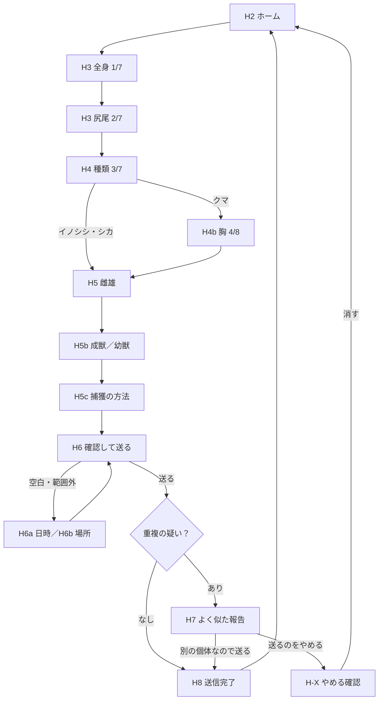
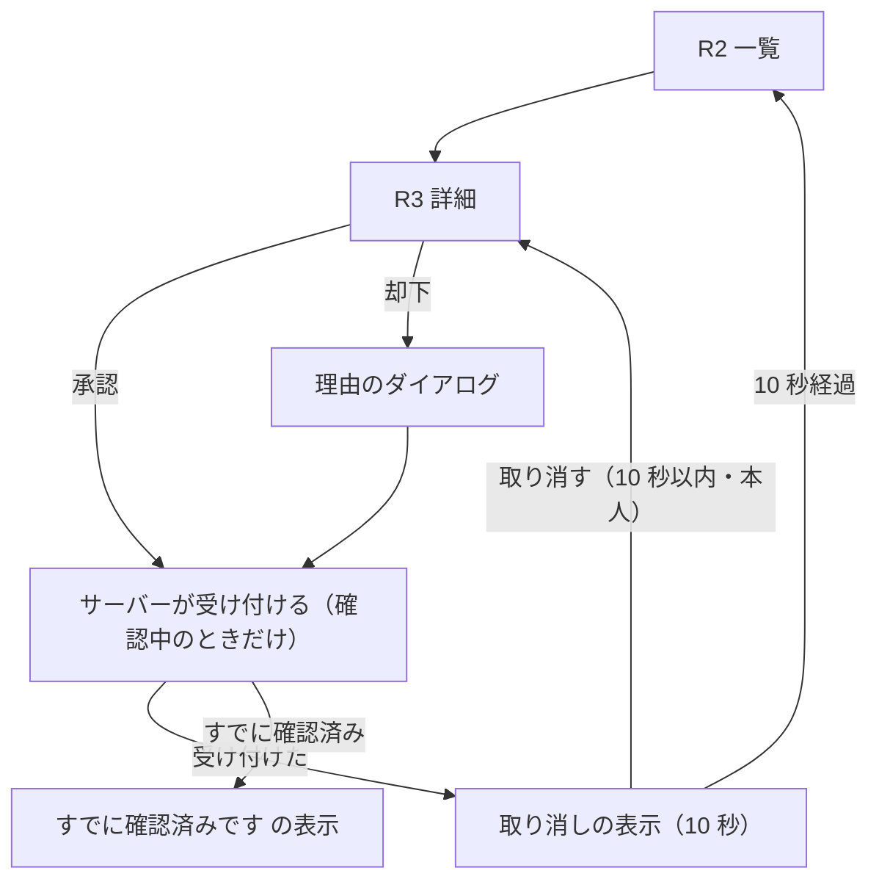

# Interaction Spec（操作の仕様）— MonsterNote 最初の版

入力: mockups.md、`ideation/rough-mockups/user-flow.md`（user-flow）、`ideation/rough-mockups/wireframes.md`（wireframes）、`inception/user-stories/stories.md`（stories）、`inception/requirements-analysis/requirements.md`（requirements）、`inception/practices-discovery/team-practices.md`（team-practices）、refined-mockups-questions.md（Q1〜Q6）。

部品の仕様は `.claude/knowledge/aidlc-design-agent/component-spec-template.md` の形に従う。幅の区切りは Q4 の値（スマホ 〜599px、タブレット 600〜1023px、パソコン 1024px〜）を使う。

## 1. 報告の作成の流れ（ハンター）

<!-- Text fallback: ホームから全身、尻尾、種類の順に進む。クマなら胸の写真を挟み、雌雄、成獣／幼獣、捕獲の方法、確認の画面へ。日時か場所が空白や範囲外なら手入力の画面で直して戻る。送ると重複を判定し、疑いがあれば確認のダイアログ、なければ送信完了。送るのをやめると、やめる確認で消してホームへ戻る。 -->

### ステップの数の決まり

| 種類 | ステップ | 表示 |
|---|---|---|
| 未選択・イノシシ・シカ | 全身・尻尾・種類・雌雄・成獣／幼獣・方法・確認 | n/7 |
| クマ | 上に「胸」を種類の次に加える | n/8 |

種類を変えたら、その時点で分母を切り替える（クマ → シカに直したら胸の写真は捨て、n/7 に戻す）。

### 戻る・やめる

| 操作 | 結果 |
|---|---|
| ← 戻る | 1 つ前のステップ。入力済みの値は残る |
| [やめる]、ホームへの移動、ブラウザの戻るで作成の外に出る | H-X（「写真と入力内容は消えます。よろしいですか？」）。[ 消す ] で内容を捨てホームへ、[ 続ける ] で元の画面 |
| H6 の [直す] | 該当のステップへ。[ 次へ ] / [ 決める ] で H6 に直接戻る |

## 2. 依頼元の確認の流れ

<!-- Text fallback: 一覧から詳細を開き、承認するか、理由を選んで却下する。サーバーは確認中の報告だけ受け付け、受け付けたら 10 秒の取り消しを表示し、取り消せば確認中に戻る。すでに他の人が確認していたら、その旨を表示する。 -->

## 3. 部品の仕様

### StepHeader（ステップの見出し）

| Field | Value |
|---|---|
| Component | StepHeader |
| Description | 報告の作成の各画面の上部。戻る・何ステップ目か・やめる |
| Category | navigation |

| State | Description | Trigger |
|---|---|---|
| default | 「← 戻る」「n/7」「やめる」と進み具合の棒 | 画面の表示 |
| first | 1/7 では「← 戻る」の代わりに何も出さない | 全身の写真の画面 |

| Prop | Type | Required | Default | Description |
|---|---|---|---|---|
| step | number | yes | — | 今のステップ |
| total | number | yes | 7 | 全体のステップ（クマは 8） |
| onBack | function | no | — | 戻る |
| onQuit | function | yes | — | やめる（H-X を出す） |

| Breakpoint | Behaviour |
|---|---|
| mobile | 画面幅いっぱい。文字 20px |
| tablet・desktop | 最大幅 600px で中央寄せ |

| Requirement | Implementation |
|---|---|
| ARIA role | nav（aria-label「報告の手順」） |
| Keyboard | Tab で戻る→やめる |
| Label | 進み具合は「7 ステップ中 3」と読み上げ（aria-valuetext） |
| Contrast | 4.5:1 以上 |
| Screen reader | 画面が変わったら h1 にフォーカスを移し、見出しを読む |
| Focus | 画面の表示時は h1 |

### BigChoice（大きな選択肢）

| Field | Value |
|---|---|
| Component | BigChoice |
| Description | 種類・雌雄・成獣／幼獣・方法の 1〜3 個の大きな選択肢 |
| Category | input |

| State | Description | Trigger |
|---|---|---|
| default | 何も選ばれていない。[ 次へ ] は押せない | 画面の表示 |
| selected | ● と太い枠と太字 | タップ |
| preselected | AI の判定で選ばれた状態（H4） | 確からしさ 80% 以上 |
| disabled | 判別中で押せない（10 秒まで） | 判別の処理中 |

| Prop | Type | Required | Default | Description |
|---|---|---|---|---|
| options | {value,label,icon}[] | yes | — | 1〜3 個（NFR7） |
| value | string | no | — | 選ばれている値 |
| onChange | function | yes | — | 選んだとき |

| Requirement | Implementation |
|---|---|
| ARIA role | radiogroup / radio |
| Keyboard | 矢印キーで移動、Space で選ぶ |
| Label | 画面の h1 を aria-labelledby |
| Contrast | 選択の枠 3:1 以上 |
| Screen reader | 「イノシシ、選択済み、3 個中 1」 |
| Focus | 選択済みがあればそれ、なければ 1 つ目 |

### PhotoPicker（写真を撮る・選ぶ）

| Field | Value |
|---|---|
| Component | PhotoPicker |
| Description | 撮る・選ぶ・確認・撮り直し。撮影情報の読み取りと縮小 |
| Category | input |

| State | Description | Trigger |
|---|---|---|
| empty | 手本の絵と [ 撮る ] [ 選ぶ ]（胸は [ 撮れなかった ] も） | 画面の表示 |
| processing | 「写真を読み込んでいます」 | 選んだ直後（情報の読み取り→縮小） |
| preview | 写真と [ この写真を使う ] [ 撮り直す ]、情報の有無の文 | 処理の完了 |
| error | ⚠ と理由（15 MB 超・画像でない・変換できない） | 確認の失敗 |

| Prop | Type | Required | Default | Description |
|---|---|---|---|---|
| kind | "body" \| "tail" \| "chest" | yes | — | どの写真か |
| maxBytes | number | no | 15728640 | 15 MB（FR2.12） |
| longEdge | number | no | 2048 | 縮小の長辺（FR2.12） |
| onDone | function | yes | — | 写真と読み取った日時・位置を返す |

| Requirement | Implementation |
|---|---|
| ARIA role | button（撮る・選ぶ）、img（プレビュー） |
| Keyboard | Enter で撮る・選ぶ |
| Label | 手本の絵の代替テキスト「全身と、体に書いた日付と番号が写った写真の例」 |
| Screen reader | 読み取り結果を aria-live で知らせる |
| Focus | 表示時は [ 撮る ]、プレビューでは [ この写真を使う ] |

撮影情報は縮小の前に読み取る（FR2.3）。

### DateTimeQuick（日時の手入力）

| Field | Value |
|---|---|
| Component | DateTimeQuick |
| Description | 今日・昨日・おととい・カレンダー（7 日前まで）と時刻 |
| Category | input |

| State | Description | Trigger |
|---|---|---|
| default | 日のボタンと時刻の選択 | 画面の表示 |
| error | ⚠「未来の日時は入れられません」 | 今日で今より後の時刻（5 分の誤差を超える） |

| Prop | Type | Required | Default | Description |
|---|---|---|---|---|
| maxPastDays | number | no | 7 | FR2.14 |
| futureToleranceMin | number | no | 5 | FR2.14 |

| Requirement | Implementation |
|---|---|
| ARIA role | radiogroup（日）、combobox（時・分） |
| Keyboard | 矢印・Enter |
| Screen reader | 選べない日は「選べません」と読む |

### MapPicker（場所の手入力）

| Field | Value |
|---|---|
| Component | MapPicker |
| Description | 地図をタップして印を置く。今いる場所へ移動 |
| Category | input |

| State | Description | Trigger |
|---|---|---|
| default | 対象地域の中心を表示 | 画面の表示 |
| locating | 「今いる場所を調べています」 | [ 今いる場所へ移動 ] |
| permission | 位置の許可の手順 | 許可がない |
| placed | 印と緯度・経度、[ 決める ] が押せる | タップ |
| outside | ⚠「対象地域の外です」、[ 決める ] は押せない | 地域の外にタップ |

| Requirement | Implementation |
|---|---|
| ARIA role | application（地図）、button |
| Keyboard | 地図は矢印で動かし Enter で中心に印（キーボードだけでも置ける） |
| Screen reader | 「印を置きました。A町付近」 |

### ConfirmDialog（確認のダイアログ）

H7、H-X、却下の理由、アカウントの無効化、データの削除で使う。

| State | Description | Trigger |
|---|---|---|
| open | 見出し・本文・2 つのボタン | 操作 |
| danger | 危険の操作（消す・削除）を赤で、文字とアイコンも付ける | 削除系 |

| Requirement | Implementation |
|---|---|
| ARIA role | alertdialog |
| Keyboard | フォーカスはダイアログ内に閉じる。Escape は「安全な方」（続ける・やめる） |
| Focus | 開いたら安全な方のボタン（H7 は「送るのをやめる」）。閉じたら元のボタン |

### ReportTable（依頼元の一覧）

| State | Description | Trigger |
|---|---|---|
| loading | 表の形の仮表示 | 読み込み |
| empty | 「報告はまだありません」 | 0 件 |
| filtered-empty | 「条件に合う報告はありません」と [ 絞り込みを外す ] | 絞り込みで 0 件 |
| error | 「読み込めませんでした」と [ もう一度 ] | 失敗 |

| Breakpoint | Behaviour |
|---|---|
| mobile・tablet | 1 件 1 枚のカード。押すと R3 の画面に切り替え |
| desktop | 表（左）と R3（右）を並べる |

| Requirement | Implementation |
|---|---|
| ARIA role | table（見出しセル付き） |
| Screen reader | 印は「重複の疑い」「手入力」「7 日以上」と文字で読む |

### DecisionBar（承認・却下と取り消し）

| State | Description | Trigger |
|---|---|---|
| ready | [ 承認 ] [ 却下 ] | 確認中の報告 |
| sending | 押せない、回転の表示 | 押した直後 |
| undo | 「承認しました」[ 取り消す ] と残り秒数（10→0） | サーバーが受け付けた |
| conflict | ⚠「すでに確認済みです（承認、佐藤）」 | サーバーが受け付けなかった |
| done | ボタンなし、状態だけ | 10 秒経過 |

| Requirement | Implementation |
|---|---|
| Screen reader | 「承認しました。10 秒以内なら取り消せます」を aria-live で |
| Focus | undo の間は [ 取り消す ]、done で一覧の次の報告 |

## 4. 応答と待ち時間の表示

| 待ち | 表示 | 出典 |
|---|---|---|
| 1 秒未満 | 何も出さない | — |
| 1〜10 秒 | 回転の表示と、何をしているかの文（「確認しています」） | NFR2 |
| 10 秒超（種類の判別） | 「手で選べます」と選択肢を有効に | mockups の仮定 |
| 失敗 | ⚠ と「もう一度」。入力は残す | FR2.10 |

## Assumptions & Open Questions

- ブラウザの戻るボタンで作成の外に出るときも H-X を出す。ブラウザの仕組みで出せない場合（タブを閉じるなど）は、内容は失われる。 [assumption]
