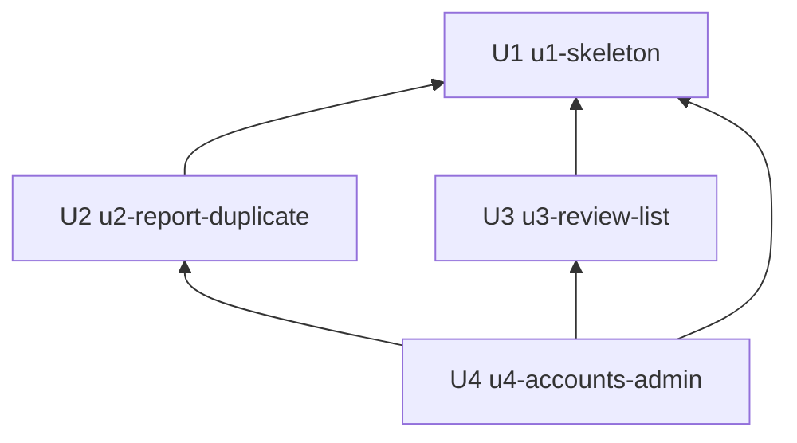

# Unit of Work Dependency（Unit の依存関係）— MonsterNote

入力: unit-of-work.md、`inception/domain-design/components.md`（components）・`decisions.md`（decisions）、`inception/requirements-analysis/requirements.md`（requirements）、`inception/user-stories/stories.md`（stories）、units-generation-questions.md（Q5）。

この文書は「どの Unit がどの Unit を前提にするか」だけを書く。どの順で作るか・どれを先に出すかは Delivery Planning で決める。

## 1. 依存の図



<!-- Text fallback: U2 と U3 は U1 に依存する。U4 は U1・U2・U3 のすべてに依存する。U2 と U3 の間には依存がない。矢印は「依存する側から、依存される側へ」。 -->

## 2. 依存の理由

| Unit | 依存先 | 理由 |
|---|---|---|
| U1 | なし | 最初の細い版。AWS の土台と、部品の最小の形を作る |
| U2 | U1 | U1 の Reporting・HunterApp・ログインの証明の確認・AWS の土台に機能を足す |
| U3 | U1 | U1 の Review・ReportCatalog・RequesterApp に機能を足す |
| U4 | U1・U2・U3 | 試験運用の終わりの削除（ADR-006）で、U2 の SpeciesDetection・DuplicateDetection と U3 の Review・ReportCatalog の機能に削除の入口を足す。設定の画面は U2 の Settings の裏側を使う |

U2 と U3 の間に依存はない。U3 の一覧の「重複の疑い」の印は U2 の DuplicateDetection が送る知らせで付くが、知らせの形は Contract Design で先に決めるため、U3 は形どおりの試験用の知らせで作って試せる。同じく U3 の却下・取り消しの知らせを U2 の DuplicateDetection が受け取るが、U2 も形どおりの試験用の知らせで試せる。

## 3. Unit の間のつなぎ目

| つなぎ目 | 送り手（Unit） | 受け手（Unit） | 種類 |
|---|---|---|---|
| ログインの証明（役割・ID） | Accounts（U1） | すべての Unit の API | 共通の処理（ADR-007・ADR-011） |
| 報告が保存された | Reporting（U1・U2） | Review（U1）、ReportCatalog（U1）、DuplicateDetection（U2） | 知らせ |
| 状態が変わった | Review（U1・U3） | ReportCatalog（U1・U3） | 知らせ |
| 報告が却下された・却下が取り消された | Review（U3） | DuplicateDetection（U2） | 知らせ |
| 重複の疑いが付いた | DuplicateDetection（U2） | ReportCatalog（U3） | 知らせ |
| 操作の記録 | 各部品（U1〜U4） | AuditLog（U4） | 知らせ |
| 対象地域・重複の基準 | Settings（U2） | Reporting・DuplicateDetection（U2）、AdminApp（U4） | その場の呼び出し |
| 削除 | AdminApp（U4） | Reporting・SpeciesDetection・DuplicateDetection・Review・ReportCatalog | その場の呼び出し |

知らせと呼び出しの形は、次の Contract Design で決める。

## 4. 同時に進められる組み合わせ

| 組み合わせ | 条件 |
|---|---|
| U2 と U3 | U1 が終わったあと。互いに依存がないため、別々の作業ブランチで同時に作れる（それぞれ U1 と、その時点の main だけで試験が通る） |

U1 は単独で最初に来る（ほかのすべての Unit の前提）。U4 は U1〜U3 がすべて終わったあと。依存の上で正しい順は「U1 → U2 → U3 → U4」と「U1 → U3 → U2 → U4」の 2 通りがある。どちらにするか、U2 と U3 を実際に同時に進めるかは Delivery Planning と Construction で決める。

## 5. 最初の細い版

依存の順で最初に来る Unit は U1 `u1-skeleton` で、これが最初の細い版（team-practices の Walking Skeleton）になる。U1 はほかの Unit がなくても単独で動く: ログイン（手順書で作ったアカウント。同意済み・従事者番号の登録済みの状態で作るため、U4 の同意・番号の画面がなくても報告できる）→ 写真 1 枚と手で選んだ種類・雌雄の報告 → 依頼元の一覧・詳細・承認 → ハンターの一覧、が U1 の部品と AWS の土台だけでつながる。種類の判別・重複・却下・管理の画面がなくても、この流れは成り立つ。

## 6. 機械が読む形

```yaml
units:
  - name: u1-skeleton
    kind: service
    depends_on: []
  - name: u2-report-duplicate
    kind: service
    depends_on: [u1-skeleton]
  - name: u3-review-list
    kind: service
    depends_on: [u1-skeleton]
  - name: u4-accounts-admin
    kind: service
    depends_on: [u1-skeleton, u2-report-duplicate, u3-review-list]
```

## Assumptions & Open Questions

- U2 と U3 は、同じ画面の部品（HunterApp・UiKit）と、全体で 1 つの AWS の構成（CDK のスタック、API の入口のルート定義、知らせの仕組みの定義）に手を入れるため、同時に進めると取り込みのときに衝突しやすい。同時に進めるかは Delivery Planning で判断する。 [assumption]
- デプロイは Unit ごとではなく、その時点の全体（1 つの CDK アプリ）をまとめて行う。各 Unit が単独でデプロイできるわけではない（U1 は全体の最初の版として単独で動く）。 [assumption]
