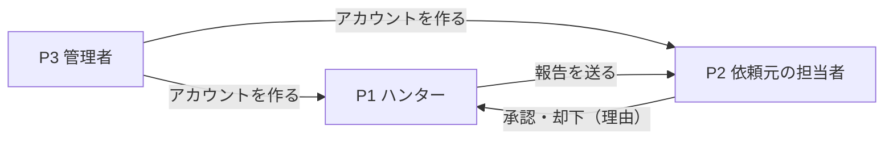

# Personas（人物像）— MonsterNote

入力: `inception/requirements-analysis/requirements.md`（requirements）、`ideation/intent-capture/stakeholder-map.md`、user-stories-questions.md（Q1）。

人物像は、ストーリーを書くときに「誰のための機能か」をそろえるための架空の人物である。名前と細かい設定は説明のための例。

## P1. 高齢のハンター — 山田 一郎（68 歳）

| 項目 | 内容 |
|---|---|
| 役割 | 地元の猟友会に入っている捕獲従事者。わなでイノシシ・シカを捕まえ、ときどきクマの駆除にも出る |
| 目的 | 捕獲したらすぐ、少ない手間で報告を出し、賞金（報奨金）を受け取る |
| 困りごと | 小さな文字や細かい入力が苦手。紙と写真の提出は手間がかかる。報告が確認されたか分からず待たされる |
| 使う機器 | スマホ（iPhone または Android）。現場で写真を撮る。家に帰ってから、保存した写真で報告することもある |
| 大事にしたいこと | 大きなボタン、1 画面に 1 つの操作、迷ったら戻れること（requirements の NFR7） |

## P2. 依頼元の担当者 — 佐藤 花子（45 歳）

| 項目 | 内容 |
|---|---|
| 役割 | 市町村の担当課の職員、または猟友会の事務担当。市町村と猟友会のどちらの所属でも、使う画面と操作は同じ（Q1） |
| 目的 | 届いた報告を確認して承認・却下し、同じ個体の二重の報告を見逃さない。交付金の実績報告に使える記録をそろえる |
| 困りごと | 紙と写真を突き合わせる作業に時間がかかる。同じ個体を別の角度で撮った写真に気づきにくい |
| 使う機器 | 職場のパソコン（Chrome・Edge）が中心。外出先ではスマホ |
| 大事にしたいこと | 確認待ちの報告がすぐ分かる一覧、疑わしい報告を見比べられる画面、押し間違いを取り消せること |

## P3. 管理者 — 開発者本人

| 項目 | 内容 |
|---|---|
| 役割 | MonsterNote を作り、試験運用を管理する人 |
| 目的 | ハンターと依頼元のアカウントを用意し、困ったときに対応する。試験運用の結果を確かめ、費用を月 100 円以内に保つ |
| 困りごと | 1 人で開発と運用を兼ねるため、手作業の運用は少なくしたい |
| 使う機器 | パソコン |
| 大事にしたいこと | アカウントの作成・再設定・無効化、基準の変更、データの削除を管理者用の画面からできること（Q4） |

## 人物像の関係と優先度

| 優先度 | 人物像 | 理由 |
|---|---|---|
| 1 | P1 ハンター | 報告がなければ何も始まらない。操作の分かりやすさが試験運用の成否を左右する |
| 2 | P2 依頼元の担当者 | 一番の課題（重複・二重の受け取り）を判断する人 |
| 3 | P3 管理者 | ほかの 2 人が使える状態を用意する人 |

<!-- Text fallback: 管理者がハンターと依頼元のアカウントを作る。ハンターが報告を送り、依頼元が承認・却下して理由をハンターに返す。 -->

## Assumptions & Open Questions

- 人物像の年齢・名前は説明のための例で、実際の参加者の情報ではない。 [assumption]
