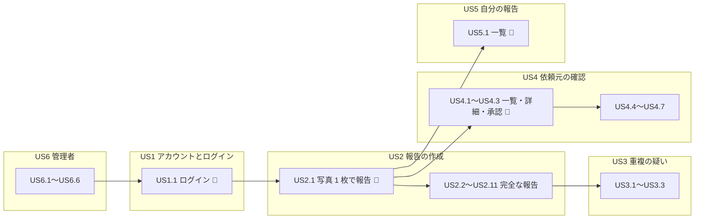

# User Stories — MonsterNote 最初の版

入力: `inception/requirements-analysis/requirements.md`（requirements。FR・NFR の ID）、`inception/practices-discovery/team-practices.md`（team-practices。TDD・最初の細い版）、personas.md（P1〜P3）、user-stories-questions.md（Q1〜Q4）。

## 0. 読み方

- 形: 「〈人物〉として、〈したいこと〉をしたい。なぜなら〈得られること〉だから」
- 人物: P1 ハンター ／ P2 依頼元の担当者 ／ P3 管理者（personas.md）
- 優先度: Must Have ／ Should Have（requirements の優先度に合わせる）
- 🦴 **細い版**: 最初の細い版（ログイン → 写真 1 枚の報告 → 依頼元が承認）に入るストーリー（team-practices の Walking Skeleton、Q3）
- 要件: そのストーリーが満たす requirements の ID
- 受け入れ基準: `AC{まとまり}.{番号}.{連番}`。Given（前提）／When（操作）／Then（結果）

## 1. ストーリーの地図

<!-- Text fallback: 細い版はログイン（US1.1）、写真 1 枚の報告（US2.1）、依頼元の一覧・詳細・承認（US4.1〜US4.3）、自分の報告の一覧（US5.1）。細い版のあとに、完全な報告（US2.2〜US2.11）、重複の疑い（US3）、依頼元の残りの操作（US4.4〜US4.7）を足す。管理者のアカウント作成（US6.1）がログインの前提になる。 -->

## US1. アカウントとログイン

### US1.1 ログインする 🦴
- 人物: P1・P2 ／ 優先度: Must Have ／ 要件: FR1.2、FR1.3、FR1.7、NFR4
- P1・P2 として、管理者から受け取った ID とパスワードでログインしたい。なぜなら、自分の役割に合った画面で報告や確認をしたいからだ。
- **AC1.1.1** Given ハンターのアカウントがある When 正しい ID とパスワードでログインする Then ハンターのホームが表示される
- **AC1.1.2** Given 依頼元のアカウントがある When 正しい ID とパスワードでログインする Then 依頼元の報告の一覧が表示される
- **AC1.1.3** Given ログイン画面 When 間違ったパスワードを入れる Then ログインできず「ID かパスワードが違います」と表示される
- **AC1.1.4** Given ハンターでログインしている When 依頼元の一覧の画面や API を直接開こうとする Then 開けない
- **AC1.1.5** Given ログインしている When メニューから「ログアウト」を選ぶ Then ログイン画面に戻り、戻るボタンでも元の画面は開けない
- 依存: US6.1（アカウントの作成）。細い版では、管理者がアカウントを手順書で作ってよい

### US1.2 初めてのログインでパスワードを変える
- 人物: P1・P2 ／ 優先度: Must Have ／ 要件: FR1.8
- P1・P2 として、仮のパスワードを自分だけのパスワードに変えたい。なぜなら、他人にログインされないようにしたいからだ。
- **AC1.2.1** Given 仮のパスワードのアカウント When 初めてログインする Then 新しいパスワードの入力画面が表示され、変えるまで先に進めない
- **AC1.2.2** Given 新しいパスワードの入力画面 When 7 文字のパスワードを入れる Then 「8 文字以上で、英字と数字を含めてください」と表示され、変わらない
- **AC1.2.3** Given 新しいパスワードの入力画面 When 「abcd1234」を入れる Then パスワードが変わり、次の画面に進む

### US1.3 利用の同意をする
- 人物: P1 ／ 優先度: Must Have ／ 要件: FR1.4
- P1 として、報告の氏名・位置・写真を依頼元に見せることを理解して同意したい。なぜなら、自分の情報がどう使われるかを知ったうえで使いたいからだ。
- **AC1.3.1** Given 初めてログインしたハンター When 同意の画面で「同意する」を押す Then 同意した日時が記録され、従事者番号の画面に進む
- **AC1.3.2** Given 同意の画面 When 「同意しない」を押す Then 報告は作れず、理由と問い合わせ先が表示される
- **AC1.3.3** Given 同意していないハンター When もう一度ログインする Then 再び同意の画面が表示される

### US1.4 捕獲従事者の番号を登録する
- 人物: P1 ／ 優先度: Must Have ／ 要件: FR1.5
- P1 として、自分の捕獲従事者の番号を一度だけ登録したい。なぜなら、報告のたびに番号を入れる手間を省きたいからだ。
- **AC1.4.1** Given 同意したハンター When 番号の画面で番号を入れて「登録」を押す Then 番号が記録され、ホームが表示される
- **AC1.4.2** Given 番号の画面 When 空のまま「登録」を押す Then 「番号を入れてください」と表示され、先に進めない
- **AC1.4.3** Given 番号を登録したハンター When 報告を送る Then 報告にその番号が入る

### US1.5 ログインしたままにする
- 人物: P1・P2 ／ 優先度: Must Have ／ 要件: FR1.6
- P1・P2 として、毎回 ID とパスワードを入れずに使いたい。なぜなら、現場ですぐ報告や確認をしたいからだ。
- **AC1.5.1** Given 29 日前に最後に使ったハンター When アプリを開く Then ログインしたままホームが表示される
- **AC1.5.2** Given 31 日前に最後に使ったハンター When アプリを開く Then ログイン画面が表示される
- **AC1.5.3** Given 報告の作成中にログインが切れた When 次の画面に進もうとする Then 「ログインが切れました。作成中の内容は消えました」と表示され、ログイン画面に移る

## US2. 報告の作成

### US2.1 写真 1 枚で報告を送る（細い版） 🦴
- 人物: P1 ／ 優先度: Must Have ／ 要件: FR2.2、FR2.8、FR2.11、FR4.1
- P1 として、全身の写真 1 枚と、手で選んだ種類・雌雄だけで報告を送りたい。なぜなら、まず「報告して確認してもらう」流れを確かめたいからだ。
- 細い版の割り切り: 写真は全身の 1 枚だけ。種類・雌雄は手で選ぶ。日時と位置は送信の時点のスマホのものを使う。US2.2〜US2.11 で完全な報告に置き換える
- **AC2.1.1** Given ログインしたハンター When 全身の写真を 1 枚選び、種類「イノシシ」、雌雄「オス」を選んで「送る」を押す Then 送信完了の画面が表示され、ホームの一覧に「確認中」で出る
- **AC2.1.2** Given 「送る」を押した When 送信が終わるまで Then ボタンは押せず「確認しています」と表示され、報告は 1 件だけ作られる
- **AC2.1.3** Given 通信ができない When 「送る」を押す Then 「送れませんでした」と「もう一度」が表示され、選んだ内容は残る

### US2.2 写真を撮る・選ぶ
- 人物: P1 ／ 優先度: Must Have ／ 要件: FR2.1、FR2.2、FR2.6、FR2.12
- P1 として、案内に従って全身と尻尾の写真を撮るか選びたい。なぜなら、国のマニュアルに合った証拠を迷わずそろえたいからだ。
- **AC2.2.1** Given 報告の作成を始めた When 全身の写真の画面を開く Then 「マーキングが写るように全身を撮ります」の案内と例の図、「撮る」「選ぶ」のボタンが表示され、ステップは「1/7」と表示される
- **AC2.2.2** Given 全身の写真の画面 When 保存済みの写真を選ぶ Then その写真が表示され、尻尾の写真の画面に進める
- **AC2.2.3** Given 写真の画面 When 16 MB の写真や PDF を選ぶ Then 理由が表示され、選び直す
- **AC2.2.4** Given HEIC の写真を選んだ When 次へ進む Then 写真は長辺 2,048 ピクセルの JPEG に縮小されて送られる
- **AC2.2.5** Given 尻尾の写真の画面 When 「戻る」を押す Then 全身の写真の画面に戻り、選んだ写真は残る

### US2.3 日時と場所が自動で入る
- 人物: P1 ／ 優先度: Must Have ／ 要件: FR2.3
- P1 として、写真から捕獲日時と捕獲場所が自動で入ってほしい。なぜなら、入力の手間と間違いを減らしたいからだ。
- **AC2.3.1** Given 撮影日時と位置の情報がある全身の写真 When 内容の確認の画面を開く Then 捕獲日時と捕獲場所にその値が入っている
- **AC2.3.2** Given 全身の写真に位置がなく、尻尾の写真に位置がある When 内容の確認の画面を開く Then 捕獲場所に尻尾の写真の位置が入る
- **AC2.3.3** Given 位置の情報がある写真 When 写真を縮小して送る Then 縮小の前に読み取った位置が報告に入る

### US2.4 日時と場所を手で入れる
- 人物: P1 ／ 優先度: Must Have ／ 要件: FR2.4、FR2.5
- P1 として、写真に日時や場所の情報がないときは自分で入れたい。なぜなら、保存した写真でも報告を出したいからだ。
- **AC2.4.1** Given 位置の情報がない写真 When 内容の確認の画面を開く Then 捕獲場所は空白で、地図で指すよう案内され、送信ボタンは押せない
- **AC2.4.2** Given 捕獲場所が空白 When 地図で場所を指す Then 捕獲場所が入り、送信ボタンが押せる
- **AC2.4.3** Given 日時か場所を手で入れた報告 When 送る Then 報告に「日時・位置は手入力」の印が付く

### US2.5 日時と場所の確認
- 人物: P2（P1 が操作） ／ 優先度: Must Have ／ 要件: FR2.14
- P2 として、ありえない日時や対象地域の外の報告は送られてこないでほしい。なぜなら、明らかな不正や入力の間違いを確認する手間を減らしたいからだ。
- **AC2.5.1** Given 9 日前に撮った写真 When 内容の確認の画面を開く Then 「捕獲日時が 7 日より前です」と表示され、送信できない
- **AC2.5.2** Given 捕獲日時を 1 時間後に入れた When 内容の確認の画面を開く Then 「捕獲日時が未来です」と表示され、送信できない
- **AC2.5.3** Given 捕獲日時がちょうど 6 日 23 時間前 When 送る Then 送信できる
- **AC2.5.4** Given 対象地域の外の場所を指した When 内容の確認の画面を開く Then 「対象地域の外です」と表示され、送信できない

### US2.6 種類を自動で判別して直す
- 人物: P1 ／ 優先度: Must Have ／ 要件: FR3.1、FR3.2、FR3.3、FR3.4、FR3.5
- P1 として、写真から種類が自動で選ばれ、違っていたら直したい。なぜなら、種類を選ぶ手間を減らしつつ、間違いは自分で正したいからだ。
- **AC2.6.1** Given 判別で「イノシシ」の確からしさが 92% When 種類の確認の画面を開く Then 「イノシシ」が選ばれ「AI の判定（92%）」と表示される
- **AC2.6.2** Given 「イノシシ」が選ばれている When 「シカ」を押して「次へ」を押す Then 種類は「シカ」になり、報告に自動判別「イノシシ」と最終「シカ」の両方が記録される
- **AC2.6.3** Given 判別の最高の確からしさが 79% When 種類の確認の画面を開く Then 何も選ばれておらず、手で選ぶよう案内される
- **AC2.6.4** Given 判別の処理が失敗した When 種類の確認の画面を開く Then 何も選ばれておらず、報告の作成は続けられる

### US2.7 クマの胸の写真を撮る
- 人物: P1 ／ 優先度: Must Have ／ 要件: FR2.13
- P1 として、クマのときは胸の写真を撮るか、撮れなければ先に進みたい。なぜなら、月の輪の確認に協力しつつ、撮れない状況でも報告を出したいからだ。
- **AC2.7.1** Given 種類で「クマ」を選んだ When 次へ進む Then 胸の写真の画面が表示され、ステップは「4/8」になる
- **AC2.7.2** Given 胸の写真の画面 When 「撮れなかった」を押す Then 雌雄の画面に進み、報告に「胸の写真なし」と記録される
- **AC2.7.3** Given 種類で「イノシシ」を選んだ When 次へ進む Then 胸の写真の画面は出ず、雌雄の画面になる

### US2.8 雌雄を選ぶ
- 人物: P1 ／ 優先度: Must Have ／ 要件: FR4.1
- P1 として、雌雄を大きなボタンで選びたい。なぜなら、分からないときも迷わず進みたいからだ。
- **AC2.8.1** Given 雌雄の画面 When 「オス」「メス」「不明」のどれかを押す Then 選んだ値が記録され、次に進む
- **AC2.8.2** Given 雌雄の画面 When 何も選ばずに「次へ」を押そうとする Then 次へは押せない

### US2.9 成獣／幼獣と捕獲の方法を選ぶ
- 人物: P1・P2 ／ 優先度: Must Have ／ 要件: FR5.1、FR5.2、FR5.3
- P1 として、成獣／幼獣と捕獲の方法を大きなボタンで選びたい。なぜなら、依頼元が交付金の実績報告に使える情報を、少ない手間で出したいからだ。
- **AC2.9.1** Given 成獣／幼獣の画面 When 「成獣」を押す Then 記録され、捕獲の方法の画面に進む
- **AC2.9.2** Given 捕獲の方法の画面 When 「わな」を押す Then 記録され、内容の確認の画面に進む
- **AC2.9.3** Given どちらかの画面 When 選ばずに次へ進もうとする Then 進めない
- **AC2.9.4** Given 送られた報告 When 依頼元が詳細を開く Then 捕獲日時・場所・種類・成獣／幼獣・雌雄・捕獲の方法・従事者番号・写真がすべて表示される

### US2.10 内容を確かめて送る
- 人物: P1 ／ 優先度: Must Have ／ 要件: FR2.7、FR2.8、FR2.10、FR2.11
- P1 として、送る前に内容を一覧で確かめ、間違いがあれば直したい。なぜなら、間違った報告で却下されたくないからだ。
- **AC2.10.1** Given 内容の確認の画面 When 開く Then 写真と全項目が一覧で表示され、各項目に「直す」がある
- **AC2.10.2** Given 内容の確認の画面 When 雌雄の「直す」を押す Then 雌雄の画面に戻り、直したあと確認の画面に戻る
- **AC2.10.3** Given 「送る」を押した When 送信が終わる Then 送信完了の画面が表示され、ホームの一覧に「確認中」で出る
- **AC2.10.4** Given 送信に失敗した When 画面を見る Then 「送れませんでした」と「もう一度」が表示され、内容と写真は残る

### US2.11 報告の作成をやめる
- 人物: P1 ／ 優先度: Must Have ／ 要件: FR2.9
- P1 として、報告の作成を途中でやめたい。なぜなら、撮り直したいときや間違えて始めたときに、やり直したいからだ。
- **AC2.11.1** Given 報告の作成中 When ホームに戻ろうとする Then 「写真と入力内容は消えます。よろしいですか？」と表示される
- **AC2.11.2** Given その確認 When 「消す」を押す Then 内容は消え、ホームに戻る。一覧に下書きは出ない
- **AC2.11.3** Given その確認 When 「続ける」を押す Then 作成中の画面に戻り、内容は残る

## US3. 重複の疑い

### US3.1 重複の疑いを見つける
- 人物: P2 ／ 優先度: Must Have ／ 要件: FR6.1、FR6.2
- P2 として、近い場所・近い日時の同じ種類の報告に印が付いてほしい。なぜなら、同じ個体の二重の報告を見逃したくないからだ。
- **AC3.1.1** Given イノシシの報告 A（11/20 10:00、地点 P） When 11/21 9:00 に地点 P から 800 m でイノシシの報告 B を送る Then B は重複の疑いになる
- **AC3.1.2** Given 同じ報告 A When 11/21 11:00（25 時間後）に地点 P でイノシシの報告 C を送る Then C は重複の疑いにならない
- **AC3.1.3** Given 同じ報告 A When 同じ時刻・地点でシカの報告 D を送る Then D は重複の疑いにならない
- **AC3.1.4** Given 同じ報告 A When ちょうど 1,000 m・ちょうど 24 時間後にイノシシの報告を送る Then 重複の疑いになる
- **AC3.1.5** Given 報告 A が却下されている When 同じ地点・時刻でイノシシの報告を送る Then 重複の疑いにならない

### US3.2 送る前に重複の疑いを知る
- 人物: P1 ／ 優先度: Must Have ／ 要件: FR7.1、FR7.2、FR7.3
- P1 として、送る前に「同じ個体ではないか」と知らせてほしい。なぜなら、うっかり同じ個体を二度報告するのを避けたいからだ。
- **AC3.2.1** Given 重複の疑いがある報告 When 「送る」を押す Then 「近くで同じ日に、よく似た報告があります。同じ個体ではありませんか？」と、種類・日時・おおよその距離が表示され、他のハンターの氏名と写真は表示されない
- **AC3.2.2** Given その表示 When 「別の個体なので送る」を押す Then 送信され、報告に「重複の疑い」の印が付く
- **AC3.2.3** Given その表示 When 「送るのをやめる」を押し、確認で「消す」を押す Then 内容は消え、ホームに戻る

### US3.3 ほぼ同時に送られた報告も見つける
- 人物: P2 ／ 優先度: Must Have ／ 要件: FR6.4
- P2 として、2 人のハンターがほぼ同時に送った同じ個体の報告にも印が付いてほしい。なぜなら、送信の時刻が重なっただけで見逃したくないからだ。
- **AC3.3.1** Given 2 件の報告がほぼ同時に送られ、互いに基準に当たる When 保存が終わる Then 両方に「重複の疑い」の印が付く
- **AC3.3.2** Given 新しい報告が既存の報告 A と重複の疑いになった When 依頼元が A の詳細を開く Then A にも「重複の疑い」の印があり、新しい報告と見比べられる

## US4. 依頼元の確認

### US4.1 報告の一覧を見る 🦴
- 人物: P2 ／ 優先度: Must Have ／ 要件: FR8.1、FR8.2
- P2 として、すべての報告を新しい順に一覧で見て、確認が必要なものを絞り込みたい。なぜなら、確認待ちの報告を早く片付けたいからだ。
- **AC4.1.1** Given 市町村と猟友会の依頼元 When それぞれ一覧を開く Then どちらもすべてのハンターの報告が新しい順に表示される
- **AC4.1.2** Given 一覧 When 「確認中」で絞り込む Then 確認中の報告だけが表示される（細い版では絞り込みなしでよい）
- **AC4.1.3** Given 報告が 51 件ある When 一覧を開く Then 1 ページ目に 50 件、2 ページ目に 1 件が表示される
- **AC4.1.4** Given 報告が 0 件 When 一覧を開く Then 「報告はまだありません」と表示される

### US4.2 報告の詳細を見る 🦴
- 人物: P2 ／ 優先度: Must Have ／ 要件: FR8.3
- P2 として、報告の写真とすべての項目、印を見たい。なぜなら、承認してよいかを判断したいからだ。
- **AC4.2.1** Given 一覧 When 報告を開く Then 写真・全項目・自動判別の結果・印（重複の疑い・手入力）が表示される
- **AC4.2.2** Given 重複の疑いがある報告 When 詳細を開く Then 似ている報告が並べて表示され、写真を見比べられる
- **AC4.2.3** Given 写真 When 表示する Then 認証された利用者だけが見られる、期限付きの URL で表示される

### US4.3 報告を承認する 🦴
- 人物: P2 ／ 優先度: Must Have ／ 要件: FR8.4、FR8.7
- P2 として、問題のない報告を承認したい。なぜなら、ハンターに結果を早く知らせ、賞金の手続きに進みたいからだ。
- **AC4.3.1** Given 確認中の報告 When 「承認」を押す Then 状態が「承認」になり、承認した人と日時が記録される
- **AC4.3.2** Given 承認された報告 When ハンターがホームを開く Then その報告が「承認」で表示される
- **AC4.3.3** Given 承認済みの報告（取り消しの 10 秒を過ぎた） When 詳細を開く Then 「承認」「却下」のボタンは表示されない

### US4.4 理由を選んで却下する
- 人物: P2 ／ 優先度: Must Have ／ 要件: FR8.4、FR8.7
- P2 として、問題のある報告を理由を付けて却下したい。なぜなら、ハンターに何が足りなかったかを伝えたいからだ。
- **AC4.4.1** Given 確認中の報告 When 「却下」を押し「写真が不十分」を選ぶ Then 状態が「却下」になり、理由・確認した人・日時が記録される
- **AC4.4.2** Given 却下の画面 When 「その他」を選び、理由を空のまま確定しようとする Then 確定できない
- **AC4.4.3** Given 「その他」 When 理由を書いて確定する Then 書いた理由が記録され、ハンターに表示される

### US4.5 承認・却下を取り消す
- 人物: P2 ／ 優先度: Must Have ／ 要件: FR8.5
- P2 として、押し間違えた承認・却下をすぐ取り消したい。なぜなら、間違った結果をハンターに伝えたくないからだ。
- **AC4.5.1** Given 承認した直後 When 9 秒後に「取り消す」を押す Then 状態が「確認中」に戻る
- **AC4.5.2** Given 承認した When 11 秒後 Then 「取り消す」は表示されない
- **AC4.5.3** Given 依頼元 A が承認した直後 When 依頼元 B がその報告を開く Then 「取り消す」は表示されない（操作した本人だけ）

### US4.6 2 人が同時に確認しても結果が 1 つになる
- 人物: P2 ／ 優先度: Must Have ／ 要件: FR8.6
- P2 として、市町村と猟友会の担当者が同じ報告を同時に操作しても、結果が食い違わないでほしい。なぜなら、ハンターに矛盾した結果を伝えたくないからだ。
- **AC4.6.1** Given 依頼元 A と B が同じ確認中の報告を開いている When A が承認し、そのあと B が却下を押す Then B の操作は受け付けられず「すでに確認済みです（承認、A）」と表示される
- **AC4.6.2** Given A が承認して 10 秒以内 When B が操作する Then 受け付けられない
- **AC4.6.3** Given A が取り消して「確認中」に戻った When B が承認する Then 受け付けられる

### US4.7 確認が遅れている報告に気づく
- 人物: P2 ／ 優先度: Must Have ／ 要件: FR9.3
- P2 として、送られてから 7 日を過ぎた確認待ちの報告に印が付いてほしい。なぜなら、確認の遅れでハンターを待たせたくないからだ。
- **AC4.7.1** Given 送られてから 7 日 1 時間たった確認中の報告 When 一覧を開く Then その報告に「7 日以上」の印が付く
- **AC4.7.2** Given 送られてから 6 日の確認中の報告 When 一覧を開く Then 印は付かない

## US5. 自分の報告の一覧

### US5.1 自分の報告の一覧を見る 🦴
- 人物: P1 ／ 優先度: Must Have ／ 要件: FR9.1、FR9.4、NFR4
- P1 として、自分の報告とその状態を一覧で見たい。なぜなら、報告が確認されたかを知りたいからだ。
- **AC5.1.1** Given 3 件の報告を送ったハンター When ホームを開く Then 3 件が新しい順に、日付・種類・状態（文字とアイコン）で表示される
- **AC5.1.2** Given ハンター A と B が報告を送っている When A がホームを開く Then A の報告だけが表示される
- **AC5.1.3** Given ハンター A When B の報告を API で直接取得しようとする Then 取得できない
- **AC5.1.4** Given 報告が 0 件 When ホームを開く Then 「まだ報告はありません」と表示される

### US5.2 却下の理由を見て、新しく報告する
- 人物: P1 ／ 優先度: Must Have ／ 要件: FR9.2
- P1 として、却下された理由を見て、撮り直して報告し直したい。なぜなら、賞金を受け取れるよう、足りなかった点を補いたいからだ。
- **AC5.2.1** Given 却下された報告 When 詳細を開く Then 状態「却下」と理由が表示される
- **AC5.2.2** Given 却下の詳細 When 「撮り直して新しく報告する」を押す Then 新しい報告の作成が全身の写真から始まる
- **AC5.2.3** Given 送った報告 When 詳細を開く Then 内容を直すボタンはない

### US5.3 確認待ちの日数を知る
- 人物: P1 ／ 優先度: Must Have ／ 要件: FR9.3
- P1 として、送ってから何日たったかと、遅いときにどうすればよいかを知りたい。なぜなら、待つべきか連絡すべきかを判断したいからだ。
- **AC5.3.1** Given 3 日前に送った確認中の報告 When ホームを開く Then 「送ってから 3 日」と表示される
- **AC5.3.2** Given 8 日前に送った確認中の報告 When ホームを開く Then 「依頼元の確認に時間がかかっています。急ぐときは依頼元に連絡してください」と表示される
- **AC5.3.3** Given 確認が遅れている When 何日たっても Then アプリからメールや通知は送られない

## US6. 管理者の操作

### US6.1 アカウントを作る
- 人物: P3 ／ 優先度: Must Have ／ 要件: FR1.1、FR1.3、FR1.8、FR10.1
- P3 として、管理者用の画面でハンターと依頼元のアカウントを作りたい。なぜなら、試験運用の参加者がすぐ使い始められるようにしたいからだ。
- **AC6.1.1** Given 管理者の画面 When 役割「ハンター」、氏名、ID を入れて「作成」を押す Then アカウントができ、仮のパスワードが 1 回だけ表示される
- **AC6.1.2** Given 管理者の画面 When 役割「依頼元」で、所属を選ばずに作成しようとする Then 「所属を選んでください」と表示され、作成されない
- **AC6.1.3** Given すでにある ID When 同じ ID で作成しようとする Then 「この ID は使われています」と表示され、作成されない
- **AC6.1.4** Given ハンターや依頼元のアカウント When 管理者の画面を開こうとする Then 開けない

### US6.2 パスワードを再設定する
- 人物: P3 ／ 優先度: Must Have ／ 要件: FR10.3
- P3 として、パスワードを忘れた人のために仮のパスワードを発行し直したい。なぜなら、問い合わせにすぐ対応したいからだ。
- **AC6.2.1** Given ハンターのアカウント When 管理者が「パスワードの再設定」を押す Then 新しい仮のパスワードが 1 回だけ表示され、古いパスワードではログインできなくなる
- **AC6.2.2** Given 再設定されたアカウント When 仮のパスワードでログインする Then 新しいパスワードへの変更を求められる

### US6.3 アカウントを無効にする・戻す
- 人物: P3 ／ 優先度: Must Have ／ 要件: FR10.4、FR10.5
- P3 として、やめた人や同意を取り消した人のアカウントを無効にしたい。なぜなら、使わない人に報告を見せたり送らせたりしたくないからだ。
- **AC6.3.1** Given ハンターのアカウント When 管理者が「無効にする」を押す Then そのハンターはログインできなくなる
- **AC6.3.2** Given ログイン中のハンターが無効にされた When 1 時間後に操作する Then 操作できずログイン画面に移る
- **AC6.3.3** Given 無効にしたハンター When 依頼元が一覧を開く Then そのハンターの報告は残っている
- **AC6.3.4** Given 無効にしたアカウント When 管理者が「有効に戻す」を押す Then 再びログインできる

### US6.4 重複の基準と対象地域を設定する
- 人物: P3 ／ 優先度: Must Have ／ 要件: FR6.3、FR2.14、FR10.1
- P3 として、重複の基準（距離・時間）と対象地域を画面で変えたい。なぜなら、試験運用の様子や参加する市町村に合わせて調整したいからだ。
- **AC6.4.1** Given 基準が 1 km・24 時間 When 管理者が 500 m・24 時間に変える Then 変えたあとに送られる報告から 500 m で判定される
- **AC6.4.2** Given 対象地域の設定 When 中心の地点と半径 20 km を設定する Then その範囲の外の報告は送信できなくなる
- **AC6.4.3** Given 設定の画面 When 距離に 0 や負の数を入れる Then 「1 m 以上を入れてください」と表示され、保存されない

### US6.5 試験運用の終わりにデータを削除する
- 人物: P3 ／ 優先度: Must Have ／ 要件: FR10.2、NFR11
- P3 として、試験運用が終わったら報告と写真をすべて削除したい。なぜなら、必要のなくなった個人情報を残したくないからだ。
- **AC6.5.1** Given 報告が 40 件ある When 管理者が「すべて削除」を押す Then 「報告 40 件と写真を削除します。よろしいですか？」と表示される
- **AC6.5.2** Given その確認 When 「削除する」を押す Then 報告と写真がすべて削除され、一覧は 0 件になる
- **AC6.5.3** Given その確認 When 「やめる」を押す Then 何も削除されない

### US6.6 操作の記録を見る
- 人物: P3 ／ 優先度: Must Have ／ 要件: NFR14
- P3 として、誰がいつ何をしたかの記録を見たい。なぜなら、問い合わせや不正の疑いがあったときに経緯を確かめたいからだ。
- **AC6.6.1** Given 依頼元が報告を承認した When 管理者が操作の記録を開く Then 「承認・依頼元の名前・日時・報告」が表示される
- **AC6.6.2** Given 管理者がパスワードを再設定した When 操作の記録を開く Then 再設定の記録が残っている
- **AC6.6.3** Given 操作の記録 When 開く Then 新しい順に表示され、パスワードは記録に含まれない

## US7. Should（余裕があれば）

### US7.1 同じ写真・ほぼ同じ写真を見つける
- 人物: P2 ／ 優先度: Should Have ／ 要件: FR11.1
- P2 として、前の報告と同じ写真やほぼ同じ写真が使われたら印が付いてほしい。なぜなら、写真の使い回しによる二重の報告を見つけたいからだ。
- **AC7.1.1** Given 報告 A の全身の写真 When 同じ写真で報告 B を送る Then B に「重複の疑い（写真）」の印が付く
- **AC7.1.2** Given 報告 A の全身の写真 When 同じ写真を縮小・切り抜きしたもので報告を送る Then 「重複の疑い（写真）」の印が付く
- **AC7.1.3** Given 別の個体の写真 When 報告を送る Then 写真の重複の印は付かない

### US7.2 クマの月の輪で同じ個体を見つける
- 人物: P2 ／ 優先度: Should Have ／ 要件: FR12.1
- P2 として、クマの胸の月の輪の形が似ている報告に印が付いてほしい。なぜなら、別の場所・日時で報告された同じクマを見つけたいからだ。
- **AC7.2.1** Given 胸の写真がある既存のクマの報告 When 月の輪の形が似ているクマの報告を送る Then 「重複の疑い（月の輪）」の印が付く
- **AC7.2.2** Given 「胸の写真なし」のクマの報告 When 送る Then 月の輪の照合は行われない
- **AC7.2.3** Given 月の輪の照合が間に合わない When 最初の版を出す Then このストーリーは次の版に回す（scope-document）

## 2. 依存関係

| ストーリー | 依存先 | 内容 |
|---|---|---|
| US1.1 | US6.1 | アカウントがないとログインできない（細い版は手順書で作成してよい） |
| US2.1 | US1.1 | ログインしてから報告する |
| US2.2〜US2.11 | US2.1 | 細い版の報告を、完全な報告に置き換える |
| US3.1〜US3.3 | US2.10 | 送信の流れに判定を加える |
| US4.1〜US4.3 | US2.1 | 報告がないと確認できない |
| US4.4〜US4.7 | US4.3 | 承認の流れに却下・取り消し・同時操作を加える |
| US5.1〜US5.3 | US2.1 | 報告がないと一覧が空 |
| US7.1 | US3.1 | 重複の疑いの扱いを使う |
| US7.2 | US2.7・US3.1 | 胸の写真と重複の扱いを使う |

## 3. INVEST の確認

| 観点 | 確認 |
|---|---|
| Independent | 依存は上の表のとおり。細い版（🦴）は単独で通しで動く。完全な報告は細い版を置き換える形で足す |
| Negotiable | 画面の見た目は Refined Mockups で決める。ストーリーは目的と結果だけを書く |
| Valuable | すべてのストーリーに「なぜなら」がある。技術だけのストーリーはない |
| Estimable | 1 つの画面または 1 つの決まりに絞っている |
| Small | 受け入れ基準は 2〜5 個。最も大きい US2.2・US3.1 も 1〜3 日の見込み |
| Testable | 受け入れ基準はすべて Given/When/Then で、数値の境界（7 日、24 時間、1 km、10 秒、50 件）を含む |

## 4. 数

| まとまり | ストーリー数 | 細い版 🦴 |
|---|---|---|
| US1 アカウントとログイン | 5 | 1 |
| US2 報告の作成 | 11 | 1 |
| US3 重複の疑い | 3 | 0 |
| US4 依頼元の確認 | 7 | 3 |
| US5 自分の報告の一覧 | 3 | 1 |
| US6 管理者の操作 | 6 | 0 |
| US7 Should | 2 | 0 |
| 合計 | 37 | 6 |

## Assumptions & Open Questions

- 細い版（US2.1）では、日時と位置を送信の時点のスマホから取る。完全な報告（US2.3・US2.4）で、写真の情報と手入力に置き換える。 [assumption]
- NFR（応答時間・費用・アクセシビリティなど）は、個別のストーリーではなく NFR Requirements で扱う（traceability.json の Deferred）。 [assumption]
