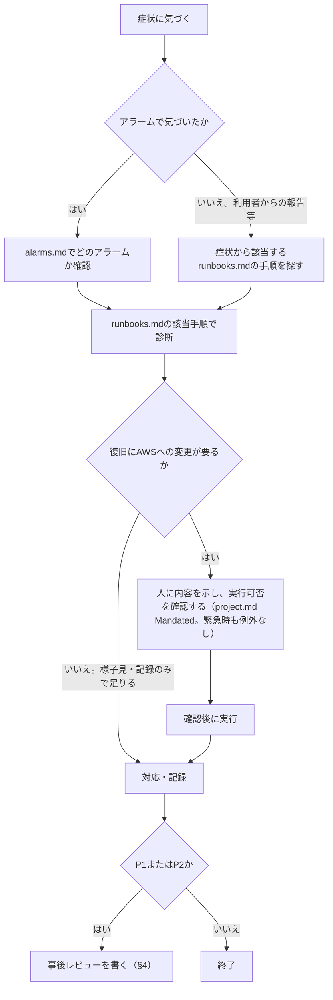

# Incident Plan — Incident Response

入力: `aidlc/spaces/default/memory/phases/operation.md`（Incident Responseの指針）、各Unitの`nfr-design/reliability-design.md`（受け入れたリスクの一覧）、`operation/deployment-pipeline/rollback-runbook.md`、`docs/06-operation.md`（実機デプロイで発生した2件の実例）。

## 1. 重大度の分類（開発者1人の試験運用MVPに合わせた区分）

企業向けの汎用的な区分（可用性%・影響利用者数の帯など）ではなく、**この具体的なシステムで何ができなくなるか**を基準にする。

| 重大度 | 定義 | 具体例 |
|---|---|---|
| P1 | 報告の送信・承認のどちらか一方でも業務の本流が完全に止まる。またはデータ消失のおそれがある | API全体が応答しない／ログインできない／`POST /v1/reports`が常に失敗する／DynamoDBのテーブルを誤って削除した |
| P2 | 一部の機能だけが使えない、または一部の利用者だけに影響する | 重複判定（Rekognition呼び出し）だけが失敗し続ける／管理者の「すべて削除」操作だけが失敗する／特定の関数グループのエラー率アラームが継続して鳴る |
| P3 | 業務への支障はないが直すべきもの | ダッシュボードの表示がずれる／ログの一部項目が欠ける／`EVENT_PUBLISH_FAILED`が単発で記録された（受け入れたリスクの範囲内） |

**P1/P2の判定にはアラームの状態（`alarms.md`）を使う**: `masahiro-cloudwatch-monsternote-api-5xx`が鳴れば一次的にP1〜P2疑い、`-lambda-errors-0`／`-1`はどの関数グループかで業務影響の大きさが変わる（`runbooks.md`参照）。ただし§2のとおり、現状アラームの通知は誰にも届かない（`escalation-matrix.md` §2）。

## 2. RTO/RPO（現実的な目標。既存の設計上の制約を前提にする）

このプロジェクトの各Unitのnfr-design（reliability-design.md）は、**費用と試験運用の規模を理由に、DynamoDBのポイントインタイムリカバリ（PITR）もS3のバージョン管理も使わないと明記している**（U1 NFR11.3）。これは今回新たに決めることではなく、既存の承認済みの設計判断であり、本ステージで覆さない。

この前提のもとでの現実的な目標:

| 項目 | 目標 | 根拠・制約 |
|---|---|---|
| RTO（復旧までの時間） | 数時間〜1日（開発者1人が気づいてから対応するまでの現実的な時間。自動フェイルオーバーは無い） | 単一`dev`環境・手動デプロイ（team.md）。インフラ自体の復旧は`rollback-runbook.md`の手順で、人の確認を経てから`cdk deploy`し直す |
| RPO（データ損失の許容範囲） | **保証なし。PITRが無いため、誤って消したデータ・壊れたデータは原則復元できない** | NFR11.3の明記どおり。DynamoDBテーブルは`RemovalPolicy.RETAIN`（スタック削除では消えないが、項目レベルの誤操作・誤削除からは守らない） |
| 写真（S3） | 保証なし（バージョン管理なし） | 同上。ただし元の写真ファイル自体は端末に残っている可能性がある（利用者側の問題） |

**この制約は、試験運用の規模（月50件未満の報告）とコストを理由に受け入れられた判断であり、本ステージはこれを前提として扱う**（NFR11.3を覆すかどうかは本ステージの範囲外。将来、利用者が増える・本番相当の運用になる場合に見直す判断）。

## 3. インシデント対応の流れ

<!-- Text fallback: 症状に気づいたら（アラームか、利用者からの報告か）、runbooks.mdの該当手順で診断する。復旧にAWSへの変更が要る場合は、緊急時であっても必ず人に確認してから実行する（project.mdのMandated）。対応後、P1またはP2なら事後レビューを書く。 -->

## 4. 事後レビュー（P1/P2のみ必須。Operationフェーズの指針どおり）

`aidlc/spaces/default/memory/phases/operation.md`の指針「P1/P2インシデントには事後レビューが必須（タイムライン・根本原因・再発防止を文書化する）」に従う。**新しい別立ての事後レビューの仕組み（Jira・Confluence等）は作らない**。このプロジェクトはteam.mdの標準的な教材ドキュメント化の慣行（`docs/06-operation.md`に実機での出来事を記録してきた）にすでに従っているため、事後レビューも同じ場所に追記する。

事後レビューの記載項目:
- 発生日時・検知方法（どのアラーム／誰からの報告か）
- タイムライン（気づいてから復旧までの時系列）
- 根本原因
- 実施した対応
- 再発防止（コード・設計・運用手順のどれを変えたか）

**実例（すでに`docs/06-operation.md` §4に同じ形式で記録済みの2件を、事後レビューの先例として示す）**:
1. `cdk deploy`実行時のCloudWatchアラーム指標数上限超過（`MonsterNote-Api-dev`のデプロイ失敗）。原因: 入れ子の数式がCloudFormation上で平らに展開され、12関数分＋中間式で15指標となり上限10を超えた。対応: アラームを9関数以下の組に分割。
2. `scripts/smoke.ts`の送信内容がBuild and Testでの必須項目追加に追従していなかった（422で検知）。原因: 画面・バックエンドの修正時に実機確認用スクリプトが更新対象から漏れた。対応: 必須項目を追加して再実行。

どちらもP1相当（デプロイ完全停止／デプロイ後の動作確認が完全に失敗）に分類できる実例であり、当時その場で記録はされたが、この事後レビューの形式（タイムライン・根本原因・再発防止）に沿った体裁では整理されていなかった。本ステージの範囲では過去分の遡及的な書き直しは行わず、**今後のP1/P2からこの形式を使う**ことを本ステージの成果物とする。

## Assumptions & Open Questions

None（RTO/RPOの制約はNFR11.3の既存の承認済み決定を前提にしており、本ステージで新たに判断を仰ぐ事項ではない）。
